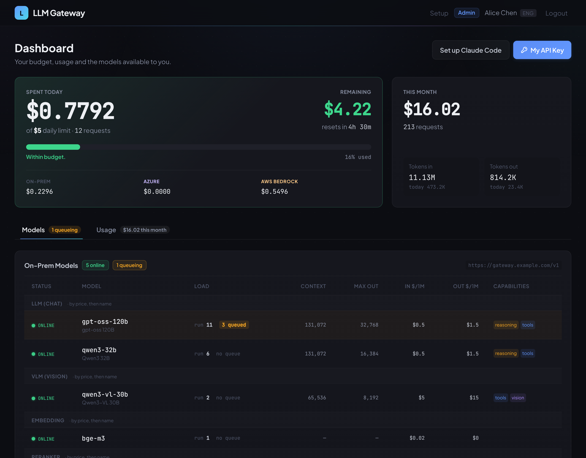
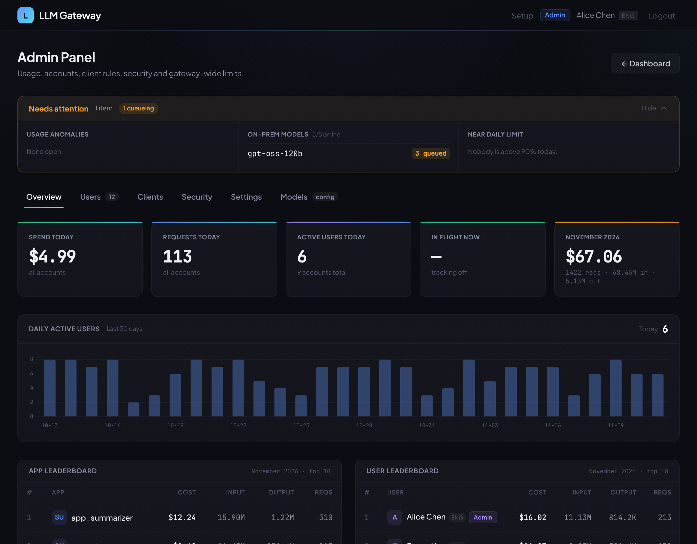

# LLM Gateway

[](https://github.com/bwinken/llm-gateway/actions/workflows/ci.yml)

[中文版](README.zh-TW.md)

One OpenAI- and Anthropic-compatible endpoint in front of your on-prem [vLLM](https://github.com/vllm-project/vllm) servers, Azure OpenAI and AWS Bedrock. Every user gets their own API key, a daily budget and a usage dashboard.

```
                                  ┌──▶ vLLM servers   (LLM, VLM, embedding, reranker, System One)
Clients ──▶ LLM Gateway ──────────┼──▶ Azure OpenAI   (per-user access)
 (OpenAI SDK, Anthropic SDK,      └──▶ AWS Bedrock    (per-user access)
  Claude Code, Roo Code, …)
```

| Dashboard: budget, usage, live model status | Admin panel: spend, accounts, limits |
|---|---|
|  |  |

## What it does

- **One base URL for every backend.** Clients call `/v1/*`; the model name picks vLLM, Azure or Bedrock.
- **OpenAI and Anthropic APIs.** Chat completions, Responses, Messages (works with Claude Code), embeddings and rerank, with streaming.
- **Stays up.** Health checks, automatic failover to another server of the same type, and keepalive pings for long reasoning turns.
- **Cost control.** Daily budget per user, a separate cap on cloud spend, concurrency limits, per-model pricing.
- **Access and security.** Cloud access per user, an optional IP allowlist, prompt screening (guardrail), and an audit log of every admin action.
- **Helps users fix their setup.** Detects misconfigured Claude Code clients and gives each user one script that fixes their settings, on the dashboard and by mail.
- **Web UI for everyone.** Users see their budget, usage and model status. Admins manage accounts, models and prices without editing files.

## Quick start

You need Python 3.11, [uv](https://docs.astral.sh/uv/) and Docker (for the dev database).

```bash
git clone https://github.com/bwinken/llm-gateway.git && cd llm-gateway
uv sync
cp config.toml.example config.toml    # your model servers
cp .env.example .env                  # DATABASE_URL and AUTH_*
bash scripts/start-pg-dev.sh start    # dev PostgreSQL in Docker
uv run alembic upgrade head           # create the schema
uv run fastapi dev app/main.py
```

For web-UI login, put your [AuthCenter](https://github.com/bwinken/authcenter) RS256 public key at `keys/public.pem`. On Windows, set `PYTHONUTF8=1` if you see `UnicodeEncodeError`.

## Use it

Each user's API key is on their dashboard.

```python
from openai import OpenAI

client = OpenAI(base_url="https://your-gateway/v1", api_key="sk-your-api-key")
client.chat.completions.create(model="my-model", messages=[{"role": "user", "content": "Hello!"}])
```

```bash
# Claude Code
ANTHROPIC_BASE_URL=https://your-gateway ANTHROPIC_AUTH_TOKEN=sk-your-api-key claude
```

The **[Client Guide](docs/client-guide.md)** has every endpoint, Azure and Bedrock access, setup for Roo Code, Cursor and others, and the errors a client should handle.

## Configure it

There are two files. Most day-to-day settings can also be changed in the admin panel.

**`config.toml`: models and prices.** A minimal model:

```toml
[models.llm."my-model"]                # llm | vlm | embedding | reranker | ...
base_url   = "http://vllm-host:8000/v1"
real_model = "Qwen/Qwen3-32B"          # the name the vLLM server uses
```

Azure and Bedrock models go in `[azure_models.*]` and `[bedrock_models.*]`; prices in `[pricing]`; what to use when a model is unknown or down in `[fallback]`. Model names must be unique across all backends. [`config.toml.example`](config.toml.example) documents every key, and **Admin → Models** edits the file for you.

**`.env`: connections and secrets.** The ones you are most likely to set:

| Variable | What it is for |
|---|---|
| `DATABASE_URL` | PostgreSQL connection string |
| `AUTH_BASE_URL`, `AUTH_CENTER_APP_ID`, `AUTH_CENTER_PUBLIC_KEY_PATH` | Web-UI login: JWT issuer, audience and public key |
| `AZURE_HTTP_PROXY`, `BEDROCK_HTTP_PROXY` | HTTP proxy for cloud traffic (on-prem traffic is never proxied) |
| `BEDROCK_REGION`, `BEDROCK_AWS_ACCESS_KEY_ID`, `BEDROCK_AWS_SECRET_ACCESS_KEY` | AWS settings shared by every Bedrock model |
| `LANGFUSE_HOST`, `LANGFUSE_PUBLIC_KEY`, `LANGFUSE_SECRET_KEY` | Turn on [Langfuse](https://langfuse.com) tracing |
| `METRICS_ENABLED` | Serve Prometheus metrics at `/metrics` |
| `EXCHANGE_*`, `COMPANY_EMAIL_DOMAIN`, `PUBLIC_BASE_URL` | Mail to users about their client setup |
| `USAGE_LOG_RETENTION_DAYS` | Delete raw usage rows older than this (off by default; reports keep their totals) |

[`.env.example`](.env.example) lists every variable with its default: logging, the failed-login lockout, connection pools, job intervals and mail pacing. SSO itself (OIDC issuer, client secret) is configured for oauth2-proxy in `deploy/.env`; see [deploy/README.md](deploy/README.md).

## Run it as an admin

Open `https://your-gateway` and sign in through SSO. Accounts with the `admin` scope in AuthCenter get the admin panel:

| Tab | What you do there |
|---|---|
| **Overview** | See spend, requests and active users; review usage anomalies; export monthly cost reports |
| **Users** | Set budgets and cloud caps, grant Azure or AWS access, disable accounts, create app accounts, view or regenerate keys |
| **Clients** | Choose which client problems to detect, how users are told, and the settings patch they get; see who is affected and what mail went out |
| **Security** | IP allowlist, prompt guardrail, audit log |
| **Settings** | Default budgets, concurrency limit, what happens when the cloud cap is spent, site links |
| **Models** | Add and edit models, prices and fallbacks; test a connection |

## Deploy it

Production runs as a user-level systemd service behind nginx and oauth2-proxy, with PostgreSQL in Docker: see [deploy/README.md](deploy/README.md). On every upgrade, apply schema changes before restarting:

```bash
uv run alembic upgrade head
```

Coming from the old SQLite database? See the [migration guide](docs/migration-guide.md).

## Develop

```bash
uv run pytest tests/ -q     # in-memory SQLite, mocked downstreams, no config.toml needed
uv run ruff check .
```

CI runs both on every pull request, plus a dependency audit and a secret scan. [CLAUDE.md](CLAUDE.md) is the contributor map: where things live and the rules that are easy to break.

## More documentation

| | |
|---|---|
| [Client Guide](docs/client-guide.md) | Connecting clients, endpoints, error handling |
| [Architecture](docs/architecture.md) | How every subsystem behaves, in detail |
| [Deployment](deploy/README.md) | Production setup, backups, upgrades |
| [Langfuse](docs/langfuse-observability.md) | Observability design |
| [Migrations](alembic/README.md) | Database schema changes |
| Package notes | [core](app/core/README.md) · [routers](app/routers/README.md) · [models](app/models/README.md) · [templates](app/templates/README.md) · [tests](tests/README.md) |
