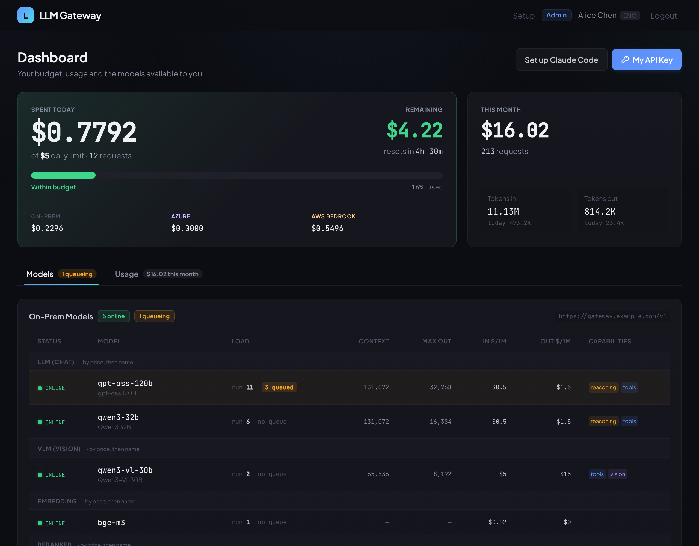
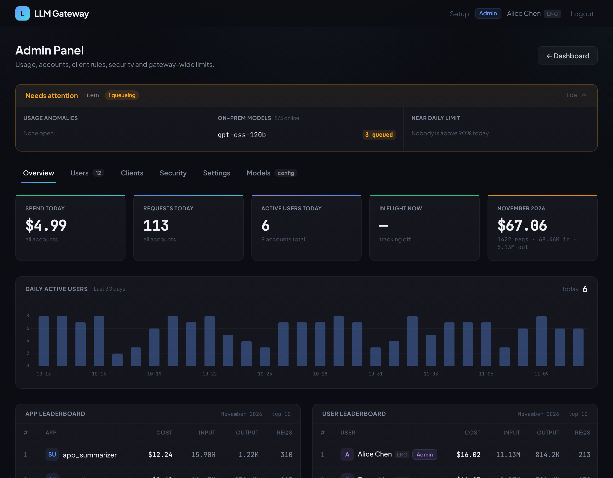

# LLM Gateway

[](https://github.com/bwinken/llm-gateway/actions/workflows/ci.yml)

[English](README.md)

一個同時相容 OpenAI 與 Anthropic API 的入口，統一接上地端 [vLLM](https://github.com/vllm-project/vllm) 伺服器、Azure OpenAI 與 AWS Bedrock。每位使用者有自己的 API key、每日預算和用量儀表板。

```
                                  ┌──▶ vLLM 伺服器    (LLM、VLM、embedding、reranker、System One)
Clients ──▶ LLM Gateway ──────────┼──▶ Azure OpenAI   (逐使用者授權)
 (OpenAI SDK、Anthropic SDK、      └──▶ AWS Bedrock    (逐使用者授權)
  Claude Code、Roo Code…)
```

| 儀表板：預算、用量、模型即時狀態 | 管理面板：花費、帳號、限制 |
|---|---|
|  |  |

## 它能做什麼

- **一個 base URL 接所有後端。** Client 呼叫 `/v1/*`，由模型名稱決定走 vLLM、Azure 或 Bedrock。
- **OpenAI 與 Anthropic API。** Chat completions、Responses、Messages（可直接搭配 Claude Code）、embeddings、rerank，都支援串流。
- **穩定不斷線。** 健康檢查、自動切換到同類型的其他伺服器，長時間推理時送 keepalive ping。
- **成本控管。** 每人每日預算、雲端花費另設上限、並行上限、逐模型計價。
- **存取與安全。** 逐人授權雲端模型、可選的 IP allowlist、prompt 篩檢（guardrail），以及記錄每個管理操作的稽核紀錄。
- **每週寄報表。** 各後端的 token、預估費用、延遲與錯誤率；guardrail 判定與需要留意的帳號。每封報表有自己的星期、時間與收件人。
- **幫使用者修好設定。** 偵測設定有問題的 Claude Code，並在儀表板和信件裡給每位使用者一個修正設定的腳本。
- **人人可用的 Web UI。** 使用者看自己的預算、用量與模型狀態；管理員不用改檔案就能管理帳號、模型與價格。

## 快速開始

需要 Python 3.11、[uv](https://docs.astral.sh/uv/) 和 Docker（開發用資料庫）。

```bash
git clone https://github.com/bwinken/llm-gateway.git && cd llm-gateway
uv sync
cp config.toml.example config.toml    # 你的模型伺服器
cp .env.example .env                  # DATABASE_URL 與 AUTH_*
bash scripts/start-pg-dev.sh start    # 以 Docker 啟動開發用 PostgreSQL
uv run alembic upgrade head           # 建立資料表
uv run fastapi dev app/main.py
```

Web UI 登入需要把 [AuthCenter](https://github.com/bwinken/authcenter) 的 RS256 公鑰放在 `keys/public.pem`。Windows 若出現 `UnicodeEncodeError`，請先設定 `PYTHONUTF8=1`。

## 使用方式

每位使用者的 API key 在自己的儀表板上。

```python
from openai import OpenAI

client = OpenAI(base_url="https://your-gateway/v1", api_key="sk-your-api-key")
client.chat.completions.create(model="my-model", messages=[{"role": "user", "content": "Hello!"}])
```

```bash
# Claude Code
ANTHROPIC_BASE_URL=https://your-gateway ANTHROPIC_AUTH_TOKEN=sk-your-api-key claude
```

**[Client 指南](docs/client-guide.zh-TW.md)** 有完整內容：所有端點、Azure 與 Bedrock 的使用方式、Roo Code 與 Cursor 等工具的設定，以及 client 該處理的錯誤回應。

## 設定

設定檔有兩個。日常會調整的項目大多也能在管理面板裡改。

**`config.toml`：模型與價格。** 最簡單的模型設定：

```toml
[models.llm."my-model"]                # llm | vlm | embedding | reranker | ...
base_url   = "http://vllm-host:8000/v1"
real_model = "Qwen/Qwen3-32B"          # vLLM 伺服器上的模型名稱
```

Azure 與 Bedrock 模型放在 `[azure_models.*]`、`[bedrock_models.*]`；價格在 `[pricing]`；模型不存在或離線時改用哪個模型在 `[fallback]`。模型名稱在所有後端之間不能重複。[`config.toml.example`](config.toml.example) 說明了每個欄位，**Admin → Models** 也能直接編輯這個檔案。

**`.env`：連線與金鑰。** 最常需要設定的幾項（所有變數列在[環境變數](#環境變數)）：

| 變數 | 用途 |
|---|---|
| `DATABASE_URL` | PostgreSQL 連線字串 |
| `AUTH_BASE_URL`、`AUTH_CENTER_APP_ID`、`AUTH_CENTER_PUBLIC_KEY_PATH` | Web UI 登入：JWT 的 issuer、audience 與公鑰 |
| `AZURE_HTTP_PROXY`、`BEDROCK_HTTP_PROXY` | 雲端流量用的 HTTP proxy（地端流量不會走 proxy） |
| `BEDROCK_REGION`、`BEDROCK_AWS_ACCESS_KEY_ID`、`BEDROCK_AWS_SECRET_ACCESS_KEY` | 所有 Bedrock 模型共用的 AWS 設定 |
| `LANGFUSE_HOST`、`LANGFUSE_PUBLIC_KEY`、`LANGFUSE_SECRET_KEY` | 啟用 [Langfuse](https://langfuse.com) 追蹤（週報需要它） |
| `METRICS_ENABLED` | 在 `/metrics` 提供 Prometheus 指標 |
| `EXCHANGE_*`、`COMPANY_EMAIL_DOMAIN`、`PUBLIC_BASE_URL` | 寄信：通知使用者修正 client 設定，以及週報 |
| `USAGE_LOG_RETENTION_DAYS` | 刪除超過這個天數的原始用量紀錄（預設關閉；報表的總計會保留） |

[`.env.example`](.env.example) 列出所有變數與預設值：log、登入失敗封鎖、連線池、背景工作的間隔、寄信節奏。SSO 本身（OIDC issuer、client secret）是在 `deploy/.env` 設定給 oauth2-proxy，見 [deploy/README.zh-TW.md](deploy/README.zh-TW.md)。

## 管理

開啟 `https://your-gateway` 並透過 SSO 登入。在 AuthCenter 擁有 `admin` scope 的帳號會看到管理面板：

| 分頁 | 在這裡做什麼 |
|---|---|
| **Overview** | 查看花費、請求數與活躍使用者；檢視用量異常；匯出每月費用報表 |
| **Users** | 設定預算與雲端上限、授權 Azure 或 AWS、停用帳號、建立服務帳號、查看或重新產生 key |
| **Clients** | 選擇要偵測哪些 client 問題、怎麼通知使用者、給他們什麼設定 patch；查看受影響的人和寄出的信 |
| **Security** | IP allowlist、prompt guardrail、稽核紀錄 |
| **Settings** | 預設預算、並行上限、雲端上限用完時的處理方式、週報信、網站連結 |
| **Models** | 新增與編輯模型、價格、備援；測試連線 |

## 功能總覽與各自需要的設定

Gateway 的所有功能、在哪裡開啟，以及在 `.env` 需要設什麼。「一律開啟」表示除了必填設定（`DATABASE_URL` 與 `AUTH_*`）之外不需要其他設定。最後一欄裡的變數，除非標示「選用」，否則就是該功能必填的；下面的[環境變數](#環境變數)逐一標明每個變數是必填還是選用。

**API 與路由**

| 功能 | 怎麼開啟 | `.env` |
|---|---|---|
| 一個 `/v1/*` 端點接 vLLM、Azure、Bedrock，由模型名稱決定後端 | 一律開啟；模型在 `config.toml` 或 **Admin → Models** | – |
| OpenAI 與 Anthropic API：chat completions、Responses、Messages、embeddings、rerank / score、tokenize / count_tokens，支援串流 | 一律開啟 | – |
| Azure OpenAI 模型 | `[azure_models.*]` + 使用者的 **Azure 權限** | 選用 `AZURE_HTTP_PROXY`、`AZURE_INSECURE` |
| AWS Bedrock 模型（Converse；Claude 可走原生 Messages） | `[bedrock_models.*]` + 使用者的 **AWS 權限** | `BEDROCK_REGION`、`BEDROCK_AWS_ACCESS_KEY_ID`、`BEDROCK_AWS_SECRET_ACCESS_KEY`（或逐模型寫在 `config.toml`）；選用 `BEDROCK_HTTP_PROXY`、`BEDROCK_INSECURE` |
| 健康檢查、自動切換到同類型的其他伺服器、長時間推理的 keepalive ping | 一律開啟 | 選用連線池大小（`DOWNSTREAM_*`、`CLOUD_*`） |
| 模型不存在或離線時的備援、雲端模型被限流時的備援 | `[fallback]`、逐模型的 `rate_limit_fallback` | – |
| 逐模型的 reasoning effort 對應 | **Admin → Models** 逐模型設定 | – |

**帳號與存取**

| 功能 | 怎麼開啟 | `.env` |
|---|---|---|
| 每人一把 API key、儀表板與用量；Web UI 以 SSO 登入 | 一律開啟 | `AUTH_BASE_URL`、`AUTH_CENTER_APP_ID`、`AUTH_CENTER_PUBLIC_KEY_PATH` |
| 終端機工具登入（`POST /auth/api-key`：用 AuthCenter token 換帳號的 key） | 一律開啟（需要對應的 nginx location） | 同上的 `AUTH_*` |
| 給程式用的服務帳號，擁有者可在自己的儀表板看到 | **Admin → Users** | – |
| 給工具用的帳號端點：`/v1/me`、`/v1/status`、`/v1/usage`、`/v1/service-accounts`、`/v1/notices`、`/v1/settings` | 一律開啟 | – |
| 提供給工具的 client 設定（`/v1/settings`） | **Admin → Clients → Client setup** | – |
| Setup 頁與 Claude Code 的 Windows 安裝檔 | 預設開啟 | `SETUP_PAGE_ENABLED=false` 可關閉 |

**成本與上限**

| 功能 | 怎麼開啟 | `.env` |
|---|---|---|
| 每人每日預算 | 一律開啟；金額在 **Admin → Users** / **Settings** | `ENFORCE_DAILY_LIMIT=false` 改為只記錄不拒絕 |
| 雲端花費（Azure + AWS）的單一每日上限，用完時可選擇改走地端模型 | **Admin → Settings** | – |
| 每個帳號的並行上限（地端與雲端分開計算） | **Admin → Settings**；預設關閉 | – |
| 逐模型計價、用量報表、每月匯出 | 一律開啟 | 選用 `USAGE_ROLLUP_INTERVAL_S` |
| 每小時的用量異常掃描（只偵測，不阻擋） | 預設開啟 | 選用 `ANOMALY_SCAN_INTERVAL_S` |
| 刪除舊的原始用量紀錄 | 預設關閉 | `USAGE_LOG_RETENTION_DAYS` |

**安全**

| 功能 | 怎麼開啟 | `.env` |
|---|---|---|
| API 的 IP allowlist（monitor 或 enforce） | **Admin → Security**；預設關閉 | – |
| 地端流量的 prompt guardrail（Qwen3Guard-Gen） | **Admin → Security**；預設關閉；需要一台 guard 模型伺服器 | 選用 `GUARDRAIL_MAX_CONNECTIONS` |
| 同一位址送出多把不同的無效 API key 後暫時封鎖 | 預設開啟 | 選用 `AUTH_FAIL_DISTINCT_KEYS`、`AUTH_FAIL_WINDOW_S`、`AUTH_LOCKOUT_S` |
| 記錄每個管理與儀表板操作的稽核紀錄 | 一律開啟 | – |

**Client 與寄信**

| 功能 | 怎麼開啟 | `.env` |
|---|---|---|
| Claude Code 的 client 檢查（auto mode、未加密的 http、版本過舊、不存在或無權限的模型），在儀表板提示並給每人一個修正腳本 | **Admin → Clients**；第一項檢查預設開啟 | – |
| 寄信通知使用者修正 client 設定，分批寄送 | **Admin → Clients** 逐項檢查設定 | `EXCHANGE_SERVER`、`EXCHANGE_USER`、`EXCHANGE_PASSWORD`、`EXCHANGE_EMAIL`、`COMPANY_EMAIL_DOMAIN`；信中連結用 `PUBLIC_BASE_URL`；選用 `CLIENT_RULE_MAIL_*` |

**觀測與報表**

| 功能 | 怎麼開啟 | `.env` |
|---|---|---|
| Langfuse 追蹤：每個請求一筆 generation，含用量、費用、延遲、client 與 guardrail 判定 | 設好三個變數 | `LANGFUSE_HOST`、`LANGFUSE_PUBLIC_KEY`、`LANGFUSE_SECRET_KEY`；選用 `LANGFUSE_SAMPLE_RATE`、`LANGFUSE_CAPTURE_IO` |
| **用量週報**（寄信）：各後端的 token、預估費用的每日與 8 週趨勢（地端、Azure、AWS、總計）、各模型的 p50 / p95 延遲、錯誤率 | **Admin → Settings → Weekly reports**：星期、時間、收件人；預設關閉 | 需要 Langfuse 追蹤**與**寄信（上面兩列）；選用 `WEEKLY_REPORT_TICK_S` |
| **Guardrail 週報**（寄信）：判定、分類、值得注意的變化、需要留意的帳號 | **Admin → Settings → Weekly reports**，有自己的星期、時間、收件人；預設關閉 | 同上 |
| `/metrics` 的 Prometheus 指標 | 設定變數 | `METRICS_ENABLED=true`；選用 `METRICS_DIR` |
| 每個 worker 一份 log 檔、慢請求警告 | 一律開啟 | 選用 `LOG_*`、`SLOW_REQUEST_WARN_S` |

週報只有在 Langfuse 追蹤開啟時才能開啟（三個變數都設了，且 `LANGFUSE_SAMPLE_RATE` 大於 0）：否則開關會鎖住，也不會寄出任何信。收件人必須是 `COMPANY_EMAIL_DOMAIN` 的信箱。卡片上的 **Preview** 會在瀏覽器顯示週報而不寄出；`uv run python scripts/weekly_report.py usage` 可在主機上做同樣的事。

**維運**

| 功能 | 怎麼開啟 | `.env` |
|---|---|---|
| Gateway 內建的週期工作（用量 rollup、異常掃描、清理、寄信、週報），不需要 cron 或 systemd timer | 一律開啟 | 上面的間隔變數；設 `0` 關閉該項 |
| 資料庫備份與還原演練 | 主機的 cron：`deploy/backup-db.sh`、`deploy/restore-drill.sh` | 見 [deploy/README.zh-TW.md](deploy/README.zh-TW.md) |
| 以容器執行、搬移到新主機 | `deploy/migration/` | 見[該目錄的 README](deploy/migration/README.md) |

## 環境變數

Gateway 會讀取的所有變數，分成三組：一定要設的、某個功能需要的（有用到那個功能才設）、以及有預設值可用的選用項。修改後要重啟才生效。[`.env.example`](.env.example) 有同一批變數與更詳細的說明。

### 必填

沒有這些 gateway 無法運作。它們內建的值只是佔位用。

| 變數 | 用途 |
|---|---|
| `DATABASE_URL` | PostgreSQL 連線字串 |
| `AUTH_BASE_URL` | AuthCenter：JWT 的 issuer。沒設的話 Web UI 與終端機工具都無法登入 |
| `AUTH_CENTER_APP_ID` | AuthCenter：JWT 的 audience（佔位值 `llm_gateway`） |
| `AUTH_CENTER_PUBLIC_KEY_PATH` | AuthCenter 的 RS256 公鑰（佔位值 `./keys/public.pem`） |

### 功能需要的

整組不設，該功能就是關閉。同一組裡標示**必填**的變數都要設，功能才會運作。

| 功能 | 變數 | 必填？ | 用途 |
|---|---|---|---|
| **Langfuse 追蹤**（週報也是從這裡讀資料） | `LANGFUSE_HOST` | **必填** | Langfuse 伺服器 |
| | `LANGFUSE_PUBLIC_KEY` | **必填** | 專案的 public key |
| | `LANGFUSE_SECRET_KEY` | **必填** | 專案的 secret key |
| | `LANGFUSE_SAMPLE_RATE` | 選用（`1.0`） | 記錄的請求比例；`0` 表示完全不記錄，週報也會被鎖住 |
| | `LANGFUSE_CAPTURE_IO` | 選用（`false`） | 連 prompt 與回覆內容也記錄。屬於對個人的監看，應當作政策決定 |
| **寄信**（通知使用者修正 client 設定，以及週報） | `EXCHANGE_SERVER` | **必填** | Exchange（EWS）伺服器 |
| | `EXCHANGE_USER` | **必填** | 寄信用的服務帳號 |
| | `EXCHANGE_PASSWORD` | **必填** | 該帳號的密碼 |
| | `EXCHANGE_EMAIL` | **必填** | 寄件人位址 |
| | `COMPANY_EMAIL_DOMAIN` | **必填** | 使用者的信箱是 `<帳號>@<網域>`；信只會寄到這個網域 |
| | `PUBLIC_BASE_URL` | 選用 | 瀏覽器連到 gateway 的網址，用在信中的連結（沒設就沒有連結） |
| | `CLIENT_RULE_MAIL_BATCH`、`CLIENT_RULE_MAIL_PAUSE_S`、`CLIENT_RULE_MAIL_INTERVAL_S` | 選用（`20`、`2`、`600`） | Client 設定通知信的節奏：每輪幾封、每封間隔秒數、每輪間隔秒數（`0` = 關閉） |
| **週報** | 上面的 Langfuse 追蹤與寄信 | **必填**（共八個） | 少了任一組，週報就無法開啟，也不會寄出 |
| | `WEEKLY_REPORT_TICK_S` | 選用（`300`） | 多久檢查一次週報是否到期，也就是週報會在設定時間後這麼多秒內寄出（`0` = 關閉） |
| **AWS Bedrock 模型** | `BEDROCK_REGION` | **必填**，除非每個模型在 `config.toml` 自己設 `region` | 所有 Bedrock 模型共用的 AWS region |
| | `BEDROCK_AWS_ACCESS_KEY_ID`、`BEDROCK_AWS_SECRET_ACCESS_KEY` | **必填**，除非每個模型在 `config.toml` 有自己的 IAM 金鑰或 API key | 所有 Bedrock 模型共用的 IAM 金鑰（SigV4） |
| | `BEDROCK_HTTP_PROXY` | 選用 | 只給 Bedrock 流量用的 HTTP proxy |
| | `BEDROCK_INSECURE` | 選用（`false`） | 連 Bedrock 時不驗證 TLS |
| **Azure OpenAI 模型** | 無：endpoint 與 key 是逐模型寫在 `config.toml` | – | – |
| | `AZURE_HTTP_PROXY` | 選用 | 只給 Azure 流量用的 HTTP proxy |
| | `AZURE_INSECURE` | 選用（`false`） | 連 Azure 時不驗證 TLS（公司有 TLS 檢查 proxy 時） |
| **Prometheus 指標** | `METRICS_ENABLED` | **必填**（設 `true` 才開啟） | 在 `/metrics` 提供指標 |
| | `METRICS_DIR` | 選用（`<tmp>/llm-gateway-metrics`） | 各 worker 共用指標數值的目錄 |
| **刪除舊的用量紀錄** | `USAGE_LOG_RETENTION_DAYS` | **必填**（設天數才開啟） | 刪除超過這個天數的原始用量紀錄；報表的總計會保留 |

### 選用

都有可用的預設值；只有想改變行為時才需要設。

| 變數 | 預設值 | 用途 |
|---|---|---|
| `APP_TITLE` | `LLM Gateway` | Web UI 與信件裡顯示的名稱 |
| `SETUP_PAGE_ENABLED` | `true` | 設 `false` 移除 Windows 用的 Setup 頁與安裝檔 |
| `ENFORCE_DAILY_LIMIT` | `true` | 設 `false` 時超出預算只記錄，不回 429 |
| `AUTH_FAIL_DISTINCT_KEYS` | `10` | 同一位址送出幾把不同的無效 key 後封鎖（`0` = 關閉） |
| `AUTH_FAIL_WINDOW_S` | `600` | 計算這些 key 的時間窗 |
| `AUTH_LOCKOUT_S` | `900` | 封鎖多久 |
| `DOWNSTREAM_MAX_CONNECTIONS`、`DOWNSTREAM_MAX_KEEPALIVE_CONNECTIONS` | `1000`、`100` | 連 vLLM 伺服器的連線池 |
| `CLOUD_MAX_CONNECTIONS`、`CLOUD_MAX_KEEPALIVE_CONNECTIONS`、`CLOUD_KEEPALIVE_EXPIRY_S` | `200`、`100`、`30` | 連 Azure 與 Bedrock 的連線池 |
| `GUARDRAIL_MAX_CONNECTIONS` | `200` | 連 guard 模型伺服器的連線池 |
| `USAGE_ROLLUP_INTERVAL_S` | `600` | 每日用量 rollup 的執行間隔秒數（`0` = 關閉；報表數字仍正確，只是變慢） |
| `ANOMALY_SCAN_INTERVAL_S` | `3600` | 用量異常掃描的間隔秒數（`0` = 關閉） |
| `LOG_DIR`、`LOG_LEVEL`、`LOG_ROTATION`、`LOG_RETENTION` | `./logs`、`WARNING`、`100 MB`、`14 days` | Log 檔（每個 worker 一份） |
| `LOG_REQUEST_BODIES` | `false` | 下游出錯時記錄完整的請求內容。只用於除錯：會把 prompt 寫到磁碟 |
| `SLOW_REQUEST_WARN_S` | `120` | 請求慢於這個秒數時在 log 警告（`0` = 關閉） |
| `CONFIG_DIR` | 專案根目錄 | 放 `config.toml` 與 `client_settings.json` 的目錄；容器部署時會設定 |

不在這個檔案裡的：SSO 本身（OIDC issuer、client secret）與 PostgreSQL 容器在 `deploy/.env` 設定（見 [deploy/README.zh-TW.md](deploy/README.zh-TW.md)）；容器部署有自己的 `gateway.env`（見 [deploy/migration/README.md](deploy/migration/README.md)）。模型伺服器、價格、上限與 guardrail 在 `config.toml` 或管理面板設定，不在 `.env`。

## 部署

正式環境以 user-level systemd 服務執行，前面接 nginx 與 oauth2-proxy，PostgreSQL 跑在 Docker，詳見 [deploy/README.zh-TW.md](deploy/README.zh-TW.md)。每次升級都要先套用資料庫變更再重啟：

```bash
uv run alembic upgrade head
```

從舊的 SQLite 資料庫搬過來？請看[遷移指南](docs/migration-guide.md)。

## 開發

```bash
uv run pytest tests/ -q     # in-memory SQLite、模擬下游，不需要 config.toml
uv run ruff check .
```

CI 會在每個 pull request 跑這兩項，另外還有相依套件稽核與金鑰掃描。[CLAUDE.md](CLAUDE.md) 是貢獻者的地圖：東西放在哪裡，以及容易踩到的規則。

## 更多文件

| | |
|---|---|
| [Client 指南](docs/client-guide.zh-TW.md) | 連接 client、端點、錯誤處理 |
| [架構](docs/architecture.md) | 每個子系統的詳細行為 |
| [部署](deploy/README.zh-TW.md) | 正式環境設定、備份、升級 |
| [Langfuse](docs/langfuse-observability.md) | 可觀測性設計 |
| [Migrations](alembic/README.zh-TW.md) | 資料庫 schema 變更 |
| 各套件說明 | [core](app/core/README.zh-TW.md) · [routers](app/routers/README.zh-TW.md) · [models](app/models/README.zh-TW.md) · [templates](app/templates/README.zh-TW.md) · [tests](tests/README.md) |
