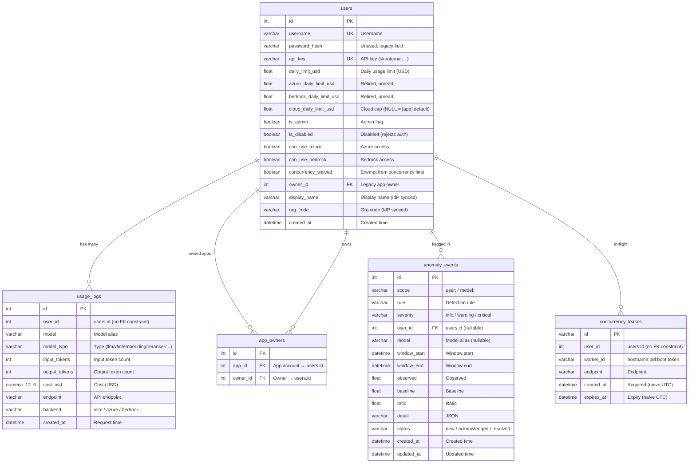

# Alembic — Database Migration Management

[中文版](README.zh-TW.md)

[Alembic](https://alembic.sqlalchemy.org/) is SQLAlchemy's database migration tool, managing PostgreSQL schema version control. When model definitions in `app/models/schema.py` change, Alembic generates corresponding migration scripts to safely upgrade or downgrade the database schema.

## How It Works

```
schema.py (Python Model) ──autogenerate──▶ versions/*.py (migration scripts)
                                                  │
                                            alembic upgrade head
                                                  │
                                                  ▼
                                          PostgreSQL schema
```

1. **Model definitions** — `app/models/schema.py` defines the `User`, `AppOwner`, `UsageLog`, `AnomalyEvent`, and `ConcurrencyLease` tables using SQLModel
2. **Autogenerate** — Alembic compares models against current database, auto-generates migration scripts
3. **Migration scripts** — Stored in `versions/` directory, each file contains `upgrade()` and `downgrade()` functions
4. **Version chain** — Each migration records the previous revision ID, forming an ordered chain
5. **alembic_version table** — PostgreSQL maintains an `alembic_version` table tracking the current revision

## Common Commands

```bash
# Apply all pending migrations (required on deploy)
uv run alembic upgrade head

# View current database version
uv run alembic current

# View unapplied migrations
uv run alembic history --indicate-current

# After modifying schema.py, auto-generate a new migration
uv run alembic revision --autogenerate -m "describe your change"

# Downgrade one version (use with caution)
uv run alembic downgrade -1

# First-time Alembic adoption on existing database (mark as current, skip migrations)
uv run alembic stamp head
```

## Directory Structure

```
alembic/
├── README             # Alembic's stock one-line description
├── README.md          # This file
├── README.zh-TW.md    # Chinese version
├── env.py             # Reads DATABASE_URL, configures migration environment
├── script.py.mako     # Migration file template
└── versions/          # Migration scripts (chain order)
    ├── ae7ecabcf79d_initial_schema_users_and_usage_logs.py
    ├── a3c2d266f101_change_cost_usd_from_float_to_numeric_.py
    ├── b4e1f8a23d01_add_display_name_and_org_code_to_users.py
    ├── c7f3e9b45a02_add_created_at_index_on_usage_logs.py
    ├── d5a2c3e67f04_add_app_owners_table.py
    ├── e8b4f1a23c05_replace_user_created_index_with_covering.py
    ├── 5d538cdf0e8b_merge_app_owners_and_covering_index_.py
    ├── f3a91c5b8d27_add_is_disabled_and_can_use_azure_to_users.py
    ├── a9d4e7c31b06_add_backend_column_and_azure_daily_limit.py
    ├── b7c8d9e2f410_add_bedrock_access_flag_and_daily_limit.py
    ├── c2e5f8a91d33_add_anomaly_events_table.py
    ├── d9f2a6b14c07_add_concurrency_leases_and_waive_flag.py
    ├── e4b7c2d91a58_waive_concurrency_for_app_accounts.py
    └── c2d5a8f3e917_add_users_cloud_daily_limit.py
```

## Migration History

| Revision | Description | Date |
|---|---|---|
| `ae7ecabcf79d` | Initial schema: create `users` and `usage_logs` tables | 2026-03-11 |
| `a3c2d266f101` | Change `cost_usd` from `FLOAT` to `NUMERIC(12,6)` for better precision; drop `ix_usage_logs_user_id` | 2026-03-11 |
| `b4e1f8a23d01` | Add `display_name` and `org_code` columns to `users` table | 2026-03-13 |
| `c7f3e9b45a02` | Add `ix_usage_created_at` index (for DAU queries) | 2026-03-13 |
| `d5a2c3e67f04` | Add `app_owners` many-to-many table (app account ownership), copying existing `users.owner_id` values into it. Branches from `c7f3e9b45a02` | 2026-03-14 |
| `e8b4f1a23c05` | Replace `ix_usage_user_created` with covering index `ix_usage_user_date_cost` (CONCURRENTLY). Branches from `c7f3e9b45a02` | 2026-03-15 |
| `5d538cdf0e8b` | Merge `app_owners` and covering index branches | 2026-03-15 |
| `f3a91c5b8d27` | Add `is_disabled` and `can_use_azure` boolean columns to `users` (`server_default=false`; PG 11+ adds these as a metadata-only operation, no table rewrite) | 2026-05-05 |
| `a9d4e7c31b06` | Add `usage_logs.backend` (`server_default='vllm'`; historical Azure rows backfilled to `'azure'` in batches from `endpoint LIKE '/azure/%'`, after the schema transaction commits) and nullable `users.azure_daily_limit_usd` (now retired, unread) | 2026-07-07 |
| `b7c8d9e2f410` | Add `users.can_use_bedrock` (`server_default=false`) and nullable `users.bedrock_daily_limit_usd` (now retired, unread) | 2026-07-17 |
| `c2e5f8a91d33` | Create `anomaly_events` table (unique `(scope, rule, window_start)`, indexes `ix_anomaly_status_created`, `ix_anomaly_events_user_id`) | 2026-08-05 |
| `d9f2a6b14c07` | Create `concurrency_leases` table (indexes `ix_concurrency_user_expires`, `ix_concurrency_leases_worker_id`) and add `users.concurrency_waived` (`server_default=false`) | 2026-10-02 |
| `e4b7c2d91a58` | Data-only: set `concurrency_waived = true` on existing `app_*` accounts. Downgrade is a no-op | 2026-10-02 |
| `c2d5a8f3e917` | Add nullable `users.cloud_daily_limit_usd` (per-user cloud cap; NULL follows `[app].cloud_daily_limit_usd`). **Current head** | 2026-10-19 |

## Database Schema

Full column semantics live in [app/models/README.md](../app/models/README.md).



### Table Details

**users** — Users and App Accounts

| Column | Type | Description |
|---|---|---|
| `id` | `INTEGER` PK | Auto-increment primary key |
| `username` | `VARCHAR` UNIQUE | Username (OAuth2 SSO `sub` claim); app accounts start with `app_` |
| `password_hash` | `VARCHAR` | Unused, defaults to empty string (legacy field) |
| `api_key` | `VARCHAR` UNIQUE | Auto-generated, format `sk-internal-{timestamp}-{hex8}` |
| `daily_limit_usd` | `FLOAT` | Daily usage limit, default 10.0 USD. `0` is a $0 budget, not unlimited |
| `azure_daily_limit_usd` | `FLOAT` NULL | **Retired, unread.** Kept until a migration drops it |
| `bedrock_daily_limit_usd` | `FLOAT` NULL | **Retired, unread.** Kept until a migration drops it |
| `cloud_daily_limit_usd` | `FLOAT` NULL | Per-user cap on Azure + Bedrock spend together. NULL follows `[app].cloud_daily_limit_usd` (not "no cap") |
| `is_admin` | `BOOLEAN` | Admin flag in DB (Web UI admin determined by JWT scope) |
| `is_disabled` | `BOOLEAN` | Default `false`. When `true`, both API key and JWT auth reject the user with 403 (admins bypass) |
| `can_use_azure` | `BOOLEAN` | Default `false`. Gates `/azure/v1/*` and `/v1/*` Azure dispatch (admins bypass) |
| `can_use_bedrock` | `BOOLEAN` | Default `false`. Gates `/aws/v1/*` and `/v1/*` Bedrock dispatch (admins bypass) |
| `concurrency_waived` | `BOOLEAN` | Default `false`. Exempt from the concurrency limit; app accounts are created waived |
| `owner_id` | `INTEGER` FK → `users.id` | Legacy single owner, superseded by `app_owners` |
| `display_name` | `VARCHAR` | Display name from IdP JWT, auto-synced on each login |
| `org_code` | `VARCHAR` | Org code from IdP JWT, auto-synced on each login |
| `created_at` | `DATETIME` | Creation time (UTC) |

**usage_logs** — API Usage Records (billing and audit record)

| Column | Type | Description |
|---|---|---|
| `id` | `INTEGER` PK | Auto-increment primary key |
| `user_id` | `INTEGER` | Requesting user (`users.id`, no FK constraint) |
| `model` | `VARCHAR` | Model alias used |
| `model_type` | `VARCHAR` | Model type: `llm`, `vlm`, `embedding`, `reranker`, etc. |
| `input_tokens` | `INTEGER` | Input token count |
| `output_tokens` | `INTEGER` | Output token count |
| `cost_usd` | `NUMERIC(12,6)` | Calculated cost (USD), 6 decimal places |
| `endpoint` | `VARCHAR` | API endpoint path (e.g. `/v1/chat/completions`) |
| `backend` | `VARCHAR` | `vllm`, `azure` or `bedrock`; server default `'vllm'` |
| `created_at` | `DATETIME` | Request time (UTC) |

**app_owners** — App Account Ownership (many-to-many)

| Column | Type | Description |
|---|---|---|
| `id` | `INTEGER` PK | Auto-increment primary key |
| `app_id` | `INTEGER` FK → `users.id` | App account |
| `owner_id` | `INTEGER` FK → `users.id` | Owning user |

**anomaly_events** — Usage-Anomaly Scan Findings (`scripts/scan_anomalies.py`, detection only)

| Column | Type | Description |
|---|---|---|
| `id` | `INTEGER` PK | Auto-increment primary key |
| `scope`, `rule`, `window_start` | `VARCHAR`, `VARCHAR`, `DATETIME` | Unique together: the scan's upsert key |
| `severity` | `VARCHAR` | `info`, `warning` (default), `critical` |
| `user_id` | `INTEGER` FK → `users.id` NULL | Denormalized user for `user:<id>` scopes |
| `model` | `VARCHAR` NULL | Denormalized model alias |
| `window_end` | `DATETIME` | End of the detection window |
| `observed`, `baseline`, `ratio` | `FLOAT` | Measured values, default 0 |
| `detail` | `VARCHAR` | JSON context, default `{}` |
| `status` | `VARCHAR` | `new` (default), `acknowledged`, `resolved` |
| `created_at`, `updated_at` | `DATETIME` | Row creation / last upsert |

**concurrency_leases** — In-Flight Limited Requests (short-lived rows)

| Column | Type | Description |
|---|---|---|
| `id` | `VARCHAR` PK | Lease ID |
| `user_id` | `INTEGER` | Lease holder (`users.id`, no FK constraint) |
| `worker_id` | `VARCHAR` | `<hostname>:<pid>:<boot token>` of the owning worker |
| `endpoint` | `VARCHAR` | Endpoint label, default empty |
| `created_at` | `DATETIME` | Acquisition time (naive UTC) |
| `expires_at` | `DATETIME` | TTL expiry, pushed forward by the worker heartbeat (naive UTC) |

### Indexes

| Index Name | Table | Columns | Description |
|---|---|---|---|
| `ix_users_username` | `users` | `username` | UNIQUE — fast user lookup |
| `ix_users_api_key` | `users` | `api_key` | UNIQUE — API key auth lookup |
| `ix_users_owner_id` | `users` | `owner_id` | Legacy app account owner lookup |
| `ix_usage_user_date_cost` | `usage_logs` | `user_id`, `created_at`, `cost_usd` | Covering index — daily limit index-only scan |
| `ix_usage_created_at` | `usage_logs` | `created_at` | DAU stats, time-range queries |
| `ix_app_owners_app_id` | `app_owners` | `app_id` | App account owner lookup |
| `ix_app_owners_owner_id` | `app_owners` | `owner_id` | User's owned apps lookup |
| `uq_anomaly_scope_rule_window` | `anomaly_events` | `scope`, `rule`, `window_start` | UNIQUE constraint — upsert key |
| `ix_anomaly_status_created` | `anomaly_events` | `status`, `created_at` | Listing by status |
| `ix_anomaly_events_user_id` | `anomaly_events` | `user_id` | Per-user lookup |
| `ix_concurrency_user_expires` | `concurrency_leases` | `user_id`, `expires_at` | Count a user's live leases |
| `ix_concurrency_leases_worker_id` | `concurrency_leases` | `worker_id` | Heartbeat renewal, dead-worker sweep |

## Notes

- Migrations are **PostgreSQL-only** (e.g. `CREATE INDEX CONCURRENTLY`); they do not run on SQLite. Verify a new one against a real PostgreSQL (a throwaway `initdb` cluster works): upgrade → downgrade → upgrade, then `uv run alembic check` for model drift
- Migrations that touch `users` start with `SET LOCAL lock_timeout = '5s'` (fail fast instead of queueing live traffic behind the lock; just re-run on timeout) and add columns with a constant `server_default` or as nullable, which is metadata-only on PostgreSQL ≥ 11 (no table rewrite)
- Deploy order: `alembic upgrade head`, then restart the gateway
- When a new table references `users.id`, also clear it in the admin `delete_user` (see `app/models/README.md`)
- `env.py` reads `DATABASE_URL` from `app.core.config` — ensure `.env` is properly configured
- Auto-generated migrations should be manually reviewed, especially those involving data transformations
- Always back up the database before downgrading in production
- For SQLite to PostgreSQL migration, use `scripts/migrate_sqlite_to_pg.py`, not Alembic
