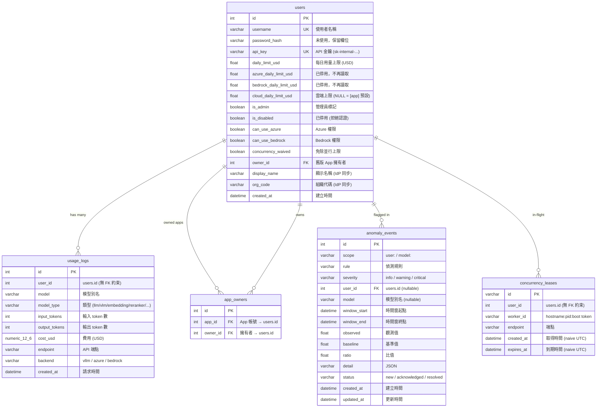

# Alembic — 資料庫遷移管理

[English](README.md)

[Alembic](https://alembic.sqlalchemy.org/) 是 SQLAlchemy 的資料庫遷移工具，負責管理 PostgreSQL schema 的版本控制。當 `app/models/schema.py` 中的 Model 定義變更時，Alembic 會產生對應的 migration script，讓資料庫結構安全地升級或降級。

## 運作原理

```
schema.py (Python Model) ──autogenerate──▶ versions/*.py (migration scripts)
                                                  │
                                            alembic upgrade head
                                                  │
                                                  ▼
                                          PostgreSQL schema
```

1. **Model 定義** — `app/models/schema.py` 用 SQLModel 定義 `User`、`AppOwner`、`UsageLog`、`AnomalyEvent` 和 `ConcurrencyLease` 五張表
2. **Autogenerate** — Alembic 比較 Model 與目前資料庫的差異，自動產生 migration script
3. **Migration script** — 記錄在 `versions/` 目錄，每個檔案包含 `upgrade()` 和 `downgrade()` 函式
4. **Version chain** — 每個 migration 記錄前一版的 revision ID，形成有序鏈
5. **alembic_version 表** — PostgreSQL 中會有一張 `alembic_version` 表，記錄目前套用到哪個 revision

## 常用指令

```bash
# 套用所有 pending migrations（部署時必做）
uv run alembic upgrade head

# 查看目前資料庫版本
uv run alembic current

# 查看尚未套用的 migrations
uv run alembic history --indicate-current

# 修改 schema.py 後，自動產生新的 migration
uv run alembic revision --autogenerate -m "describe your change"

# 降級一個版本（小心使用）
uv run alembic downgrade -1

# 已有資料庫首次納入 Alembic 管理（標記為最新，不執行 migration）
uv run alembic stamp head
```

## 目錄結構

```
alembic/
├── README             # Alembic 內建的一行說明
├── README.md          # 英文版說明
├── README.zh-TW.md    # 本文件
├── env.py             # 讀取 DATABASE_URL，設定 migration 環境
├── script.py.mako     # migration 檔案模板
└── versions/          # migration scripts（依版本鏈順序）
    ├── ae7ecabcf79d_initial_schema_users_and_usage_logs.py
    ├── a3c2d266f101_change_cost_usd_from_float_to_numeric_.py
    ├── b4e1f8a23d01_add_display_name_and_org_code_to_users.py
    ├── c7f3e9b45a02_add_created_at_index_on_usage_logs.py
    ├── d5a2c3e67f04_add_app_owners_table.py
    ├── e8b4f1a23c05_replace_user_created_index_with_covering.py
    ├── 5d538cdf0e8b_merge_app_owners_and_covering_index_.py
    ├── f3a91c5b8d27_add_is_disabled_and_can_use_azure_to_users.py
    ├── a9d4e7c31b06_add_backend_column_and_azure_daily_limit.py
    ├── b7c8d9e2f410_add_bedrock_access_flag_and_daily_limit.py
    ├── c2e5f8a91d33_add_anomaly_events_table.py
    ├── d9f2a6b14c07_add_concurrency_leases_and_waive_flag.py
    ├── e4b7c2d91a58_waive_concurrency_for_app_accounts.py
    └── c2d5a8f3e917_add_users_cloud_daily_limit.py
```

## Migration 歷史

| Revision | 說明 | 日期 |
|---|---|---|
| `ae7ecabcf79d` | 初始 schema：建立 `users` 和 `usage_logs` 表 | 2026-03-11 |
| `a3c2d266f101` | `cost_usd` 從 `FLOAT` 改為 `NUMERIC(12,6)` 提升精度；移除 `ix_usage_logs_user_id` | 2026-03-11 |
| `b4e1f8a23d01` | 新增 `display_name` 和 `org_code` 欄位至 `users` 表 | 2026-03-13 |
| `c7f3e9b45a02` | 新增 `ix_usage_created_at` 索引（DAU 查詢用） | 2026-03-13 |
| `d5a2c3e67f04` | 新增 `app_owners` 多對多表（App 帳號擁有者），並將既有 `users.owner_id` 複製進去。自 `c7f3e9b45a02` 分支 | 2026-03-14 |
| `e8b4f1a23c05` | 替換 `ix_usage_user_created` 為 covering index `ix_usage_user_date_cost`（CONCURRENTLY）。自 `c7f3e9b45a02` 分支 | 2026-03-15 |
| `5d538cdf0e8b` | 合併 `app_owners` 和 covering index 兩條分支 | 2026-03-15 |
| `f3a91c5b8d27` | 新增 `is_disabled` 與 `can_use_azure` boolean 欄位至 `users`(`server_default=false`;PG 11+ 為 metadata-only 操作,不會 rewrite 資料表) | 2026-05-05 |
| `a9d4e7c31b06` | 新增 `usage_logs.backend`（`server_default='vllm'`；schema 交易提交後，依 `endpoint LIKE '/azure/%'` 分批回填歷史 Azure 資料列為 `'azure'`）與 nullable 的 `users.azure_daily_limit_usd`（現已停用、不再讀取） | 2026-07-07 |
| `b7c8d9e2f410` | 新增 `users.can_use_bedrock`（`server_default=false`）與 nullable 的 `users.bedrock_daily_limit_usd`（現已停用、不再讀取） | 2026-07-17 |
| `c2e5f8a91d33` | 建立 `anomaly_events` 表（`(scope, rule, window_start)` 唯一，索引 `ix_anomaly_status_created`、`ix_anomaly_events_user_id`） | 2026-08-05 |
| `d9f2a6b14c07` | 建立 `concurrency_leases` 表（索引 `ix_concurrency_user_expires`、`ix_concurrency_leases_worker_id`），並新增 `users.concurrency_waived`（`server_default=false`） | 2026-10-02 |
| `e4b7c2d91a58` | 僅資料變更：將既有 `app_*` 帳號的 `concurrency_waived` 設為 `true`。Downgrade 不做任何事 | 2026-10-02 |
| `c2d5a8f3e917` | 新增 nullable 的 `users.cloud_daily_limit_usd`（每人雲端上限；NULL 沿用 `[app].cloud_daily_limit_usd`）。**目前 head** | 2026-10-19 |

## 資料庫 Schema

完整欄位語意請見 [app/models/README.zh-TW.md](../app/models/README.zh-TW.md)。



### 表說明

**users** — 使用者與 App 帳號

| 欄位 | 類型 | 說明 |
|---|---|---|
| `id` | `INTEGER` PK | 自動遞增主鍵 |
| `username` | `VARCHAR` UNIQUE | 使用者名稱（OAuth2 SSO 的 `sub` claim）；App 帳號以 `app_` 開頭 |
| `password_hash` | `VARCHAR` | 未使用，預設空字串（歷史欄位） |
| `api_key` | `VARCHAR` UNIQUE | 自動產生，格式 `sk-internal-{timestamp}-{hex8}` |
| `daily_limit_usd` | `FLOAT` | 每日用量上限，預設 10.0 USD。`0` 代表 $0 預算，不是無上限 |
| `azure_daily_limit_usd` | `FLOAT` NULL | **已停用，不再讀取**。保留到有 migration 移除為止 |
| `bedrock_daily_limit_usd` | `FLOAT` NULL | **已停用，不再讀取**。保留到有 migration 移除為止 |
| `cloud_daily_limit_usd` | `FLOAT` NULL | 每人 Azure + Bedrock 合計的花費上限。NULL 沿用 `[app].cloud_daily_limit_usd`（不是「無上限」） |
| `is_admin` | `BOOLEAN` | 資料庫中的管理員標記（Web UI admin 由 JWT scope 決定） |
| `is_disabled` | `BOOLEAN` | 預設 `false`。`true` 時 API key 與 JWT 認證皆會回 403(admin 免檢查) |
| `can_use_azure` | `BOOLEAN` | 預設 `false`。控制 `/azure/v1/*` 與 `/v1/*` 的 Azure 分派(admin 免檢查) |
| `can_use_bedrock` | `BOOLEAN` | 預設 `false`。控制 `/aws/v1/*` 與 `/v1/*` 的 Bedrock 分派(admin 免檢查) |
| `concurrency_waived` | `BOOLEAN` | 預設 `false`。免除並行上限；App 帳號建立時即為免除 |
| `owner_id` | `INTEGER` FK → `users.id` | 舊版單一擁有者，已由 `app_owners` 取代 |
| `display_name` | `VARCHAR` | 顯示名稱，來自 IdP JWT，每次登入自動同步 |
| `org_code` | `VARCHAR` | 組織代碼，來自 IdP JWT，每次登入自動同步 |
| `created_at` | `DATETIME` | 建立時間 (UTC) |

**usage_logs** — API 使用記錄（計費與稽核紀錄）

| 欄位 | 類型 | 說明 |
|---|---|---|
| `id` | `INTEGER` PK | 自動遞增主鍵 |
| `user_id` | `INTEGER` | 請求的使用者（`users.id`，無 FK 約束） |
| `model` | `VARCHAR` | 使用的模型別名 |
| `model_type` | `VARCHAR` | 模型類型：`llm`, `vlm`, `embedding`, `reranker` 等 |
| `input_tokens` | `INTEGER` | 輸入 token 數量 |
| `output_tokens` | `INTEGER` | 輸出 token 數量 |
| `cost_usd` | `NUMERIC(12,6)` | 計算的費用（USD），精度到小數點後 6 位 |
| `endpoint` | `VARCHAR` | API 端點路徑（如 `/v1/chat/completions`） |
| `backend` | `VARCHAR` | `vllm`、`azure` 或 `bedrock`；server default `'vllm'` |
| `created_at` | `DATETIME` | 請求時間 (UTC) |

**app_owners** — App 帳號擁有關係（多對多）

| 欄位 | 類型 | 說明 |
|---|---|---|
| `id` | `INTEGER` PK | 自動遞增主鍵 |
| `app_id` | `INTEGER` FK → `users.id` | App 帳號 |
| `owner_id` | `INTEGER` FK → `users.id` | 擁有者 |

**anomaly_events** — 用量異常掃描結果（`scripts/scan_anomalies.py`，僅偵測）

| 欄位 | 類型 | 說明 |
|---|---|---|
| `id` | `INTEGER` PK | 自動遞增主鍵 |
| `scope`, `rule`, `window_start` | `VARCHAR`, `VARCHAR`, `DATETIME` | 三者合併唯一：掃描的 upsert 鍵 |
| `severity` | `VARCHAR` | `info`、`warning`（預設）、`critical` |
| `user_id` | `INTEGER` FK → `users.id` NULL | `user:<id>` scope 的反正規化使用者 |
| `model` | `VARCHAR` NULL | 反正規化的模型別名 |
| `window_end` | `DATETIME` | 偵測時間窗終點 |
| `observed`, `baseline`, `ratio` | `FLOAT` | 量測值，預設 0 |
| `detail` | `VARCHAR` | JSON 脈絡，預設 `{}` |
| `status` | `VARCHAR` | `new`（預設）、`acknowledged`、`resolved` |
| `created_at`, `updated_at` | `DATETIME` | 資料列建立 / 最後 upsert 時間 |

**concurrency_leases** — 進行中的受限請求（短生命週期資料列）

| 欄位 | 類型 | 說明 |
|---|---|---|
| `id` | `VARCHAR` PK | Lease ID |
| `user_id` | `INTEGER` | Lease 持有者（`users.id`，無 FK 約束） |
| `worker_id` | `VARCHAR` | 所屬 worker 的 `<hostname>:<pid>:<boot token>` |
| `endpoint` | `VARCHAR` | 端點標籤，預設空字串 |
| `created_at` | `DATETIME` | 取得時間（naive UTC） |
| `expires_at` | `DATETIME` | TTL 到期時間，由 worker heartbeat 往後延（naive UTC） |

### 索引

| 索引名稱 | 表 | 欄位 | 說明 |
|---|---|---|---|
| `ix_users_username` | `users` | `username` | UNIQUE — 快速查詢使用者 |
| `ix_users_api_key` | `users` | `api_key` | UNIQUE — API key 認證查詢 |
| `ix_users_owner_id` | `users` | `owner_id` | 舊版 App 帳號擁有者查詢 |
| `ix_usage_user_date_cost` | `usage_logs` | `user_id`, `created_at`, `cost_usd` | Covering index — 每日限額 index-only scan |
| `ix_usage_created_at` | `usage_logs` | `created_at` | DAU 統計、時間範圍查詢 |
| `ix_app_owners_app_id` | `app_owners` | `app_id` | App 帳號擁有者查詢 |
| `ix_app_owners_owner_id` | `app_owners` | `owner_id` | 使用者所屬 App 查詢 |
| `uq_anomaly_scope_rule_window` | `anomaly_events` | `scope`, `rule`, `window_start` | UNIQUE 約束 — upsert 鍵 |
| `ix_anomaly_status_created` | `anomaly_events` | `status`, `created_at` | 依狀態列出 |
| `ix_anomaly_events_user_id` | `anomaly_events` | `user_id` | 依使用者查詢 |
| `ix_concurrency_user_expires` | `concurrency_leases` | `user_id`, `expires_at` | 計算使用者的有效 lease 數 |
| `ix_concurrency_leases_worker_id` | `concurrency_leases` | `worker_id` | Heartbeat 續約、已終止 worker 清掃 |

## 注意事項

- Migration **僅支援 PostgreSQL**（例如 `CREATE INDEX CONCURRENTLY`），無法在 SQLite 上執行。新 migration 請在真正的 PostgreSQL 上驗證（臨時用 `initdb` 建的 cluster 即可）：upgrade → downgrade → upgrade，再以 `uv run alembic check` 檢查 model 是否有落差
- 會動到 `users` 的 migration 一開頭先執行 `SET LOCAL lock_timeout = '5s'`（拿不到鎖就立即失敗，而不是讓線上流量排在後面；逾時後重跑即可），新增欄位時使用常數 `server_default` 或 nullable，在 PostgreSQL ≥ 11 上屬於 metadata-only 操作（不會 rewrite 資料表）
- 部署順序：先 `alembic upgrade head`，再重啟 gateway
- 新資料表若參照 `users.id`，也要在 Admin 的 `delete_user` 中一併清除（見 `app/models/README.zh-TW.md`）
- `env.py` 會從 `app.core.config` 讀取 `DATABASE_URL`，確保 `.env` 已正確設定
- 自動產生的 migration 需要人工檢查，特別是涉及資料轉換時
- 正式環境降級前務必備份資料庫
- 從 SQLite 遷移到 PostgreSQL 請使用 `scripts/migrate_sqlite_to_pg.py`，不是 Alembic
