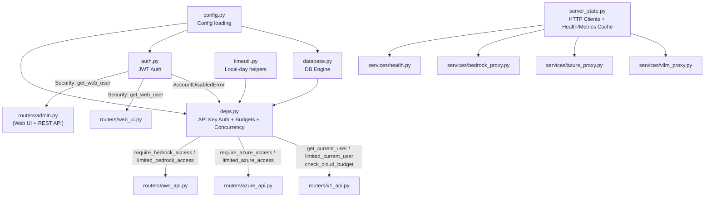

# Core — Foundation Modules

[中文版](README.zh-TW.md)

Provides authentication, configuration, database connections, HTTP client management and local-day time helpers — shared infrastructure used by routers and services.

## Module Overview



---

## Module Details

### `config.py` — Configuration Parser

Parses `config.toml` and `.env`, producing global configuration objects. `config.toml` is gitignored; when it is absent, reads fall back to `config.toml.example` (with a one-time WARNING) so a fresh clone or CI can boot. Writes always target `config.toml`.

| Export | Type | Source | Description |
|---|---|---|---|
| `APP_TITLE` | `str` | `.env` | Service name shown in UI title and navbar (default `LLM Gateway`) |
| `DATABASE_URL` | `str` | `.env` | PostgreSQL connection string |
| `AUTH_CENTER_APP_ID` | `str` | `.env` | JWT audience validation value |
| `AUTH_CENTER_PUBLIC_KEY_PATH` | `str` | `.env` | RS256 public key path |
| `AUTH_BASE_URL` | `str` | `.env` | JWT issuer validation value (default `auth-center`) |
| `APP_CONFIG` | `dict` | `config.toml` `[app]` | App-level settings: `default_daily_limit_usd`, `cloud_daily_limit_usd`, `cloud_budget_fallback`, `concurrency_limit_mode` / `concurrency_limit`, `support_bot_url` / `install_guide_url`. Read through the getters below |
| `MODEL_ROUTING` | `dict[str, dict]` | `config.toml` `[models.<type>.*]` | vLLM routing table: alias → `{base_url, real_model, api_key, type}` plus optional per-model fields |
| `PRICING_MAP` | `dict[str, dict]` | `config.toml` `[pricing]` | Pricing table: type → `{input_price_per_1m, output_price_per_1m}` (with `_default` entry) |
| `FALLBACK_MAP` | `dict[str, str]` | `config.toml` `[fallback]` | type → preferred fallback alias (vLLM path) |
| `AZURE_MODELS` | `dict[str, dict]` | `config.toml` `[azure_models.*]` | Azure routing: alias → `{type, endpoint, deployment, api_key, api_version, ...}` (`api_version` default `2024-08-01-preview`) |
| `AZURE_FALLBACK_MAP` | `dict[str, str]` | `config.toml` `[azure_fallback]` | type → preferred Azure alias, used only for unknown / wrong-type aliases |
| `BEDROCK_MODELS` | `dict[str, dict]` | `config.toml` `[bedrock_models.*]` | Bedrock routing: alias → `{type, model_id, api_key, ...}` plus optional `region`, `endpoint`, `aws_access_key_id` / `aws_secret_access_key` |
| `BEDROCK_FALLBACK_MAP` | `dict[str, str]` | `config.toml` `[bedrock_fallback]` | type → preferred Bedrock alias (same reactive-only contract as `[azure_fallback]`) |
| `CONCURRENCY_MODES` / `DEFAULT_CONCURRENCY_LIMIT` | `tuple` / `int` | — | `("off", "monitor", "enforce")` / `8` |

Aliases must be unique across `[models.*]`, `[azure_models.*]` and `[bedrock_models.*]`: `_build_config` raises `ValueError` at load time on a collision. Bad `rate_limit_fallback` targets and incomplete Bedrock credentials only log a WARNING.

**Optional per-model fields** (each set is a tuple; a new key must go in the right one):

- `_MODEL_METADATA_KEYS` — surfaced via `GET /v1/models`, `/azure/v1/models`, `/aws/v1/models`: `display_name`, `context_window`, `max_output_tokens`, `supports_tools`, `supports_vision`, `supports_prompt_caching`, `is_reasoning`
- `_MODEL_INTERNAL_KEYS` — not surfaced: `hidden` (left out of listings, still served when named), `native_messages` (native Anthropic `/v1/messages` pass-through: vLLM ≥ 0.11.1, or Bedrock's `/anthropic/v1/messages` on a Claude `[bedrock_models.*]` entry)
- `_MODEL_REASONING_KEYS` — not surfaced: `reasoning_efforts` (levels the downstream accepts) and `reasoning_effort_map` (explicit per-level override). Consumed by `app/services/reasoning_effort.py`; omitting them forwards whatever was requested.
- `_MODEL_PRICING_KEYS` — `input_price_per_1m`, `output_price_per_1m`, optional `cached_input_price_per_1m`. They take priority over `[pricing.<type>]`, which falls back to the `[pricing]` defaults (`_default`).
- `_CLOUD_ROUTING_KEYS` — `[azure_models.*]` / `[bedrock_models.*]` only, not surfaced: `rate_limit_fallback` (alias on the **same** backend that takes a 429)

**Key functions:**

| Function | Description |
|---|---|
| `reload_config()` | Re-reads the config file, updates all global dicts in-place under a lock (updates first, then drops stale keys) |
| `_check_auto_reload()` | Reloads when the file's mtime changed (multi-worker sync). Called by every getter/snapshot below |
| `save_config(models, pricing, fallback, azure_models=None, azure_fallback=None, bedrock_models=None, bedrock_fallback=None)` | Writes back to `config.toml` (atomic write) and reloads. A `None` cloud argument leaves that TOML section untouched. Tests must patch it (see CLAUDE.md) |
| `get_config_data()` | JSON-serializable snapshot for the Admin UI: `{models, pricing, fallback, azure_models, azure_fallback, bedrock_models, bedrock_fallback, bedrock_shared}`. `bedrock_shared` is `{region, iam_credentials: bool}`, never the secret |
| `get_model_routing_snapshot()` / `get_pricing_snapshot()` | Shallow copies of `MODEL_ROUTING` / `PRICING_MAP` safe for iteration |
| `get_azure_models_snapshot()` / `get_bedrock_models_snapshot()` | Shallow copies of `AZURE_MODELS` / `BEDROCK_MODELS` safe for iteration |
| `bedrock_shared_settings()` | `{region, aws_access_key_id, aws_secret_access_key}` from `BEDROCK_REGION` / `BEDROCK_AWS_*` in `.env` |
| `bedrock_region(entry)` | Entry's `region`, else `BEDROCK_REGION`, else `us-east-1` |
| `get_default_daily_limit()` / `set_default_daily_limit(value)` | `[app].default_daily_limit_usd` for auto-provisioned users: default `10.0` when missing, invalid or non-finite; negatives clamp to `0` (a $0 budget) |
| `get_cloud_daily_limit()` / `set_cloud_daily_limit(value)` | `[app].cloud_daily_limit_usd`, the default combined Azure + Bedrock cap. `None` = no default cap, `0` = $0 cap. `set_…(None)` removes the key |
| `get_cloud_budget_fallback()` / `set_cloud_budget_fallback(enabled)` | `[app].cloud_budget_fallback` (default `False`): exhausted cloud cap serves on-prem instead of 429, `/v1/*` only |
| `get_concurrency_settings()` / `set_concurrency_settings(mode, limit)` | `(mode, limit)` from `[app].concurrency_limit_mode` / `concurrency_limit`; invalid values fall back to `("off", 8)`. The setter raises `ValueError` on a bad mode or `limit < 1` |
| `get_site_links()` / `set_site_links(support_bot_url, install_guide_url)` | Admin-editable web-UI links in `[app]`; empty string hides the element |

---

### Environment variables (`.env`)

See `.env.example`. Read once at startup unless noted.

| Variable | Read in | Default | Description |
|---|---|---|---|
| `APP_TITLE`, `DATABASE_URL`, `AUTH_CENTER_APP_ID`, `AUTH_CENTER_PUBLIC_KEY_PATH`, `AUTH_BASE_URL` | `config.py` | see table above | Core settings |
| `LOG_DIR` / `LOG_LEVEL` / `LOG_ROTATION` / `LOG_RETENTION` | `logger.py` | `./logs` / `WARNING` / `100 MB` / `14 days` | File-sink settings (passed through to loguru) |
| `ENFORCE_DAILY_LIMIT` | `deps.py` (per call) | `true` | `false` = soft mode: daily and cloud overages are logged as WARNING but not refused. The only escape hatch; there is no per-user "unlimited" |
| `AZURE_HTTP_PROXY` / `AZURE_INSECURE` | `server_state.py` | unset / `false` | Proxy (inline credentials allowed) / disable TLS verification for Azure traffic only |
| `BEDROCK_HTTP_PROXY` / `BEDROCK_INSECURE` | `server_state.py` | unset / `false` | Same contract for Bedrock traffic only |
| `BEDROCK_REGION`, `BEDROCK_AWS_ACCESS_KEY_ID`, `BEDROCK_AWS_SECRET_ACCESS_KEY` | `config.py` (`bedrock_shared_settings`) | unset (`us-east-1`) | Shared by every `[bedrock_models.*]` entry; an entry's own value wins. The IAM pair must be set together. Kept out of `config.toml` so the admin page never loads the secret |
| `DOWNSTREAM_MAX_CONNECTIONS` / `DOWNSTREAM_MAX_KEEPALIVE_CONNECTIONS` | `server_state.py` | `1000` / `100` | Shared client pool size. Each open stream holds one connection |
| `LANGFUSE_HOST`, `LANGFUSE_PUBLIC_KEY`, `LANGFUSE_SECRET_KEY` | `services/observability.py` | unset | Langfuse is on only when all three are set |
| `LANGFUSE_SAMPLE_RATE` / `LANGFUSE_CAPTURE_IO` | `services/observability.py` | `1.0` / `false` | Fraction of requests sent to Langfuse (billing is never sampled) / also capture prompt and response content (PII) |
| `LOG_REQUEST_BODIES` | `services/redact.py` | `false` | Log raw request bodies on downstream errors. Debugging only |
| `SLOW_REQUEST_WARN_S` | `services/vllm_proxy.py` (per call) | `120` | `Slow request` / `Slow response headers` WARNING threshold; `0` disables |

---

### `auth.py` — JWT Authentication (Web UI)

Handles JWT authentication for the Web UI. After nginx obtains the access token from oauth2-proxy, it injects `Authorization: Bearer <JWT>` into the request header.

```
Browser → nginx → oauth2-proxy (validates session cookie)
                        ↓ pass
               nginx injects Authorization header
                        ↓
               FastAPI → auth.py → get_web_user()
```

| Function | Returns | Description |
|---|---|---|
| `get_web_user(security_scopes, request, session, credentials)` | `User` | FastAPI `Security` dependency: decodes JWT, checks scopes, auto-creates new users; raises `AccountDisabledError` if `user.is_disabled` (admins bypass). Uses `Depends(get_session)`, which is fine for the web/admin routers |
| `_decode_jwt(token)` | `dict \| None` | RS256 decode + audience/issuer validation (5 s leeway) |
| `_load_public_key()` | `str` | Reads the public key, re-reading when its mtime changes (key rotation without restart) |
| `_sync_user(session, username, display_name, org_code)` | `User` | Find or create user (new users get `get_default_daily_limit()`), sync IdP fields |
| `AccountDisabledError(username)` | exception | Raised by `get_web_user` and by every API-key dependency in `deps.py` when `user.is_disabled=True`. Caught by a global handler in `app/main.py` that renders `templates/disabled.html` for `Accept: text/html` requests and returns JSON 403 otherwise |

**Usage:**
```python
# Declare required scope at route level
user: User = Security(get_web_user, scopes=["read"])   # read or admin
user: User = Security(get_web_user, scopes=["admin"])   # admin only

# Set at router level (applies to all routes)
router = APIRouter(dependencies=[Security(get_web_user, scopes=["admin"])])
```

**Key behaviors:**
- First-time login users are auto-provisioned, with `display_name` and `org_code` (JWT `org_id`, else `org_code`) saved from JWT
- On subsequent logins, `display_name` and `org_code` are auto-synced if changed in IdP
- Returned `User` is **expunged** from session; `is_admin` is set dynamically from JWT scope, not written to DB
- `"admin"` scope automatically satisfies any scope requirement (admin can access read pages)
- In tests, `_decode_jwt` is patched to use HS256 validation

---

### `deps.py` — API Key Auth, Budgets, Concurrency (`/v1/*`, `/azure/v1/*`, `/aws/v1/*`)

FastAPI dependencies that authenticate the API key, enforce the daily limit and the cloud cap, and hold a concurrency slot.

The auth dependencies open their **own short-lived `Session(engine)`** and close it before returning, never `Depends(get_session)`: a `yield` dependency's exit runs after the response is sent, so a request-scoped session would pin one pool connection per open stream and exhaust the QueuePool.

| Function | Returns | Description |
|---|---|---|
| `get_current_user(credentials, x_api_key)` | `User` | Validates the API key (`Authorization: Bearer` or `x-api-key`; each candidate is tried when both are sent) + checks the daily limit. Raises `AccountDisabledError` if `user.is_disabled` (admins bypass) |
| `get_current_user_unmetered(credentials, x_api_key)` | `User` | Same auth without the daily-limit check. Used by `GET /v1/me`, which must answer when the budget is spent |
| `require_azure_access(user)` | `User` | Wraps `get_current_user`; 403 if `not user.can_use_azure and not user.is_admin`, then `ensure_azure_budget`. Used by `/azure/v1/*` |
| `require_bedrock_access(user)` | `User` | Same for `can_use_bedrock` + `ensure_bedrock_budget`. Used by `/aws/v1/*` |
| `limited_current_user` / `limited_azure_access` / `limited_bedrock_access` | `User` (yield) | The three dependencies above wrapped by `_limited`, holding a concurrency lease until the response (stream included) has been sent. Inference endpoints only (chat / responses / messages) |
| `_concurrency_slot(user, endpoint)` | async ctx manager | `off`, admins and `concurrency_waived` users: no-op. `monitor`: logs over-limit. `enforce`: 429 with `Retry-After: 5`. Store failure fails **open**. Release is shielded from cancellation |
| `effective_cloud_limit(user)` | `float \| None` | The user's `cloud_daily_limit_usd` when set (0 included), else `get_cloud_daily_limit()`. The only place to read the cloud cap |
| `check_cloud_budget(user, backend, *, allow_fallback=False)` | `bool` | Cloud-cap check with its own short-lived session, for the unified `/v1/*` handlers. Returns `False` only with `allow_fallback` (serve on-prem); otherwise raises 429. Blocking: call via `run_in_threadpool` |
| `ensure_azure_budget(user)` / `ensure_bedrock_budget(user)` | — | `check_cloud_budget(user, "azure" \| "bedrock")` without fallback |
| `_check_backend_daily_limit(session, user, backend, *, allow_fallback=False)` | `bool` | One cap for Azure + Bedrock together: sums today's `usage_logs` with `backend in ("azure", "bedrock")` against `effective_cloud_limit`. `None` = no cap; `0` = cloud refused |
| `_check_daily_limit(session, user)` | — | Sums today's `cost_usd`; 429 when it reaches `daily_limit_usd`. `daily_limit_usd = 0` is a **$0 budget**, never "unlimited" |
| `_enforce_daily_limit()` | `bool` | Reads `ENFORCE_DAILY_LIMIT` at call time; `False` turns both checks into WARNING-only |
| `get_today_usage(user)` | `dict` | Today's spend and tokens split by backend (`stats.get_user_daily_summary`); short-lived session |

All daily-limit 429s carry `Retry-After` until the next local midnight (`timeutil`).

**Auth flow:**

```
Request header: Authorization: Bearer sk-... and/or x-api-key: sk-...
       ↓
Own short-lived Session: SELECT * FROM users WHERE api_key = ? (each candidate)
       ↓  none → 401; disabled (non-admin) → AccountDisabledError (403)
Check today's cost_usd vs daily_limit_usd → 429  (skipped by get_current_user_unmetered)
       ↓  session closed
require_azure_access / require_bedrock_access: access flag → 403, cloud cap → 429
       ↓
limited_*: take a concurrency lease (inference endpoints), released after the response
       ↓
Return User object
```

---

### `database.py` — Database Engine

Creates SQLAlchemy engine and provides session factory.

| Export | Description |
|---|---|
| `engine` | SQLAlchemy engine. PostgreSQL enables connection pooling (pool_size=20, max_overflow=15) |
| `init_db()` | Creates all tables (dev only; production uses Alembic) |
| `get_session()` | FastAPI dependency, yields a Session. Web/admin routers only; API-path auth opens its own session |

**Connection pool parameters** (PostgreSQL only):

| Parameter | Value | Description |
|---|---|---|
| `pool_pre_ping` | `True` | Pings before checkout to avoid stale connections |
| `pool_size` | `20` | Resident connection count |
| `max_overflow` | `15` | Extra connections during peak (up to 35 total) |
| `pool_timeout` | `30` | Timeout in seconds waiting for available connection |

---

### `server_state.py` — HTTP Clients + Health Cache

Manages four `httpx.AsyncClient` instances, the downstream server health cache (`_health_cache`) and the per-vLLM-server load metrics cache (`_metrics_cache`).

- **Shared client** (`_client`): vLLM downstreams (internal LAN, never proxied).
- **Health client** (`_health_client`): background health probes only, so user streams can never starve probes of pool slots.
- **Azure client** (`_azure_client`): created only when `AZURE_HTTP_PROXY` or `AZURE_INSECURE` is set; otherwise `get_azure_client()` returns the shared client.
- **Bedrock client** (`_bedrock_client`): same convention with `BEDROCK_HTTP_PROXY` / `BEDROCK_INSECURE`.

Every user-traffic client (shared, Azure, Bedrock) is built with `event_hooks=UPSTREAM_EVENT_HOOKS` (from `services/observability.py`), which stamp per-request phase timing (`gateway_overhead_ms`, `upstream_ttfb_ms`). The health client has none. A new user-traffic client without them silently drops that timing for its backend.

| Function | Description |
|---|---|
| `init_client()` | Creates the shared and health clients, plus the Azure / Bedrock clients when their env vars are set |
| `close_client()` | Closes every client (called on app shutdown) |
| `get_client()` | Shared client (vLLM path) |
| `get_health_client()` | Health-probe client; falls back to the shared client when uninitialised (tests) |
| `get_azure_client()` / `get_bedrock_client()` | Dedicated cloud client, or the shared client when none was created |
| `pool_snapshot()` | Best-effort `{connections, in_use, max}` of the shared pool (logged by the health loop), or `None` |
| `set_alive(base_url, alive)` | Updates health cache (called by health check loop) |
| `mark_down(base_url)` | Request-layer circuit break after a connect failure; the next good probe flips it back |
| `is_alive(base_url)` | Queries whether a server is alive (unknown = `False`) |
| `set_metrics(base_url, metrics)` | Stores a vLLM server's `running` / `waiting` snapshot (`None` clears the entry) |
| `get_metrics(base_url)` | Returns the cached load snapshot for a server, or `None` |
| `prune_cache(active_urls)` | Removes health and metrics cache entries no longer in MODEL_ROUTING |
| `all_health()` | Returns health status dict for all servers |

**Client parameters:**

| Parameter | Shared | Azure / Bedrock | Health |
|---|---|---|---|
| Timeout | 30s (connect 10s) | 30s (connect 10s) | 5s |
| Max connections | `DOWNSTREAM_MAX_CONNECTIONS` (1000) | 200 | 32 |
| Max keepalive | `DOWNSTREAM_MAX_KEEPALIVE_CONNECTIONS` (100) | 40 | 16 |
| Transport retries | 1 (connect only, never re-sends) | 1 (connect only) | — |
| TLS verify | on | off when `*_INSECURE` | on |
| Follow redirects | `True` | `True` | `True` |

---

### `timeutil.py` — Local-Day Helpers

Daily budgets reset at local midnight in `LOCAL_TZ` (`Asia/Taipei`).

| Function | Description |
|---|---|
| `local_day_start_utc()` | UTC-aware datetime of the latest local midnight; the lower bound of "today's spend" |
| `next_local_midnight(local_now=None)` | Next local midnight (aware) |
| `seconds_until_local_midnight()` | Seconds until the reset (≥ 1); the `Retry-After` value on daily-limit 429s |

---

### `logger.py` — Logging

Uses [Loguru](https://github.com/Delgan/loguru). Console at INFO; a file sink at `LOG_LEVEL` (default WARNING) writes one file per worker (`LOG_DIR/gateway_<pid>.log`, gzip on rotation) so workers never share a handle. At startup, `gateway_*.log*` files older than `LOG_RETENTION` (left by dead workers) are swept.

```
2026-03-12 14:30:00 | INFO     | llm_gateway | Usage | user=alice model=radllm in=150 out=200 cost=$0.000525
```

---

## Dual Auth System

This project has two independent authentication mechanisms for different use cases:

| | API Auth (`deps.py`) | Web/Admin Auth (`auth.py`) |
|---|---|---|
| **Purpose** | `/v1/*`, `/azure/v1/*`, `/aws/v1/*` API endpoints | Web UI + Admin (incl. REST API) |
| **Method** | API key (`Authorization: Bearer` or `x-api-key`) | JWT (injected by oauth2-proxy) |
| **Lookup** | DB `users.api_key` field | JWT `sub` claim → DB `users.username` |
| **DB session** | Own short-lived session | `Depends(get_session)` |
| **Limit check** | `daily_limit_usd` per request (not `get_current_user_unmetered`), cloud cap on cloud routes, concurrency on inference endpoints | None (Web UI is read-only) |
| **Admin check** | DB `users.is_admin` (bypasses Azure/Bedrock flags, concurrency limit, disabled flag) | `"admin" in scopes` (JWT scope) |
| **Auto-provision** | No (unknown key → 401) | Yes (first login auto-creates user) |
