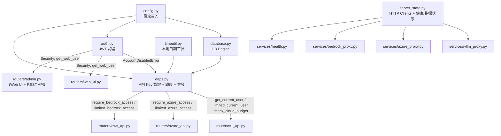

# Core — 核心基礎模組

[English](README.md)

提供認證、設定、資料庫連線、HTTP client 管理以及本地日期時間工具等基礎設施，被 routers 和 services 共同依賴。

## 模組總覽



---

## 各模組說明

### `config.py` — 設定解析

解析 `config.toml` 和 `.env`，產生全域設定物件。`config.toml` 已列入 gitignore；檔案不存在時，讀取會 fallback 到 `config.toml.example`（並記錄一次 WARNING），讓剛 clone 下來的專案或 CI 能啟動。寫入一律寫到 `config.toml`。

| 匯出 | 型別 | 來源 | 說明 |
|---|---|---|---|
| `APP_TITLE` | `str` | `.env` | 服務名稱，顯示於 UI 標題和 navbar（預設 `LLM Gateway`） |
| `DATABASE_URL` | `str` | `.env` | PostgreSQL 連線字串 |
| `AUTH_CENTER_APP_ID` | `str` | `.env` | JWT audience 驗證值 |
| `AUTH_CENTER_PUBLIC_KEY_PATH` | `str` | `.env` | RS256 公鑰路徑 |
| `AUTH_BASE_URL` | `str` | `.env` | JWT issuer 驗證值（預設 `auth-center`） |
| `APP_CONFIG` | `dict` | `config.toml` `[app]` | App 層級設定：`default_daily_limit_usd`、`cloud_daily_limit_usd`、`cloud_budget_fallback`、`concurrency_limit_mode` / `concurrency_limit`、`support_bot_url` / `install_guide_url`。請透過下方 getter 讀取 |
| `MODEL_ROUTING` | `dict[str, dict]` | `config.toml` `[models.<type>.*]` | vLLM 路由表：alias → `{base_url, real_model, api_key, type}`，加上可選的 per-model 欄位 |
| `PRICING_MAP` | `dict[str, dict]` | `config.toml` `[pricing]` | 定價表：type → `{input_price_per_1m, output_price_per_1m}`（包含 `_default`） |
| `FALLBACK_MAP` | `dict[str, str]` | `config.toml` `[fallback]` | type → 偏好的 fallback alias（vLLM 路徑） |
| `AZURE_MODELS` | `dict[str, dict]` | `config.toml` `[azure_models.*]` | Azure 路由：alias → `{type, endpoint, deployment, api_key, api_version, ...}`（`api_version` 預設 `2024-08-01-preview`） |
| `AZURE_FALLBACK_MAP` | `dict[str, str]` | `config.toml` `[azure_fallback]` | type → 偏好的 Azure alias，只在 alias 不存在或型別不符時使用 |
| `BEDROCK_MODELS` | `dict[str, dict]` | `config.toml` `[bedrock_models.*]` | Bedrock 路由：alias → `{type, model_id, api_key, ...}`，可選 `region`、`endpoint`、`aws_access_key_id` / `aws_secret_access_key` |
| `BEDROCK_FALLBACK_MAP` | `dict[str, str]` | `config.toml` `[bedrock_fallback]` | type → 偏好的 Bedrock alias（與 `[azure_fallback]` 相同，只處理錯誤 alias） |
| `CONCURRENCY_MODES` / `DEFAULT_CONCURRENCY_LIMIT` | `tuple` / `int` | — | `("off", "monitor", "enforce")` / `8` |

Alias 在 `[models.*]`、`[azure_models.*]`、`[bedrock_models.*]` 之間必須唯一：重複時 `_build_config` 在載入時丟出 `ValueError`。`rate_limit_fallback` 目標錯誤或 Bedrock 憑證不完整則只記錄 WARNING。

**Per-model 可選欄位**（每組各是一個 tuple；新增的 key 必須放進正確的那組）：

- `_MODEL_METADATA_KEYS` — 透過 `GET /v1/models`、`/azure/v1/models`、`/aws/v1/models` 對外揭露：`display_name`、`context_window`、`max_output_tokens`、`supports_tools`、`supports_vision`、`supports_prompt_caching`、`is_reasoning`
- `_MODEL_INTERNAL_KEYS` — 不對外揭露：`hidden`（不出現在列表中，但指名呼叫仍會服務）、`native_messages`（vLLM 原生 Anthropic `/v1/messages` 直通）
- `_MODEL_REASONING_KEYS` — 不對外揭露：`reasoning_efforts`（下游實際接受的等級）與 `reasoning_effort_map`（逐級指定改寫目標）。由 `app/services/reasoning_effort.py` 使用；不設定則照原樣轉送。
- `_MODEL_PRICING_KEYS` — `input_price_per_1m`、`output_price_per_1m`，以及可選的 `cached_input_price_per_1m`。優先於 `[pricing.<type>]`，後者再 fallback 到 `[pricing]` 預設值（`_default`）。
- `_CLOUD_ROUTING_KEYS` — 僅 `[azure_models.*]` / `[bedrock_models.*]`，不對外揭露：`rate_limit_fallback`（遇到 429 時接手的**同一後端** alias）

**關鍵函式：**

| 函式 | 說明 |
|---|---|
| `reload_config()` | 重新讀取設定檔，在 lock 內原地更新所有全域 dict（先更新、再移除過時的 key） |
| `_check_auto_reload()` | 檔案 mtime 改變時 reload（多 worker 同步）。下方每個 getter / snapshot 都會呼叫 |
| `save_config(models, pricing, fallback, azure_models=None, azure_fallback=None, bedrock_models=None, bedrock_fallback=None)` | 寫回 `config.toml`（atomic write）並 reload。雲端參數傳 `None` 則不動該 TOML 區段。測試中必須 patch（見 CLAUDE.md） |
| `get_config_data()` | 給 Admin UI 的 JSON-serializable 快照：`{models, pricing, fallback, azure_models, azure_fallback, bedrock_models, bedrock_fallback, bedrock_shared}`。`bedrock_shared` 是 `{region, iam_credentials: bool}`，絕不含 secret |
| `get_model_routing_snapshot()` / `get_pricing_snapshot()` | `MODEL_ROUTING` / `PRICING_MAP` 的 shallow copy，可安全 iterate |
| `get_azure_models_snapshot()` / `get_bedrock_models_snapshot()` | `AZURE_MODELS` / `BEDROCK_MODELS` 的 shallow copy，可安全 iterate |
| `bedrock_shared_settings()` | 從 `.env` 的 `BEDROCK_REGION` / `BEDROCK_AWS_*` 讀出 `{region, aws_access_key_id, aws_secret_access_key}` |
| `bedrock_region(entry)` | 該項目的 `region`，否則 `BEDROCK_REGION`，再否則 `us-east-1` |
| `get_default_daily_limit()` / `set_default_daily_limit(value)` | `[app].default_daily_limit_usd`，自動建立使用者時使用：缺漏、無效或非有限值時為 `10.0`；負值夾到 `0`（$0 額度） |
| `get_cloud_daily_limit()` / `set_cloud_daily_limit(value)` | `[app].cloud_daily_limit_usd`，Azure + Bedrock 合計的預設上限。`None` = 無預設上限，`0` = $0 上限。`set_…(None)` 會移除該 key |
| `get_cloud_budget_fallback()` / `set_cloud_budget_fallback(enabled)` | `[app].cloud_budget_fallback`（預設 `False`）：雲端上限用完時改由地端服務而非回 429，僅適用 `/v1/*` |
| `get_concurrency_settings()` / `set_concurrency_settings(mode, limit)` | 從 `[app].concurrency_limit_mode` / `concurrency_limit` 讀出 `(mode, limit)`；無效值 fallback 為 `("off", 8)`。setter 遇到錯誤的 mode 或 `limit < 1` 會丟出 `ValueError` |
| `get_site_links()` / `set_site_links(support_bot_url, install_guide_url)` | 存在 `[app]`、可由管理員編輯的 Web UI 連結；空字串表示隱藏該元素 |

---

### 環境變數（`.env`）

參見 `.env.example`。除特別註明外，只在啟動時讀取一次。

| 變數 | 讀取位置 | 預設 | 說明 |
|---|---|---|---|
| `APP_TITLE`、`DATABASE_URL`、`AUTH_CENTER_APP_ID`、`AUTH_CENTER_PUBLIC_KEY_PATH`、`AUTH_BASE_URL` | `config.py` | 見上表 | 核心設定 |
| `LOG_DIR` / `LOG_LEVEL` / `LOG_ROTATION` / `LOG_RETENTION` | `logger.py` | `./logs` / `WARNING` / `100 MB` / `14 days` | 檔案 sink 設定（直接傳給 loguru） |
| `ENFORCE_DAILY_LIMIT` | `deps.py`（每次呼叫時讀取） | `true` | `false` = 軟性模式：每日與雲端超額只記錄 WARNING，不拒絕。這是唯一的豁免開關，沒有 per-user「無上限」 |
| `AZURE_HTTP_PROXY` / `AZURE_INSECURE` | `server_state.py` | 未設定 / `false` | 僅 Azure 流量使用的 proxy（可內嵌帳密）/ 停用 TLS 驗證 |
| `BEDROCK_HTTP_PROXY` / `BEDROCK_INSECURE` | `server_state.py` | 未設定 / `false` | 同上，僅 Bedrock 流量 |
| `BEDROCK_REGION`、`BEDROCK_AWS_ACCESS_KEY_ID`、`BEDROCK_AWS_SECRET_ACCESS_KEY` | `config.py`（`bedrock_shared_settings`） | 未設定（`us-east-1`） | 所有 `[bedrock_models.*]` 共用；項目自己的值優先。IAM 金鑰必須成對設定。不放在 `config.toml`，因此管理頁面永遠不會載入 secret |
| `DOWNSTREAM_MAX_CONNECTIONS` / `DOWNSTREAM_MAX_KEEPALIVE_CONNECTIONS` | `server_state.py` | `1000` / `100` | 共用 client 的連線池大小。每條進行中的串流佔用一條連線 |
| `LANGFUSE_HOST`、`LANGFUSE_PUBLIC_KEY`、`LANGFUSE_SECRET_KEY` | `services/observability.py` | 未設定 | 三者都設定才啟用 Langfuse |
| `LANGFUSE_SAMPLE_RATE` / `LANGFUSE_CAPTURE_IO` | `services/observability.py` | `1.0` / `false` | 送到 Langfuse 的請求比例（計費永不抽樣）/ 一併記錄 prompt 與回應內容（含個資） |
| `LOG_REQUEST_BODIES` | `services/redact.py` | `false` | 下游錯誤時記錄原始 request body。僅供除錯 |
| `SLOW_REQUEST_WARN_S` | `services/vllm_proxy.py`（每次呼叫時讀取） | `120` | `Slow request` / `Slow response headers` WARNING 門檻；`0` 停用 |

---

### `auth.py` — JWT 認證（Web UI）

處理 Web UI 的 JWT 認證。nginx 從 oauth2-proxy 取得 access token 後，以 `Authorization: Bearer <JWT>` 注入到 request header。

```
Browser → nginx → oauth2-proxy (驗證 session cookie)
                        ↓ 通過
               nginx 注入 Authorization header
                        ↓
               FastAPI → auth.py → get_web_user()
```

| 函式 | 回傳 | 說明 |
|---|---|---|
| `get_web_user(security_scopes, request, session, credentials)` | `User` | FastAPI `Security` dependency：解析 JWT，檢查 scope，自動建立新使用者；若 `user.is_disabled` 則丟出 `AccountDisabledError`（admin 免檢查）。使用 `Depends(get_session)`，web/admin router 可以這樣用 |
| `_decode_jwt(token)` | `dict \| None` | RS256 解碼 + audience/issuer 驗證（5 秒 leeway） |
| `_load_public_key()` | `str` | 讀取公鑰，mtime 改變時重新讀取（輪替金鑰不必重啟） |
| `_sync_user(session, username, display_name, org_code)` | `User` | 查找或建立使用者（新使用者額度為 `get_default_daily_limit()`），同步 IdP 欄位 |
| `AccountDisabledError(username)` | 例外類別 | 由 `get_web_user` 與 `deps.py` 的每個 API key dependency 在 `user.is_disabled=True` 時丟出。`app/main.py` 內的全域 handler 在 `Accept: text/html` 時 render `templates/disabled.html`，其他則回 JSON 403 |

**用法：**
```python
# Route 層宣告需要的 scope
user: User = Security(get_web_user, scopes=["read"])   # read 或 admin 皆可
user: User = Security(get_web_user, scopes=["admin"])   # 僅 admin

# Router 層統一設定（所有 route 自動套用）
router = APIRouter(dependencies=[Security(get_web_user, scopes=["admin"])])
```

**重要行為：**
- 第一次登入的使用者會自動建立（auto-provision），同時從 JWT 存入 `display_name` 和 `org_code`（JWT 的 `org_id`，否則 `org_code`）
- 後續登入時若 IdP 的 `display_name` 或 `org_code` 有變更，會自動同步更新到 DB
- 回傳的 `User` 已從 session 中 **expunge**，`is_admin` 是根據 JWT scope 動態設定，不會寫回 DB
- `"admin"` scope 自動滿足任何 scope 需求（admin 可以存取 read 頁面）
- 測試時 `_decode_jwt` 會被 patch 為 HS256 驗證

---

### `deps.py` — API Key 認證、額度、併發（`/v1/*`、`/azure/v1/*`、`/aws/v1/*`）

FastAPI dependency：驗證 API key、檢查每日額度與雲端上限，並佔用併發名額。

認證 dependency 會開**自己的短期 `Session(engine)`**，並在 return 前關閉，絕不使用 `Depends(get_session)`：`yield` dependency 的結束段在回應送出後才執行，若用 request-scoped session，每條進行中的串流都會佔住一條連線池連線，最終耗盡 QueuePool。

| 函式 | 回傳 | 說明 |
|---|---|---|
| `get_current_user(credentials, x_api_key)` | `User` | 驗證 API key（`Authorization: Bearer` 或 `x-api-key`；兩者都送時逐一嘗試）+ 檢查每日額度。若 `user.is_disabled` 則丟出 `AccountDisabledError`（admin 免檢查） |
| `get_current_user_unmetered(credentials, x_api_key)` | `User` | 相同認證但不檢查每日額度。供 `GET /v1/me` 使用，額度用完時仍須回應 |
| `require_azure_access(user)` | `User` | 包裝 `get_current_user`；若 `not user.can_use_azure and not user.is_admin` 則回 403，再呼叫 `ensure_azure_budget`。`/azure/v1/*` 使用 |
| `require_bedrock_access(user)` | `User` | 同上，檢查 `can_use_bedrock` + `ensure_bedrock_budget`。`/aws/v1/*` 使用 |
| `limited_current_user` / `limited_azure_access` / `limited_bedrock_access` | `User`（yield） | 以 `_limited` 包裝上面三個 dependency，持有併發 lease 直到回應（含串流）送完。僅用於推論端點（chat / responses / messages） |
| `_concurrency_slot(user, endpoint)` | async context manager | `off`、admin 與 `concurrency_waived` 使用者：不做事。`monitor`：超量只記錄。`enforce`：回 429 並帶 `Retry-After: 5`。lease 儲存失敗時 **fail open**。釋放時以 shield 防止被取消 |
| `effective_cloud_limit(user)` | `float \| None` | 使用者自己的 `cloud_daily_limit_usd`（有設定時，含 0），否則 `get_cloud_daily_limit()`。讀取雲端上限的唯一入口 |
| `check_cloud_budget(user, backend, *, allow_fallback=False)` | `bool` | 以自己的短期 session 檢查雲端上限，供統一 `/v1/*` handler 使用。只有在 `allow_fallback` 時才回 `False`（改由地端服務）；否則丟出 429。屬阻塞呼叫：請透過 `run_in_threadpool` |
| `ensure_azure_budget(user)` / `ensure_bedrock_budget(user)` | — | 不帶 fallback 的 `check_cloud_budget(user, "azure" \| "bedrock")` |
| `_check_backend_daily_limit(session, user, backend, *, allow_fallback=False)` | `bool` | Azure + Bedrock 共用一個上限：加總今日 `backend in ("azure", "bedrock")` 的 `usage_logs`，與 `effective_cloud_limit` 比較。`None` = 無上限；`0` = 拒絕雲端 |
| `_check_daily_limit(session, user)` | — | 加總今日 `cost_usd`，達到 `daily_limit_usd` 時回 429。`daily_limit_usd = 0` 是 **$0 額度**，絕非「無上限」 |
| `_enforce_daily_limit()` | `bool` | 每次呼叫時讀取 `ENFORCE_DAILY_LIMIT`；`False` 時兩種檢查都只記錄 WARNING |
| `get_today_usage(user)` | `dict` | 依後端拆分的今日花費與 token 數（`stats.get_user_daily_summary`）；短期 session |

所有額度相關的 429 都帶 `Retry-After`，值為距離下一個本地午夜的秒數（`timeutil`）。

**認證流程：**

```
Request header: Authorization: Bearer sk-... 和/或 x-api-key: sk-...
       ↓
自己的短期 Session: SELECT * FROM users WHERE api_key = ?（逐一嘗試）
       ↓  找不到 → 401；停用（非 admin）→ AccountDisabledError (403)
檢查今日 cost_usd vs daily_limit_usd → 429（get_current_user_unmetered 略過）
       ↓  session 關閉
require_azure_access / require_bedrock_access：權限旗標 → 403，雲端上限 → 429
       ↓
limited_*：取得併發 lease（推論端點），回應送完後釋放
       ↓
回傳 User 物件
```

---

### `database.py` — 資料庫引擎

建立 SQLAlchemy engine，提供 session factory。

| 匯出 | 說明 |
|---|---|
| `engine` | SQLAlchemy engine。PostgreSQL 時啟用連線池（pool_size=20, max_overflow=15） |
| `init_db()` | 建立所有表（僅開發用，正式環境使用 Alembic） |
| `get_session()` | FastAPI dependency，yield 一個 Session。僅 web/admin router 使用；API 路徑的認證會自己開 session |

**連線池參數**（僅 PostgreSQL）：

| 參數 | 值 | 說明 |
|---|---|---|
| `pool_pre_ping` | `True` | 每次取出連線前先 ping，避免使用已斷開的連線 |
| `pool_size` | `20` | 常駐連線數 |
| `max_overflow` | `15` | 尖峰時可額外建立的連線數（最多 35 條） |
| `pool_timeout` | `30` | 等待可用連線的逾時秒數 |

---

### `server_state.py` — HTTP Client + 健康快取

管理四個 `httpx.AsyncClient` 實例、下游伺服器健康狀態快取（`_health_cache`）以及每台 vLLM 伺服器的負載指標快取（`_metrics_cache`）。

- **共用 client**（`_client`）：vLLM 下游（內部 LAN，永遠不走 proxy）。
- **健康檢查 client**（`_health_client`）：只給背景健康檢查使用，使用者串流再多也不會讓探測搶不到連線。
- **Azure client**（`_azure_client`）：僅在設定 `AZURE_HTTP_PROXY` 或 `AZURE_INSECURE` 時建立；否則 `get_azure_client()` 回傳共用 client。
- **Bedrock client**（`_bedrock_client`）：相同慣例，對應 `BEDROCK_HTTP_PROXY` / `BEDROCK_INSECURE`。

每個承載使用者流量的 client（共用、Azure、Bedrock）都以 `event_hooks=UPSTREAM_EVENT_HOOKS`（來自 `services/observability.py`）建立，用來記錄每個請求的階段計時（`gateway_overhead_ms`、`upstream_ttfb_ms`）。健康檢查 client 沒有掛。新增使用者流量 client 若漏掛，該後端的計時會無聲遺失。

| 函式 | 說明 |
|---|---|
| `init_client()` | 建立共用與健康檢查 client；對應環境變數有設定時另外建立 Azure / Bedrock client |
| `close_client()` | 關閉所有 client（app shutdown 時呼叫） |
| `get_client()` | 共用 client（vLLM 路徑） |
| `get_health_client()` | 健康檢查 client；未初始化時（測試）fallback 到共用 client |
| `get_azure_client()` / `get_bedrock_client()` | 專屬雲端 client，未建立時回傳共用 client |
| `pool_snapshot()` | 共用連線池使用率 `{connections, in_use, max}`（盡力而為，由 health loop 記錄），失敗回 `None` |
| `set_alive(base_url, alive)` | 更新健康快取（由 health check loop 呼叫） |
| `mark_down(base_url)` | 連線失敗時於請求層立即斷路；下一次探測成功即恢復 |
| `is_alive(base_url)` | 查詢伺服器是否存活（未知 = `False`） |
| `set_metrics(base_url, metrics)` | 存入某台 vLLM 伺服器的 `running` / `waiting` 快照（傳 `None` 則清除） |
| `get_metrics(base_url)` | 回傳該伺服器快取的負載快照，未抓取過則回 `None` |
| `prune_cache(active_urls)` | 移除不再存在於 MODEL_ROUTING 的健康與指標 cache entry |
| `all_health()` | 回傳所有伺服器的健康狀態 dict |

**Client 參數：**

| 參數 | 共用 | Azure / Bedrock | 健康檢查 |
|---|---|---|---|
| Timeout | 30s（connect 10s） | 30s（connect 10s） | 5s |
| Max connections | `DOWNSTREAM_MAX_CONNECTIONS`（1000） | 200 | 32 |
| Max keepalive | `DOWNSTREAM_MAX_KEEPALIVE_CONNECTIONS`（100） | 40 | 16 |
| Transport retries | 1（僅建立連線，絕不重送） | 1（僅建立連線） | — |
| TLS 驗證 | 開 | `*_INSECURE` 時關閉 | 開 |
| Follow redirects | `True` | `True` | `True` |

---

### `timeutil.py` — 本地日期工具

每日額度在 `LOCAL_TZ`（`Asia/Taipei`）的午夜重置。

| 函式 | 說明 |
|---|---|
| `local_day_start_utc()` | 最近一次本地午夜的 UTC aware datetime；「今日花費」的起點 |
| `next_local_midnight(local_now=None)` | 下一個本地午夜（aware） |
| `seconds_until_local_midnight()` | 距離重置的秒數（≥ 1）；額度 429 的 `Retry-After` 值 |

---

### `logger.py` — 日誌設定

使用 [Loguru](https://github.com/Delgan/loguru)。主控台輸出 INFO；檔案 sink 使用 `LOG_LEVEL`（預設 WARNING），每個 worker 寫自己的檔案（`LOG_DIR/gateway_<pid>.log`，輪替時 gzip 壓縮），避免多個 worker 共用 file handle。啟動時會清掉超過 `LOG_RETENTION` 的 `gateway_*.log*`（已結束 worker 留下的檔案）。

```
2026-03-12 14:30:00 | INFO     | llm_gateway | Usage | user=alice model=radllm in=150 out=200 cost=$0.000525
```

---

## 雙重認證系統

本專案有兩套獨立的認證機制，分別處理不同的使用場景：

| | API 認證 (`deps.py`) | Web/Admin 認證 (`auth.py`) |
|---|---|---|
| **用途** | `/v1/*`、`/azure/v1/*`、`/aws/v1/*` API 端點 | Web UI + Admin（含 REST API） |
| **認證方式** | API key（`Authorization: Bearer` 或 `x-api-key`） | JWT（oauth2-proxy 注入） |
| **查詢對象** | DB `users.api_key` 欄位 | JWT `sub` claim → DB `users.username` |
| **DB session** | 自己的短期 session | `Depends(get_session)` |
| **額度檢查** | 每次請求檢查 `daily_limit_usd`（`get_current_user_unmetered` 除外），雲端路由檢查雲端上限，推論端點檢查併發 | 不檢查（Web UI 僅查看） |
| **Admin 判斷** | DB `users.is_admin`（略過 Azure/Bedrock 權限旗標、併發限制、停用旗標） | `"admin" in scopes`（JWT scope） |
| **自動建立帳號** | 否（key 不存在回 401） | 是（首次登入自動 provision） |
