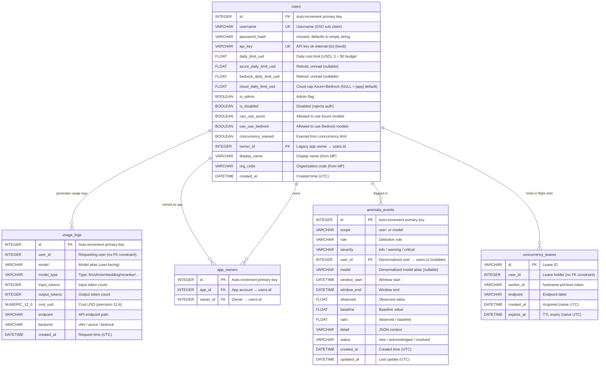
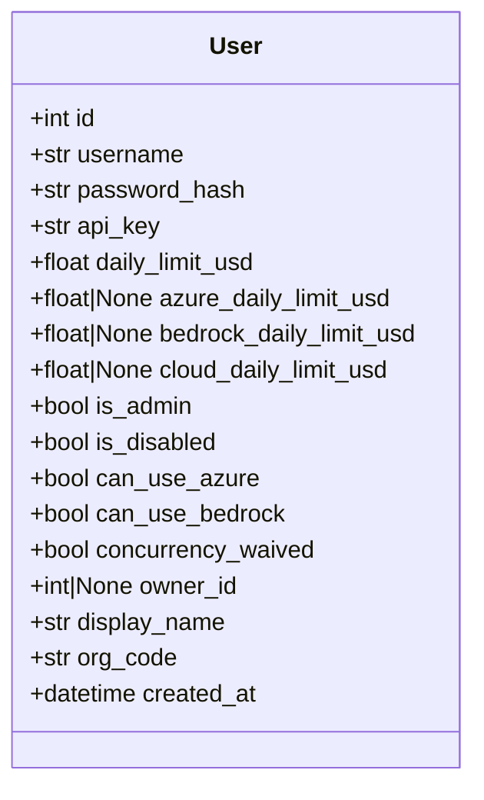
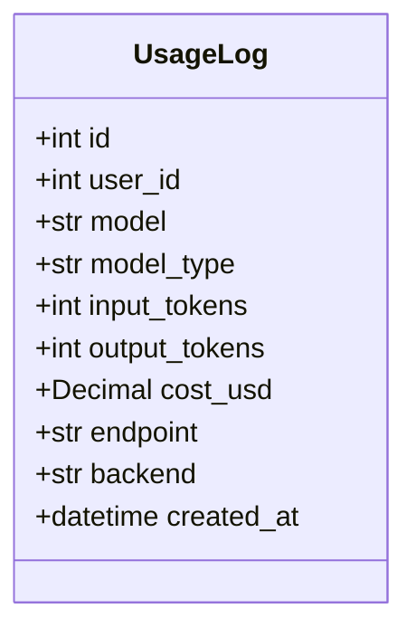

# Models — Database Model Definitions

[中文版](README.zh-TW.md)

Defines PostgreSQL table structures using [SQLModel](https://sqlmodel.tiangolo.com/) (SQLAlchemy + Pydantic integration).

## Files

| File | Description |
|---|---|
| `schema.py` | `User`, `AppOwner`, `UsageLog`, `UsageDaily`, `UsageRollupState`, `ScheduledJob`, `AnomalyEvent`, `ConcurrencyLease` — eight ORM models, plus helpers `is_app_account()` (`app_*` prefix) and `mask_api_key()` (key display in admin listings) |

## ER Diagram



`usage_logs.user_id` and `concurrency_leases.user_id` are logical references without a foreign-key constraint. The admin `delete_user` clears every row that references a user (`app_owners`, the legacy `users.owner_id`, `anomaly_events`, leases) before deleting it; add any new foreign key there too. `usage_logs` and `usage_daily` are deliberately kept: they are the billing and audit record, and the delete logs the id → account mapping.

## User Model

Maps to `users` table. Represents a human user or a programmatic app account.



### Field Details

| Field | Type | Constraints | Default | Description |
|---|---|---|---|---|
| `id` | `INTEGER` | PK, auto-increment | — | Primary key, auto-generated |
| `username` | `VARCHAR` | UNIQUE, INDEX | — | SSO `sub` claim. App accounts are prefixed with `app_` (`is_app_account()`) |
| `password_hash` | `VARCHAR` | — | `""` | **Unused.** Legacy field kept for backward compatibility |
| `api_key` | `VARCHAR` | UNIQUE, INDEX | `_generate_api_key()` | Auto-generated, format `sk-internal-{unix_timestamp}-{8-char hex}`. Used for API auth. Admin listings show `mask_api_key(...)` |
| `daily_limit_usd` | `FLOAT` | — | `10.0` | Daily spend limit (USD) for all backends. API returns 429 when exceeded. Always finite and ≥ 0: **`0` is a $0 budget, not unlimited**. SSO-created users get `[app].default_daily_limit_usd` |
| `azure_daily_limit_usd` | `FLOAT` | NULLABLE | `None` | **Retired, unread.** Former per-user Azure sub-limit; kept until a migration drops it. The admin API answers 400 to this field |
| `bedrock_daily_limit_usd` | `FLOAT` | NULLABLE | `None` | **Retired, unread.** Former per-user Bedrock sub-limit; same status as above |
| `cloud_daily_limit_usd` | `FLOAT` | NULLABLE | `None` | The user's cloud cap: Azure + Bedrock spend together, per day. **NULL follows `[app].cloud_daily_limit_usd`**, not "no cap"; a value (`0` included, which refuses cloud) replaces it. Read only through `deps.effective_cloud_limit`. Applies only to users with Azure or AWS access |
| `is_admin` | `BOOLEAN` | — | `False` | Admin flag in DB. **Note: Web UI admin access is determined by JWT scope, not this field** |
| `is_disabled` | `BOOLEAN` | — | `False` | When `True`, both API key auth and JWT web auth raise `AccountDisabledError` (HTML page or JSON 403). **Admins bypass** the check. Toggled via `POST /admin/users/{id}/toggle-disable` (refuses self-disable) |
| `can_use_azure` | `BOOLEAN` | — | `False` | Gates `/azure/v1/*` (`deps.require_azure_access`) and unified `/v1/*` dispatch to Azure aliases. **Admins bypass** the check. Toggled via `POST /admin/users/{id}/toggle-azure` |
| `can_use_bedrock` | `BOOLEAN` | — | `False` | Gates `/aws/v1/*` (`deps.require_bedrock_access`) and unified `/v1/*` dispatch to Bedrock aliases. **Admins bypass** the check. Toggled via `POST /admin/users/{id}/toggle-bedrock` |
| `concurrency_waived` | `BOOLEAN` | — | `False` | Exempt from the concurrency limit (`[app].concurrency_limit_*`). Admins are always exempt. App accounts are created waived. Toggled via `POST /admin/users/{id}/toggle-concurrency-waive` |
| `owner_id` | `INTEGER` | FK → `users.id`, INDEX, NULLABLE | `None` | **Legacy** single-owner column, superseded by `app_owners`. Migration `d5a2c3e67f04` copied it without clearing it, so old app accounts may still point at their original owner |
| `display_name` | `VARCHAR` | — | `""` | Display name from IdP JWT `display_name` field. Auto-synced on each web login |
| `org_code` | `VARCHAR` | — | `""` | Org code from IdP JWT `org_code` field. Auto-synced on each web login. Shown in Admin user table |
| `created_at` | `DATETIME` | — | `datetime.now(UTC)` | Account creation time |

### API Key Generation

```python
def _generate_api_key() -> str:
    ts = int(datetime.now(timezone.utc).timestamp())
    short_hex = uuid.uuid4().hex[:8]
    return f"sk-internal-{ts}-{short_hex}"
```

Example: `sk-internal-1741651200-a1b2c3d4`

### User Type Distinctions

| Type | Criteria | Description |
|---|---|---|
| Regular user | Not prefixed with `app_` | Auto-created on SSO login |
| App account | `is_app_account(username)` (`username.startswith("app_")`) | Created by admin for programmatic use (the admin panel adds the prefix). Created with `concurrency_waived = True` |
| Owned app | Has `app_owners` rows with `app_id = id` | Bound to one or more users; owners can manage it on Dashboard |

---

## AppOwner Model

Maps to `app_owners` table. Many-to-many: which users own which app accounts.

| Field | Type | Constraints | Default | Description |
|---|---|---|---|---|
| `id` | `INTEGER` | PK, auto-increment | — | Primary key |
| `app_id` | `INTEGER` | FK → `users.id`, INDEX | — | The app account |
| `owner_id` | `INTEGER` | FK → `users.id`, INDEX | — | The owning user |

---

## UsageLog Model

Maps to `usage_logs` table. One record per billable API request (written by `_log_usage`; debug and metadata calls such as `render`, `tokenize`, `count_tokens` are not logged). This is the billing and audit record.



### Field Details

| Field | Type | Constraints | Default | Description |
|---|---|---|---|---|
| `id` | `INTEGER` | PK, auto-increment | — | Primary key |
| `user_id` | `INTEGER` | Composite index | — | Requesting user ID. No FK constraint: the rows outlive a deleted account (`delete_user` keeps them) |
| `model` | `VARCHAR` | — | `""` | Model alias requested by user (user-facing name, not real_model) |
| `model_type` | `VARCHAR` | — | `""` | Model type: `llm`, `vlm`, `embedding`, `vision_embedding`, `reranker`, `vision_reranker`, `systemone` |
| `input_tokens` | `INTEGER` | — | `0` | Input token count (`prompt_tokens`) |
| `output_tokens` | `INTEGER` | — | `0` | Output token count (`completion_tokens`). Usually 0 for Embedding/Reranker, always 0 for System One |
| `cost_usd` | `NUMERIC(12,6)` | NOT NULL | `0` | Calculated cost (USD). 6 decimal places. Based on per-1M-token pricing (see below) |
| `endpoint` | `VARCHAR` | — | `""` | API endpoint label, e.g. `/v1/chat/completions`, `/v1/embeddings`, `/v1/score`, `/azure/v1/responses` |
| `backend` | `VARCHAR` | NOT NULL, server default `'vllm'` | `"vllm"` | Downstream that served the request: `vllm` (on-prem), `azure` or `bedrock`. Splits cloud spend from on-prem spend for the cloud cap, dashboard and usage export |
| `created_at` | `DATETIME` | Composite index | `datetime.now(UTC)` | Request time |

### Cost Formula

```
cost_usd = (uncached_input_tokens × input_price_per_1m
            + cached_input_tokens × cached_input_price_per_1m
            + output_tokens × output_price_per_1m) / 1,000,000
```

Prices come from `config.toml`: the model entry's own override, else `[pricing.<type>]`, else `[pricing]`. Cached input tokens bill at `cached_input_price_per_1m` only when that price is configured and the backend reports cache hits; otherwise all input bills at `input_price_per_1m`.

### Indexes

| Index Name | Columns | Purpose |
|---|---|---|
| `ix_usage_user_date_cost` | `user_id`, `created_at`, `cost_usd` | Covering index. Daily limit queries use index-only scan without reading cost_usd from table |
| `ix_usage_created_at` | `created_at` | DAU stats, time-range queries |

---

## AnomalyEvent Model

Maps to `anomaly_events` table. Findings from the hourly usage-anomaly scan (`scripts/scan_anomalies.py`). Detection only: nothing here blocks or throttles a request.

One row per `(scope, rule, window_start)`: the scan upserts, so re-running a window is idempotent and an ongoing anomaly updates one row (`window_end` / `observed` grow). Alert side-channels must fire only when a row is **created**, never on updates.

| Field | Type | Constraints | Default | Description |
|---|---|---|---|---|
| `id` | `INTEGER` | PK, auto-increment | — | Primary key |
| `scope` | `VARCHAR` | UNIQUE (with `rule`, `window_start`) | — | `user:<id>` for per-account rules, `model:<alias>` for model-level rules |
| `rule` | `VARCHAR` | UNIQUE (with `scope`, `window_start`) | — | `cost_spike`, `off_hours`, `burst_rate`, `behavior_shift`, `empty_turn_rate` |
| `severity` | `VARCHAR` | — | `"warning"` | `info`, `warning`, `critical` |
| `user_id` | `INTEGER` | FK → `users.id`, INDEX, NULLABLE | `None` | Denormalized copy of the user in `scope`, for joins and display |
| `model` | `VARCHAR` | NULLABLE | `None` | Denormalized model alias |
| `window_start` | `DATETIME` | UNIQUE (with `scope`, `rule`) | — | Start of the detection window |
| `window_end` | `DATETIME` | — | — | End of the detection window |
| `observed` | `FLOAT` | — | `0.0` | Observed value |
| `baseline` | `FLOAT` | — | `0.0` | Baseline value |
| `ratio` | `FLOAT` | — | `0.0` | Observed / baseline |
| `detail` | `VARCHAR` | — | `"{}"` | JSON: summary + structured context |
| `status` | `VARCHAR` | — | `"new"` | `new` → `acknowledged` → `resolved` |
| `created_at` | `DATETIME` | — | `datetime.now(UTC)` | Row creation time |
| `updated_at` | `DATETIME` | — | `datetime.now(UTC)` | Last upsert time |

### Indexes and Constraints

| Name | Columns | Purpose |
|---|---|---|
| `uq_anomaly_scope_rule_window` | `scope`, `rule`, `window_start` | UNIQUE — upsert key |
| `ix_anomaly_status_created` | `status`, `created_at` | Admin listing by status |
| `ix_anomaly_events_user_id` | `user_id` | Per-user lookup and user deletion |

---

## ConcurrencyLease Model

Maps to `concurrency_leases` table. One row per in-flight limited request holding a concurrency slot (`app/services/concurrency.py`). Inserted when a limited request starts, deleted when its response (stream included) has been fully sent. Leases of dead workers are removed by the per-worker sweep (dead pid on this host, recycled pid) or, failing that, once `expires_at` passes; the owning worker pushes `expires_at` forward every heartbeat.

| Field | Type | Constraints | Default | Description |
|---|---|---|---|---|
| `id` | `VARCHAR` | PK | — | Lease ID |
| `user_id` | `INTEGER` | Composite index | — | Lease holder. No FK constraint: rows are short-lived and `delete_user` removes them explicitly |
| `worker_id` | `VARCHAR` | INDEX | — | `<hostname>:<pid>:<boot token>` of the owning worker |
| `endpoint` | `VARCHAR` | — | `""` | Endpoint label |
| `created_at` | `DATETIME` | — | — | Acquisition time, **naive UTC** |
| `expires_at` | `DATETIME` | Composite index | — | TTL expiry, **naive UTC** |

Timestamps are naive UTC (unlike the aware values other tables use) so a PostgreSQL session `TimeZone` can never shift them between write and compare.

### Indexes

| Index Name | Columns | Purpose |
|---|---|---|
| `ix_concurrency_user_expires` | `user_id`, `expires_at` | Count a user's live leases |
| `ix_concurrency_leases_worker_id` | `worker_id` | Heartbeat renewal and dead-worker sweep |

---

## UsageDaily Model

Maps to `usage_daily` table. Per-local-day (Asia/Taipei) rollup of `usage_logs`, written only by the gateway's background rollup (`app/services/usage_rollup.py`) for closed days. Reports read closed days here and the rest from `usage_logs` through `usage_rollup.aggregate`. See [docs/architecture.md](../../docs/architecture.md#daily-usage-rollup-appservicesusage_rolluppy).

| Field | Type | Constraints | Default | Description |
|---|---|---|---|---|
| `day` | `DATE` | PK | — | Asia/Taipei calendar day |
| `user_id` | `INTEGER` | PK | — | No FK constraint (like `usage_logs`); kept when the account is deleted |
| `backend` | `VARCHAR` | PK | — | `vllm`, `azure`, `bedrock` |
| `model` | `VARCHAR` | PK | — | Model alias |
| `model_type` | `VARCHAR` | PK | — | `llm`, `vlm`, `embedding`, ... |
| `endpoint` | `VARCHAR` | PK | — | Endpoint label |
| `requests` | `BIGINT` | — | `0` | Request count |
| `input_tokens` / `output_tokens` | `BIGINT` | — | `0` | Token sums |
| `cost_usd` | `NUMERIC(16,6)` | — | `0` | Cost sum |
| `empty_turns` | `BIGINT` | — | `0` | Requests with `output_tokens <= 1` |

| Index Name | Columns | Purpose |
|---|---|---|
| `usage_daily_pkey` | `day`, `user_id`, `backend`, `model`, `model_type`, `endpoint` | Date-range reads |
| `ix_usage_daily_user_day` | `user_id`, `day` | Per-user reads (dashboard) |

## UsageRollupState Model

Maps to `usage_rollup_state` table. One row (`name = "usage_daily"`) holding `rolled_through` (`DATE`): every day up to it is in `usage_daily`, with no gaps. No row means the rollup has not run yet, and reports read `usage_logs` only.

## ScheduledJob Model

Maps to `scheduled_jobs` table. One row per in-gateway periodic job (anomaly scan, usage-log retention; `app/services/scheduler.py`): `name` (PK), `last_started_at`, `last_finished_at` (naive UTC), `last_status` (`running` / `ok` / `error`), `last_detail`. Workers claim a run with a conditional UPDATE of `last_started_at`, so each job runs once per interval across every worker and host.
