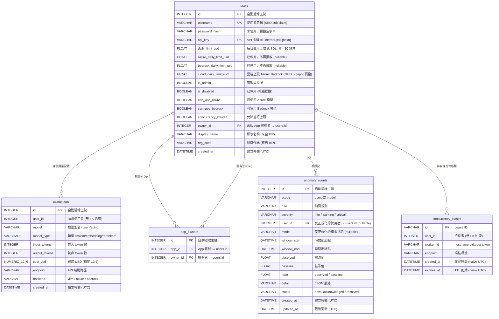
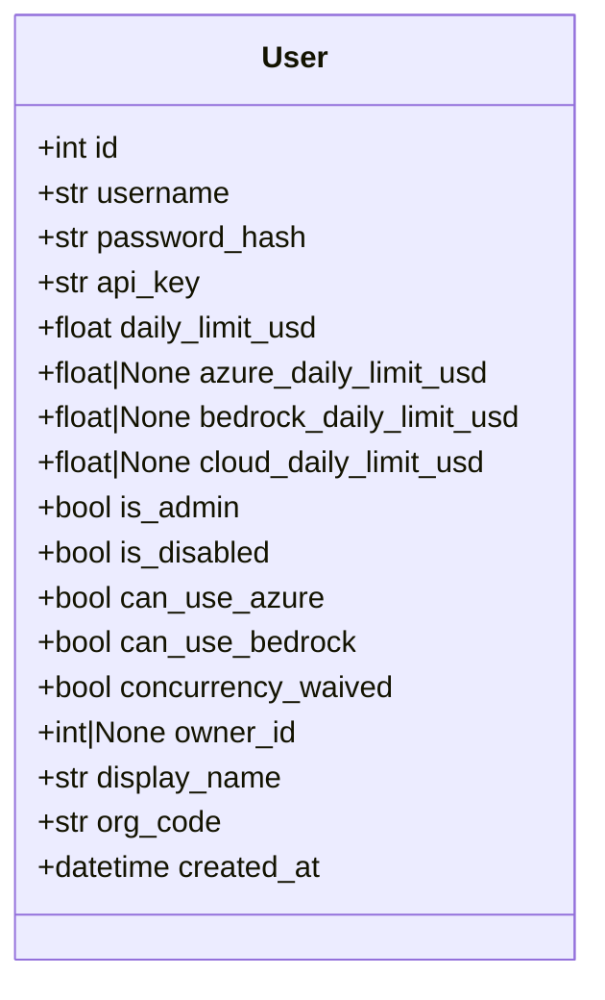
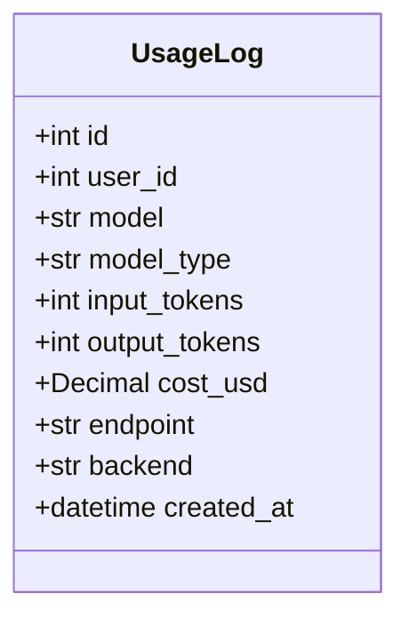

# Models — 資料庫模型定義

[English](README.md)

定義 PostgreSQL 資料表結構，使用 [SQLModel](https://sqlmodel.tiangolo.com/)（SQLAlchemy + Pydantic 整合）。

## 檔案

| 檔案 | 說明 |
|---|---|
| `schema.py` | `User`、`AppOwner`、`UsageLog`、`UsageDaily`、`UsageRollupState`、`AnomalyEvent`、`ConcurrencyLease` 七個 ORM Model，以及輔助函式 `is_app_account()`（`app_*` 前綴）與 `mask_api_key()`（Admin 列表的金鑰遮罩顯示） |

## ER Diagram



`usage_logs.user_id` 與 `concurrency_leases.user_id` 是邏輯參照，沒有外鍵約束。Admin 的 `delete_user` 會先清除所有參照該使用者的資料列（`app_owners`、舊版 `users.owner_id`、`anomaly_events`、`usage_logs`、leases）再刪除使用者；新增任何參照時也要一併加到那裡。

## User 模型

對應資料表 `users`。代表人類使用者或程式化 App 帳號。



### 欄位詳細說明

| 欄位 | 型別 | 約束 | 預設值 | 說明 |
|---|---|---|---|---|
| `id` | `INTEGER` | PK, auto-increment | — | 主鍵，資料庫自動產生 |
| `username` | `VARCHAR` | UNIQUE, INDEX | — | SSO 登入時的 `sub` claim。App 帳號以 `app_` 開頭（`is_app_account()`） |
| `password_hash` | `VARCHAR` | — | `""` | **未使用**。歷史欄位，保留以維持向後相容 |
| `api_key` | `VARCHAR` | UNIQUE, INDEX | `_generate_api_key()` | 自動產生，格式 `sk-internal-{unix_timestamp}-{8位hex}`。用於 API 認證。Admin 列表顯示 `mask_api_key(...)` |
| `daily_limit_usd` | `FLOAT` | — | `10.0` | 所有 backend 合計的每日花費上限（USD）。超過時 API 回傳 429 Too Many Requests。一律為有限值且 ≥ 0：**`0` 代表 $0 預算，不是無上限**。SSO 自動建立的使用者取 `[app].default_daily_limit_usd` |
| `azure_daily_limit_usd` | `FLOAT` | NULLABLE | `None` | **已停用，不再讀取**。舊的每人 Azure 子上限；保留到有 migration 移除為止。Admin API 收到此欄位會回 400 |
| `bedrock_daily_limit_usd` | `FLOAT` | NULLABLE | `None` | **已停用，不再讀取**。舊的每人 Bedrock 子上限；狀態同上 |
| `cloud_daily_limit_usd` | `FLOAT` | NULLABLE | `None` | 使用者的雲端上限：Azure + Bedrock 合計的每日花費。**NULL 代表沿用 `[app].cloud_daily_limit_usd`**，不是「無上限」；設定值（含 `0`，即拒絕雲端）則取代預設。只能透過 `deps.effective_cloud_limit` 讀取。僅適用於有 Azure 或 AWS 權限的使用者 |
| `is_admin` | `BOOLEAN` | — | `False` | 資料庫中的管理員標記。**注意：Web UI 的 admin 權限由 JWT scope 決定，不看此欄位** |
| `is_disabled` | `BOOLEAN` | — | `False` | `True` 時 API key 與 JWT 認證皆會丟出 `AccountDisabledError`(HTML 頁或 JSON 403)。**Admin 免檢查**。透過 `POST /admin/users/{id}/toggle-disable` 切換(禁止停用自己) |
| `can_use_azure` | `BOOLEAN` | — | `False` | 控制 `/azure/v1/*`（由 `deps.require_azure_access` 檢查）及統一 `/v1/*` 對 Azure 別名的分派。**Admin 免檢查**。透過 `POST /admin/users/{id}/toggle-azure` 切換 |
| `can_use_bedrock` | `BOOLEAN` | — | `False` | 控制 `/aws/v1/*`（由 `deps.require_bedrock_access` 檢查）及統一 `/v1/*` 對 Bedrock 別名的分派。**Admin 免檢查**。透過 `POST /admin/users/{id}/toggle-bedrock` 切換 |
| `concurrency_waived` | `BOOLEAN` | — | `False` | 免除並行上限（`[app].concurrency_limit_*`）。Admin 一律免除。App 帳號建立時即為免除。透過 `POST /admin/users/{id}/toggle-concurrency-waive` 切換 |
| `owner_id` | `INTEGER` | FK → `users.id`, INDEX, NULLABLE | `None` | **舊版**單一擁有者欄位，已由 `app_owners` 取代。Migration `d5a2c3e67f04` 複製資料時未清空，舊 App 帳號可能仍指向原擁有者 |
| `display_name` | `VARCHAR` | — | `""` | 使用者顯示名稱，來自 IdP JWT 的 `display_name` 欄位。每次 Web 登入時自動同步更新 |
| `org_code` | `VARCHAR` | — | `""` | 組織代碼，來自 IdP JWT 的 `org_code` 欄位。每次 Web 登入時自動同步更新。顯示於 Admin 使用者表格 |
| `created_at` | `DATETIME` | — | `datetime.now(UTC)` | 帳號建立時間 |

### API Key 產生邏輯

```python
def _generate_api_key() -> str:
    ts = int(datetime.now(timezone.utc).timestamp())
    short_hex = uuid.uuid4().hex[:8]
    return f"sk-internal-{ts}-{short_hex}"
```

範例：`sk-internal-1741651200-a1b2c3d4`

### 使用者類型區分

| 類型 | 判斷方式 | 說明 |
|---|---|---|
| 一般使用者 | 不以 `app_` 開頭 | SSO 登入後自動建立 |
| App 帳號 | `is_app_account(username)`（`username.startswith("app_")`） | Admin 建立，供程式使用（Admin 面板會自動加上前綴）。建立時 `concurrency_waived = True` |
| 被擁有的 App | `app_owners` 中有 `app_id = id` 的資料列 | 綁定一或多位使用者，owner 可在 Dashboard 管理 |

---

## AppOwner 模型

對應資料表 `app_owners`。多對多：哪些使用者擁有哪些 App 帳號。

| 欄位 | 型別 | 約束 | 預設值 | 說明 |
|---|---|---|---|---|
| `id` | `INTEGER` | PK, auto-increment | — | 主鍵 |
| `app_id` | `INTEGER` | FK → `users.id`, INDEX | — | App 帳號 |
| `owner_id` | `INTEGER` | FK → `users.id`, INDEX | — | 擁有者 |

---

## UsageLog 模型

對應資料表 `usage_logs`。每次計費的 API 請求產生一筆記錄（由 `_log_usage` 寫入；`render`、`tokenize`、`count_tokens` 等除錯與 metadata 呼叫不記錄）。這是計費與稽核紀錄。



### 欄位詳細說明

| 欄位 | 型別 | 約束 | 預設值 | 說明 |
|---|---|---|---|---|
| `id` | `INTEGER` | PK, auto-increment | — | 主鍵 |
| `user_id` | `INTEGER` | 複合索引 | — | 發起請求的使用者 ID。未設 FK 約束；`delete_user` 會明確刪除這些資料列 |
| `model` | `VARCHAR` | — | `""` | 使用者請求的模型別名（user-facing name，非 real_model） |
| `model_type` | `VARCHAR` | — | `""` | 模型類型。可能值：`llm`、`vlm`、`embedding`、`vision_embedding`、`reranker`、`vision_reranker`、`systemone` |
| `input_tokens` | `INTEGER` | — | `0` | 輸入 token 數量（`prompt_tokens`） |
| `output_tokens` | `INTEGER` | — | `0` | 輸出 token 數量（`completion_tokens`）。Embedding / Reranker 通常為 0,System One 一律為 0 |
| `cost_usd` | `NUMERIC(12,6)` | NOT NULL | `0` | 計算費用（USD）。精度到小數點後 6 位。依 per-1M-token 價格計算（見下方） |
| `endpoint` | `VARCHAR` | — | `""` | API 端點標籤，如 `/v1/chat/completions`、`/v1/embeddings`、`/v1/score`、`/azure/v1/responses` |
| `backend` | `VARCHAR` | NOT NULL, server default `'vllm'` | `"vllm"` | 實際處理請求的下游：`vllm`（地端）、`azure` 或 `bedrock`。用於區分雲端與地端花費，供雲端上限、Dashboard 與用量匯出使用 |
| `created_at` | `DATETIME` | 複合索引 | `datetime.now(UTC)` | 請求時間 |

### 費用計算公式

```
cost_usd = (uncached_input_tokens × input_price_per_1m
            + cached_input_tokens × cached_input_price_per_1m
            + output_tokens × output_price_per_1m) / 1,000,000
```

價格來自 `config.toml`：先看模型本身的覆寫值，其次 `[pricing.<type>]`，最後 `[pricing]`。只有在設定了 `cached_input_price_per_1m` 且 backend 回報快取命中時，快取的輸入 token 才以該價格計費；否則所有輸入一律以 `input_price_per_1m` 計費。

### 索引

| 索引名稱 | 欄位 | 用途 |
|---|---|---|
| `ix_usage_user_date_cost` | `user_id`, `created_at`, `cost_usd` | Covering index。每日限額查詢可 index-only scan，不需回表讀 cost_usd |
| `ix_usage_created_at` | `created_at` | DAU 統計、時間範圍查詢 |

---

## AnomalyEvent 模型

對應資料表 `anomaly_events`。每小時用量異常掃描（`scripts/scan_anomalies.py`）的偵測結果。僅偵測：這裡的任何資料都不會阻擋或限流請求。

每個 `(scope, rule, window_start)` 一筆：掃描採 upsert，重跑同一時間窗具冪等性，持續中的異常只更新同一筆（`window_end` / `observed` 增長）。告警旁路只能在資料列**建立**時觸發，更新時不可觸發。

| 欄位 | 型別 | 約束 | 預設值 | 說明 |
|---|---|---|---|---|
| `id` | `INTEGER` | PK, auto-increment | — | 主鍵 |
| `scope` | `VARCHAR` | UNIQUE（與 `rule`、`window_start`） | — | 帳號層級規則為 `user:<id>`，模型層級規則為 `model:<alias>` |
| `rule` | `VARCHAR` | UNIQUE（與 `scope`、`window_start`） | — | `cost_spike`、`off_hours`、`burst_rate`、`behavior_shift`、`empty_turn_rate` |
| `severity` | `VARCHAR` | — | `"warning"` | `info`、`warning`、`critical` |
| `user_id` | `INTEGER` | FK → `users.id`, INDEX, NULLABLE | `None` | `scope` 中使用者的反正規化副本，供 join 與顯示 |
| `model` | `VARCHAR` | NULLABLE | `None` | 反正規化的模型別名 |
| `window_start` | `DATETIME` | UNIQUE（與 `scope`、`rule`） | — | 偵測時間窗起點 |
| `window_end` | `DATETIME` | — | — | 偵測時間窗終點 |
| `observed` | `FLOAT` | — | `0.0` | 觀測值 |
| `baseline` | `FLOAT` | — | `0.0` | 基準值 |
| `ratio` | `FLOAT` | — | `0.0` | 觀測值 / 基準值 |
| `detail` | `VARCHAR` | — | `"{}"` | JSON：摘要與結構化脈絡 |
| `status` | `VARCHAR` | — | `"new"` | `new` → `acknowledged` → `resolved` |
| `created_at` | `DATETIME` | — | `datetime.now(UTC)` | 資料列建立時間 |
| `updated_at` | `DATETIME` | — | `datetime.now(UTC)` | 最後一次 upsert 時間 |

### 索引與約束

| 名稱 | 欄位 | 用途 |
|---|---|---|
| `uq_anomaly_scope_rule_window` | `scope`, `rule`, `window_start` | UNIQUE — upsert 鍵 |
| `ix_anomaly_status_created` | `status`, `created_at` | Admin 依狀態列出 |
| `ix_anomaly_events_user_id` | `user_id` | 依使用者查詢與刪除使用者 |

---

## ConcurrencyLease 模型

對應資料表 `concurrency_leases`。每個佔用並行名額、進行中的受限請求一筆（`app/services/concurrency.py`）。受限請求開始時插入，回應（含串流）完整送出後刪除。已終止 worker 的 lease 由各 worker 的清掃移除（同主機上已不存在的 pid、被回收重用的 pid），否則在 `expires_at` 過後移除；擁有該 lease 的 worker 每次 heartbeat 都會把 `expires_at` 往後延。

| 欄位 | 型別 | 約束 | 預設值 | 說明 |
|---|---|---|---|---|
| `id` | `VARCHAR` | PK | — | Lease ID |
| `user_id` | `INTEGER` | 複合索引 | — | Lease 持有者。未設 FK 約束：資料列生命週期短，且 `delete_user` 會明確刪除 |
| `worker_id` | `VARCHAR` | INDEX | — | 所屬 worker 的 `<hostname>:<pid>:<boot token>` |
| `endpoint` | `VARCHAR` | — | `""` | 端點標籤 |
| `created_at` | `DATETIME` | — | — | 取得時間，**naive UTC** |
| `expires_at` | `DATETIME` | 複合索引 | — | TTL 到期時間，**naive UTC** |

時間戳記為 naive UTC（不同於其他資料表的 aware 值），如此 PostgreSQL session 的 `TimeZone` 永遠不會在寫入與比較之間位移時間。

### 索引

| 索引名稱 | 欄位 | 用途 |
|---|---|---|
| `ix_concurrency_user_expires` | `user_id`, `expires_at` | 計算使用者的有效 lease 數 |
| `ix_concurrency_leases_worker_id` | `worker_id` | Heartbeat 續約與已終止 worker 清掃 |

---

## UsageDaily 模型

對應 `usage_daily` 資料表。`usage_logs` 以台北日（Asia/Taipei）為單位的彙總，只由 gateway 背景結算（`app/services/usage_rollup.py`）寫入，且只寫已結束的日子。報表透過 `usage_rollup.aggregate` 讀取：已結算的日子讀這裡，其餘讀 `usage_logs`。詳見 [docs/architecture.md](../../docs/architecture.md#daily-usage-rollup-appservicesusage_rolluppy)。

| 欄位 | 型別 | 約束 | 預設值 | 說明 |
|---|---|---|---|---|
| `day` | `DATE` | PK | — | 台北日期 |
| `user_id` | `INTEGER` | PK | — | 無 FK 約束（同 `usage_logs`）；`delete_user` 會明確刪除 |
| `backend` | `VARCHAR` | PK | — | `vllm`、`azure`、`bedrock` |
| `model` | `VARCHAR` | PK | — | 模型別名 |
| `model_type` | `VARCHAR` | PK | — | `llm`、`vlm`、`embedding` 等 |
| `endpoint` | `VARCHAR` | PK | — | Endpoint 標籤 |
| `requests` | `BIGINT` | — | `0` | 請求數 |
| `input_tokens` / `output_tokens` | `BIGINT` | — | `0` | Token 加總 |
| `cost_usd` | `NUMERIC(16,6)` | — | `0` | 成本加總 |
| `empty_turns` | `BIGINT` | — | `0` | `output_tokens <= 1` 的請求數 |

| 索引名稱 | 欄位 | 用途 |
|---|---|---|
| `usage_daily_pkey` | `day`, `user_id`, `backend`, `model`, `model_type`, `endpoint` | 依日期範圍讀取 |
| `ix_usage_daily_user_day` | `user_id`, `day` | 單一使用者讀取（dashboard） |

## UsageRollupState 模型

對應 `usage_rollup_state` 資料表。只有一列（`name = "usage_daily"`），`rolled_through`（`DATE`）之前（含）的每一天都已在 `usage_daily` 中，沒有缺漏。沒有這一列代表尚未結算過，報表全部讀 `usage_logs`。
