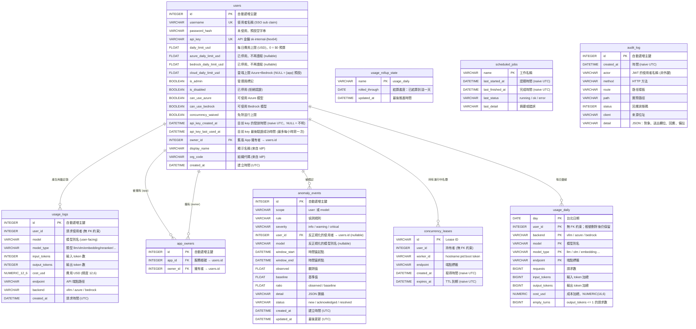
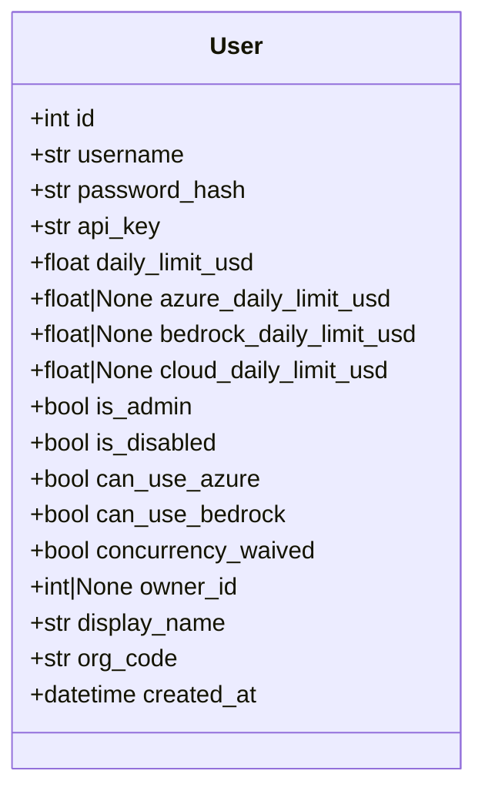
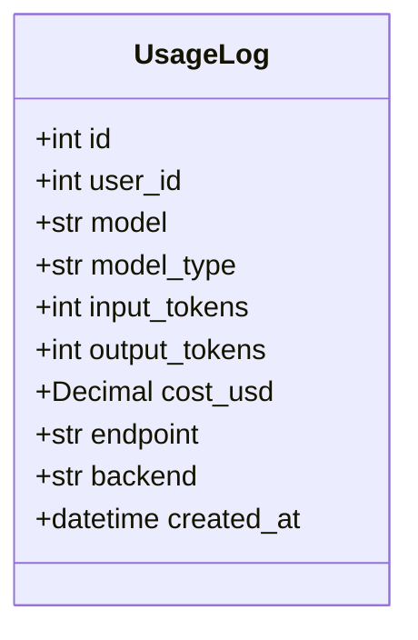

# Models — 資料庫模型定義

[English](README.md)

定義 PostgreSQL 資料表結構，使用 [SQLModel](https://sqlmodel.tiangolo.com/)（SQLAlchemy + Pydantic 整合）。

## 檔案

| 檔案 | 說明 |
|---|---|
| `schema.py` | `User`、`AppOwner`、`UsageLog`、`UsageDaily`、`UsageRollupState`、`ScheduledJob`、`AnomalyEvent`、`ConcurrencyLease`、`IpAllowRule`、`AuditLog` 十個 ORM Model，以及輔助函式 `service_account_clause()` / `service_account_names()`（誰是服務帳號：看 `is_service_account` 欄位）、`mask_api_key()`（Admin 列表的金鑰遮罩顯示）、`issue_api_key()`（發放／重發 key 的唯一入口）與 `is_legacy_api_key()`（判斷舊格式 key） |

## ER Diagram



`usage_logs.user_id` 與 `concurrency_leases.user_id` 是邏輯參照，沒有外鍵約束。Admin 的 `delete_user` 會先清除所有參照該使用者的資料列（`app_owners`、舊版 `users.owner_id`、`anomaly_events`、leases）再刪除使用者；新增任何外鍵時也要一併加到那裡。`usage_logs` 與 `usage_daily` 刻意保留：它們是計費與稽核紀錄，刪除時會在 log 記下 id 對應的帳號。

## User 模型

對應資料表 `users`。代表人類使用者或程式化服務帳號。



### 欄位詳細說明

| 欄位 | 型別 | 約束 | 預設值 | 說明 |
|---|---|---|---|---|
| `id` | `INTEGER` | PK, auto-increment | — | 主鍵，資料庫自動產生 |
| `username` | `VARCHAR` | UNIQUE, INDEX | — | 一般使用者是 SSO 登入時的 `sub` claim；服務帳號可以是任何名稱（舊的是 `app_*`；名稱不決定任何事，見 `is_service_account`） |
| `password_hash` | `VARCHAR` | — | `""` | **未使用**。歷史欄位，保留以維持向後相容 |
| `api_key` | `VARCHAR` | UNIQUE, INDEX | `_generate_api_key()` | 自動產生，格式 `sk-internal-` + 64 位 hex（256 bits 隨機）。舊格式 `sk-internal-{unix_timestamp}-{8位hex}` 仍可使用，由 `is_legacy_api_key` 辨識。用於 API 認證。Admin 列表顯示 `mask_api_key(...)` |
| `daily_limit_usd` | `FLOAT` | — | `10.0` | 所有 backend 合計的每日花費上限（USD）。超過時 API 回傳 429 Too Many Requests。一律為有限值且 ≥ 0：**`0` 代表 $0 預算，不是無上限**。SSO 自動建立的使用者取 `[app].default_daily_limit_usd` |
| `azure_daily_limit_usd` | `FLOAT` | NULLABLE | `None` | **已停用，不再讀取**。舊的每人 Azure 子上限；保留到有 migration 移除為止。Admin API 收到此欄位會回 400 |
| `bedrock_daily_limit_usd` | `FLOAT` | NULLABLE | `None` | **已停用，不再讀取**。舊的每人 Bedrock 子上限；狀態同上 |
| `cloud_daily_limit_usd` | `FLOAT` | NULLABLE | `None` | 使用者的雲端上限：Azure + Bedrock 合計的每日花費。**NULL 代表沿用 `[app].cloud_daily_limit_usd`**，不是「無上限」；設定值（含 `0`，即拒絕雲端）則取代預設。只能透過 `deps.effective_cloud_limit` 讀取。僅適用於有 Azure 或 AWS 權限的使用者 |
| `is_admin` | `BOOLEAN` | — | `False` | **已退役。** 誰是 admin 由 AuthCenter token 的 `admin` scope 決定。這個欄位不再給予任何權限：API key 驗證時會清掉這個屬性、管理 API 收到此欄位回 400、任何列表都不顯示。`get_web_user` 只在單次請求中借用這個屬性，把 scope 帶給頁面 |
| `is_disabled` | `BOOLEAN` | — | `False` | `True` 時 API key 與 JWT 認證皆會丟出 `AccountDisabledError`(HTML 頁或 JSON 403)。在 Web UI 上，token 帶 admin scope 的人不受此限；API 上沒有例外。透過 `POST /admin/users/{id}/toggle-disable` 切換(禁止停用自己) |
| `can_use_azure` | `BOOLEAN` | — | `False` | 控制 `/azure/v1/*`（由 `deps.require_azure_access` 檢查）及統一 `/v1/*` 對 Azure 別名的分派。透過 `POST /admin/users/{id}/toggle-azure` 切換 |
| `can_use_bedrock` | `BOOLEAN` | — | `False` | 控制 `/aws/v1/*`（由 `deps.require_bedrock_access` 檢查）及統一 `/v1/*` 對 Bedrock 別名的分派。透過 `POST /admin/users/{id}/toggle-bedrock` 切換 |
| `concurrency_waived` | `BOOLEAN` | — | `False` | 免除並行上限（`[app].concurrency_limit_*`）。這是唯一的免除方式。服務帳號建立時即為免除。透過 `POST /admin/users/{id}/toggle-concurrency-waive` 切換 |
| `is_service_account` | `BOOLEAN` | — | `False` | 給程式用而不是給人用的帳號（原本叫 app 帳號，當時靠 `app_` 開頭的名稱辨識）。所有區分兩者的地方都看它：admin 的兩張表、以人計算的數字、寄信、guardrail 範圍，以及沒有人能用它的名稱登入 |
| `owner_id` | `INTEGER` | FK → `users.id`, INDEX, NULLABLE | `None` | **舊版**單一擁有者欄位，已由 `app_owners` 取代。Migration `d5a2c3e67f04` 複製資料時未清空，舊服務帳號可能仍指向原擁有者 |
| `display_name` | `VARCHAR` | — | `""` | 使用者顯示名稱，來自 IdP JWT 的 `display_name` 欄位。每次 Web 登入時自動同步更新 |
| `org_code` | `VARCHAR` | — | `""` | 組織代碼，來自 IdP JWT 的 `org_code` 欄位。每次 Web 登入時自動同步更新。顯示於 Admin 使用者表格 |
| `created_at` | `DATETIME` | — | `datetime.now(UTC)` | 帳號建立時間 |
| `api_key_created_at` | `DATETIME` | 可為 NULL | `datetime.now(UTC)`（naive） | 目前這把 key 的發放時間；`issue_api_key` 重設。NULL = 不明（只有舊格式 key 能回填） |
| `api_key_last_used_at` | `DATETIME` | 可為 NULL | — | 這把 key 最後一次驗證成功的時間，**naive UTC**，最多每小時寫一次（`deps._record_key_use`）；NULL = 從未使用。由 `usage_logs` 回填 |

### API Key 產生邏輯

```python
def _generate_api_key() -> str:
    return API_KEY_PREFIX + secrets.token_hex(32)   # "sk-internal-" + 64 hex
```

範例：`sk-internal-3f9c…`（共 76 字元）。舊格式 `sk-internal-1741651200-a1b2c3d4` 的 key 仍可驗證（驗證是逐字比對）；dashboard 會提醒持有人重新產生，admin 使用者表可用 **Older-format API key** 篩出。

### 使用者類型區分

| 類型 | 判斷方式 | 說明 |
|---|---|---|
| 一般使用者 | `is_service_account = False` | SSO 登入後自動建立 |
| 服務帳號（原本叫 app 帳號） | `is_service_account = True`（SQL 用 `schema.service_account_clause()`） | Admin 建立，供程式使用，名稱不限。只能用 API key：用它的名稱做 SSO 登入會被拒絕。建立時 `concurrency_waived = True`。Migration `b2f7c9a41e68` 已標記既有的 `app_*` 帳號 |
| 被擁有的 App | `app_owners` 中有 `app_id = id` 的資料列 | 綁定一或多位使用者，owner 可在 Dashboard 管理 |

---

## AppOwner 模型

對應資料表 `app_owners`。多對多：哪些使用者擁有哪些服務帳號。

| 欄位 | 型別 | 約束 | 預設值 | 說明 |
|---|---|---|---|---|
| `id` | `INTEGER` | PK, auto-increment | — | 主鍵 |
| `app_id` | `INTEGER` | FK → `users.id`, INDEX | — | 服務帳號 |
| `owner_id` | `INTEGER` | FK → `users.id`, INDEX | — | 擁有者 |

---

## UsageLog 模型

對應資料表 `usage_logs`。每次計費的 API 請求產生一筆記錄（由 `_log_usage` 寫入；`render`、`tokenize`、`count_tokens` 等除錯與 metadata 呼叫不記錄）。這是計費與稽核紀錄。



### 欄位詳細說明

| 欄位 | 型別 | 約束 | 預設值 | 說明 |
|---|---|---|---|---|
| `id` | `INTEGER` | PK, auto-increment | — | 主鍵 |
| `user_id` | `INTEGER` | 複合索引 | — | 發起請求的使用者 ID。未設 FK 約束：帳號刪除後資料列仍保留（`delete_user` 不刪） |
| `model` | `VARCHAR` | — | `""` | 使用者請求的模型別名（user-facing name，非 real_model） |
| `model_type` | `VARCHAR` | — | `""` | 模型類型。可能值：`llm`、`vlm`、`embedding`、`vision_embedding`、`reranker`、`vision_reranker`、`systemone` |
| `input_tokens` | `INTEGER` | — | `0` | 輸入 token 數量（`prompt_tokens`） |
| `output_tokens` | `INTEGER` | — | `0` | 輸出 token 數量（`completion_tokens`）。Embedding / Reranker 通常為 0,System One 一律為 0 |
| `cost_usd` | `NUMERIC(12,6)` | NOT NULL | `0` | 計算費用（USD）。精度到小數點後 6 位。依 per-1M-token 價格計算（見下方） |
| `endpoint` | `VARCHAR` | — | `""` | API 端點標籤，如 `/v1/chat/completions`、`/v1/embeddings`、`/v1/score`、`/azure/v1/responses` |
| `backend` | `VARCHAR` | NOT NULL, server default `'vllm'` | `"vllm"` | 實際處理請求的下游：`vllm`（地端）、`azure` 或 `bedrock`。用於區分雲端與地端花費，供雲端上限、Dashboard 與用量匯出使用 |
| `created_at` | `DATETIME` | 複合索引 | `datetime.now(UTC)` | 請求時間 |

### 費用計算公式

```
cost_usd = (uncached_input_tokens × input_price_per_1m
            + cached_input_tokens × cached_input_price_per_1m
            + output_tokens × output_price_per_1m) / 1,000,000
```

價格來自 `config.toml`：先看模型本身的覆寫值，其次 `[pricing.<type>]`，最後 `[pricing]`。只有在設定了 `cached_input_price_per_1m` 且 backend 回報快取命中時，快取的輸入 token 才以該價格計費；否則所有輸入一律以 `input_price_per_1m` 計費。

### 索引

| 索引名稱 | 欄位 | 用途 |
|---|---|---|
| `ix_usage_user_date_cost` | `user_id`, `created_at`, `cost_usd` | Covering index。每日限額查詢可 index-only scan，不需回表讀 cost_usd |
| `ix_usage_created_at` | `created_at` | DAU 統計、時間範圍查詢 |

---

## AnomalyEvent 模型

對應資料表 `anomaly_events`。gateway 每小時執行的用量異常掃描（`app/services/anomaly_scan.py`；`scripts/scan_anomalies.py` 可手動執行）的偵測結果。僅偵測：這裡的任何資料都不會阻擋或限流請求。

每個 `(scope, rule, window_start)` 一筆：掃描採 upsert，重跑同一時間窗具冪等性，持續中的異常只更新同一筆（`window_end` / `observed` 增長）。告警旁路只能在資料列**建立**時觸發，更新時不可觸發。

| 欄位 | 型別 | 約束 | 預設值 | 說明 |
|---|---|---|---|---|
| `id` | `INTEGER` | PK, auto-increment | — | 主鍵 |
| `scope` | `VARCHAR` | UNIQUE（與 `rule`、`window_start`） | — | 帳號層級規則為 `user:<id>`，模型層級規則為 `model:<alias>` |
| `rule` | `VARCHAR` | UNIQUE（與 `scope`、`window_start`） | — | `cost_spike`、`off_hours`、`burst_rate`、`behavior_shift`、`empty_turn_rate` |
| `severity` | `VARCHAR` | — | `"warning"` | `info`、`warning`、`critical` |
| `user_id` | `INTEGER` | FK → `users.id`, INDEX, NULLABLE | `None` | `scope` 中使用者的反正規化副本，供 join 與顯示 |
| `model` | `VARCHAR` | NULLABLE | `None` | 反正規化的模型別名 |
| `window_start` | `DATETIME` | UNIQUE（與 `scope`、`rule`） | — | 偵測時間窗起點 |
| `window_end` | `DATETIME` | — | — | 偵測時間窗終點 |
| `observed` | `FLOAT` | — | `0.0` | 觀測值 |
| `baseline` | `FLOAT` | — | `0.0` | 基準值 |
| `ratio` | `FLOAT` | — | `0.0` | 觀測值 / 基準值 |
| `detail` | `VARCHAR` | — | `"{}"` | JSON：摘要與結構化脈絡 |
| `status` | `VARCHAR` | — | `"new"` | `new` → `acknowledged` → `resolved` |
| `created_at` | `DATETIME` | — | `datetime.now(UTC)` | 資料列建立時間 |
| `updated_at` | `DATETIME` | — | `datetime.now(UTC)` | 最後一次 upsert 時間 |

### 索引與約束

| 名稱 | 欄位 | 用途 |
|---|---|---|
| `uq_anomaly_scope_rule_window` | `scope`, `rule`, `window_start` | UNIQUE — upsert 鍵 |
| `ix_anomaly_status_created` | `status`, `created_at` | Admin 依狀態列出 |
| `ix_anomaly_events_user_id` | `user_id` | 依使用者查詢與刪除使用者 |

---

## ConcurrencyLease 模型

對應資料表 `concurrency_leases`。每個佔用並行名額、進行中的受限請求一筆（`app/services/concurrency.py`）。受限請求開始時插入，回應（含串流）完整送出後刪除。已終止 worker 的 lease 由各 worker 的清掃移除（同主機上已不存在的 pid、被回收重用的 pid），否則在 `expires_at` 過後移除；擁有該 lease 的 worker 每次 heartbeat 都會把 `expires_at` 往後延。

| 欄位 | 型別 | 約束 | 預設值 | 說明 |
|---|---|---|---|---|
| `id` | `VARCHAR` | PK | — | Lease ID |
| `user_id` | `INTEGER` | 複合索引 | — | Lease 持有者。未設 FK 約束：資料列生命週期短，且 `delete_user` 會明確刪除 |
| `worker_id` | `VARCHAR` | INDEX | — | 所屬 worker 的 `<hostname>:<pid>:<boot token>` |
| `endpoint` | `VARCHAR` | — | `""` | 端點標籤 |
| `created_at` | `DATETIME` | — | — | 取得時間，**naive UTC** |
| `expires_at` | `DATETIME` | 複合索引 | — | TTL 到期時間，**naive UTC** |

時間戳記為 naive UTC（不同於其他資料表的 aware 值），如此 PostgreSQL session 的 `TimeZone` 永遠不會在寫入與比較之間位移時間。

### 索引

| 索引名稱 | 欄位 | 用途 |
|---|---|---|
| `ix_concurrency_user_expires` | `user_id`, `expires_at` | 計算使用者的有效 lease 數 |
| `ix_concurrency_leases_worker_id` | `worker_id` | Heartbeat 續約與已終止 worker 清掃 |

---

## UsageDaily 模型

對應 `usage_daily` 資料表。`usage_logs` 以台北日（Asia/Taipei）為單位的彙總，只由 gateway 背景結算（`app/services/usage_rollup.py`）寫入，且只寫已結束的日子。報表透過 `usage_rollup.aggregate` 讀取：已結算的日子讀這裡，其餘讀 `usage_logs`。詳見 [docs/architecture.md](../../docs/architecture.md#daily-usage-rollup-appservicesusage_rolluppy)。

| 欄位 | 型別 | 約束 | 預設值 | 說明 |
|---|---|---|---|---|
| `day` | `DATE` | PK | — | 台北日期 |
| `user_id` | `INTEGER` | PK | — | 無 FK 約束（同 `usage_logs`）；帳號刪除後仍保留 |
| `backend` | `VARCHAR` | PK | — | `vllm`、`azure`、`bedrock` |
| `model` | `VARCHAR` | PK | — | 模型別名 |
| `model_type` | `VARCHAR` | PK | — | `llm`、`vlm`、`embedding` 等 |
| `endpoint` | `VARCHAR` | PK | — | Endpoint 標籤 |
| `requests` | `BIGINT` | — | `0` | 請求數 |
| `input_tokens` / `output_tokens` | `BIGINT` | — | `0` | Token 加總 |
| `cost_usd` | `NUMERIC(16,6)` | — | `0` | 成本加總 |
| `empty_turns` | `BIGINT` | — | `0` | `output_tokens <= 1` 的請求數 |

| 索引名稱 | 欄位 | 用途 |
|---|---|---|
| `usage_daily_pkey` | `day`, `user_id`, `backend`, `model`, `model_type`, `endpoint` | 依日期範圍讀取 |
| `ix_usage_daily_user_day` | `user_id`, `day` | 單一使用者讀取（dashboard） |

## UsageRollupState 模型

對應 `usage_rollup_state` 資料表。只有一列（`name = "usage_daily"`），`rolled_through`（`DATE`）之前（含）的每一天都已在 `usage_daily` 中，沒有缺漏。沒有這一列代表尚未結算過，報表全部讀 `usage_logs`。

## ScheduledJob 模型

對應 `scheduled_jobs` 資料表。gateway 內建週期性工作（異常掃描、usage log 保留期清理；`app/services/scheduler.py`）每個工作一列：`name`（PK）、`last_started_at`、`last_finished_at`（naive UTC）、`last_status`（`running` / `ok` / `error`）、`last_detail`。worker 以條件式 UPDATE `last_started_at` 認領工作，所以每個週期在所有 worker 與主機之間只會執行一次。

## IpAllowRule 模型

對應 `ip_allow_rules` 資料表：API IP 白名單（`app/services/ip_allowlist.py`）。欄位有 `cidr`、`label`、`usernames` / `org_codes`（JSON 清單；兩者皆空 = 所有帳號）、`created_by`（使用者名稱，非外鍵）、可選的 `starts_at` / `expires_at`（naive UTC；沒有結束時間 = 永久）、`created_at`。存的是使用者名稱與部門代碼，不是 user id，所以刪除帳號不會動到這張表。

## Client rule 相關資料表

管理面板 *Clients* 分頁背後的四張表（`app/services/client_rules.py`；詳見 `docs/architecture.md` 的 Client rules）。它們存的是 username 和 check id，不是 foreign key，所以刪除帳號或讓 check 退役都不會動到它們。

| 資料表（model） | 每列代表 | 內容 |
|---|---|---|
| `client_rule_settings`（`ClientRuleSetting`） | admin 儲存過的一個內建 check（`rule_id`，例如 `CC001`） | 開關、動作、標題、訊息、給所有人以及 Azure / AWS 帳號的 patch、信件主旨、自動寄信與重複週期。沒有列 = 程式內的預設值。不含任何偵測條件 |
| `client_violations`（`ClientViolation`） | check × 帳號 | 首次 / 最後看到的時間、Claude Code 版本、最後一次終端機提醒的日期、寄信狀態（`mailed_at`、`mail_attempted_at`、`mail_error`、`mail_requested_at`）、`resolved_at`（帳號表示已套用修正） |
| `client_versions`（`ClientVersion`） | 帳號 × Claude Code 版本 | 最後看到的時間（來自 User-Agent） |
| `client_mail_log`（`ClientMailLog`） | 一次寄信嘗試 | 時間、帳號、收件地址、主旨、涵蓋的 check、原因（`requested` / `automatic` / `test`）、成功或失敗與錯誤、測試信是哪位 admin 寄的。只新增不修改；不存信件內容 |

## AuditLog 模型

對應 `audit_log` 資料表：由 `AuditMiddleware`（`app/services/audit.py`）寫入的 Web UI / admin 操作稽核紀錄。`/admin`、`/dashboard` 底下每一個 POST / PUT / PATCH / DELETE（不論成功與否）、每次顯示完整 API key、每次資料匯出，各記一列。

| 欄位 | 型別 | 說明 |
|---|---|---|
| `id` | `INTEGER` | 主鍵 |
| `created_at` | `DATETIME` | 時間，**naive UTC**（有索引，另有 `(actor, created_at)` 索引） |
| `actor` | `VARCHAR` | JWT 的 `sub`（使用者名稱）；未登入時為空。不是外鍵：帳號刪除後紀錄仍保留 |
| `method`、`route`、`path` | `VARCHAR` | HTTP 方法、路徑樣板（`/admin/users/{user_id}/limit`）與實際路徑 |
| `status` | `INTEGER` | 回應狀態碼；handler 拋出例外時為 500 |
| `client` | `VARCHAR` | `request.client.host` |
| `detail` | `VARCHAR`（JSON） | `target`（路徑指到的帳號，在 handler 執行前查好）、`request`（送出的欄位）、`response`（小型 JSON 回應）、handler 補充的備註（例如 `config_changes`）。像金鑰的欄位一律記成 `<redacted>` |

只能新增：程式不會修改或刪除任何一列；PostgreSQL 上另有 trigger 拒絕 UPDATE、DELETE 和 TRUNCATE（migration `07899844c700`）。不做保留期清理。
