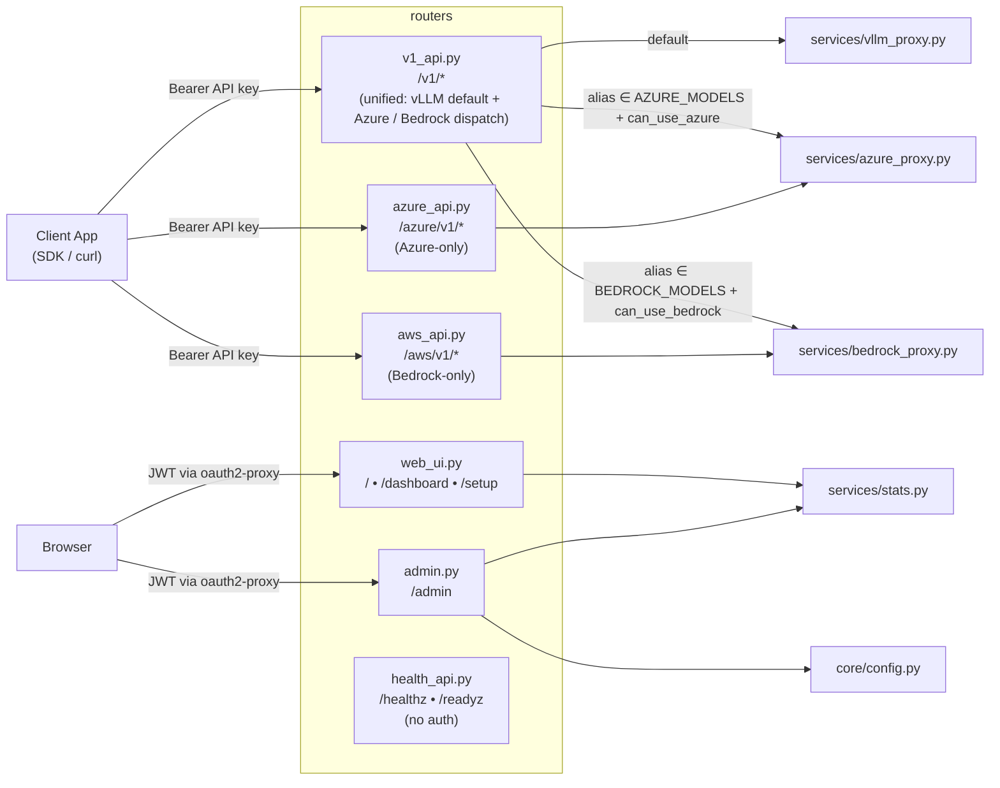

# Routers — API Endpoints and Page Routes

[中文版](README.zh-TW.md)

Defines FastAPI routes: the unified `/v1/*` public API, the Azure-only `/azure/v1/*` API, the Bedrock-only `/aws/v1/*` API, Web UI pages, Admin management, and the unauthenticated health probes.

## Module Overview



---

## `v1_api.py` — Unified `/v1/*` API (OpenAI- and Anthropic-compatible)

**Auth**: `deps.get_current_user` (API key + daily limit check). `chat/completions`, `responses` and `messages` use `deps.limited_current_user` (same check plus a concurrency slot); `/v1/me` uses `deps.get_current_user_unmetered` (no daily-limit 429).

`v1_api.py` is the main public entry. It serves the vLLM backend by default, and dispatches to a cloud backend when the requested `model` alias is configured there and the caller may use it (admins bypass both flags):

- **Azure**: alias under `[azure_models.*]` + `can_use_azure` → chat / responses / messages / count_tokens.
- **Bedrock**: alias under `[bedrock_models.*]` + `can_use_bedrock` → chat / messages / count_tokens.

One base URL surfaces every backend to clients like Claude Code's model picker. Routes are also exposed without the `/v1` prefix to accommodate clients (Roo Code, Cline, Cursor, Anthropic SDK) whose base URL omits it.

### Endpoints

| Method | Path(s) | Description | Proxy Method | Allowed Types |
|---|---|---|---|---|
| `GET` | `/v1/models`, `/models` | List models (LLM/VLM only, `hidden` entries left out). Azure aliases merged in for users with `can_use_azure`, Bedrock aliases for `can_use_bedrock` (admins bypass) | Direct response | `llm`, `vlm` |
| `GET` | `/v1/me`, `/me` | Caller's access (on-prem / Azure / AWS) and today's budget per backend. Auth skips the daily-limit 429 so it answers when the budget is spent | Direct response | — |
| `POST` | `/v1/chat/completions`, `/chat/completions` | Chat completion generation | `vllm_forward_chat_completions` (vLLM) / `azure_forward_chat_completions` (Azure) / `bedrock_forward_chat_completions` (Bedrock) | `llm`, `vlm` |
| `POST` | `/v1/responses`, `/responses` | Responses API (no Bedrock dispatch: a Bedrock alias falls back to vLLM) | `vllm_forward_responses` (vLLM) / `azure_forward_responses` (Azure) | `llm`, `vlm` |
| `POST` | `/v1/embeddings`, `/embeddings` | Text embeddings | `vllm_forward_simple_request` | `embedding`, `vision_embedding` |
| `POST` | `/v1/rerank`, `/rerank` | Document reranking | `vllm_forward_simple_request` | `reranker`, `vision_reranker` |
| `POST` | `/v1/score`, `/score` | Relevance scoring | `vllm_forward_simple_request` | `reranker`, `vision_reranker` |
| `POST` | `/v1/systemone`, `/systemone` | System One typed decisions (TypeSafe's wire format; the path the TypeSafe Python SDK calls). `model` optional — absent means the systemone default. On-prem only | `vllm_forward_systemone` | `systemone` |
| `POST` | `/v1/messages`, `/messages` | Anthropic Messages (translates to OpenAI; streams `reasoning_content` as `thinking` blocks; emits SSE `ping` every 10 s of downstream silence) | `vllm_forward_messages` (vLLM) / `azure_forward_messages` (Azure) / `bedrock_forward_messages` (Bedrock) | `llm`, `vlm` |
| `POST` | `/v1/messages/count_tokens`, `/messages/count_tokens` | Anthropic token counting (forwards to vLLM `/tokenize`, falls back to chars/4; Azure and Bedrock paths use a chars/4 estimate). Not billed | `vllm_forward_count_tokens` (vLLM) / `azure_forward_count_tokens` (Azure) / `bedrock_forward_count_tokens` (Bedrock) | `llm`, `vlm` |
| `POST` | `/v1/tokenize`, `/tokenize` | vLLM-native pass-through tokenize (no cloud path — neither Azure nor Bedrock has a tokenize endpoint) | `vllm_forward_tokenize` | `llm`, `vlm` |
| `POST` | `/v1/chat/completions/render`, `/chat/completions/render` | vLLM-native pass-through render — chat template applied, nothing generated (debug aid; on-prem vLLM only, no Azure/Bedrock path). The only route carrying a documented request body in `/docs`, declared via `openapi_extra` so nothing is validated away. `decoded_prompt` (detokenized text) is added by default; `?decode=false` for a pure pass-through. Not billed and not sent to Langfuse | `vllm_forward_render` | `llm`, `vlm` |

### Dispatch logic

Helpers `_peek_model_alias` + `_route_to_azure` + `_route_to_bedrock` determine routing:

```
alias in AZURE_MODELS   AND (can_use_azure or is_admin)   → Azure path   (chat, responses, messages, count_tokens)
alias in BEDROCK_MODELS AND (can_use_bedrock or is_admin) → Bedrock path (chat, messages, count_tokens)
alias in AZURE_MODELS / BEDROCK_MODELS, no permission     → vLLM path (silent fallback via _resolve_model)
anything else                                             → vLLM path
```

`/v1/responses` has no Bedrock dispatch (Converse has no Responses-style API), so a Bedrock alias posted there falls back to vLLM.

A cloud-bound request (count_tokens included) then passes `_cloud_budget_gate` (the daily cloud cap, Azure + Bedrock together). Exhausted → 429 by default; with `[app].cloud_budget_fallback = true` (admin panel → Cloud Budget Fallback) the request drops through to the vLLM path instead and the response carries `X-Budget-Fallback`. The overall daily limit is still enforced at auth, so a user with no budget left anywhere gets the usual 429 either way; `/azure/v1/*` and `/aws/v1/*` never fall back.

**Concurrency limit**: `chat_completions`, `responses` and `messages` (and their `/azure/v1/*` / `/aws/v1/*` counterparts) authenticate through `deps.limited_current_user` / `limited_azure_access` / `limited_bedrock_access` instead of the plain auth dependencies. Those hold a row in `concurrency_leases` until the response — stream included — has been sent, and 429 an account already at `[app].concurrency_limit` in-flight requests when the mode is `enforce` (admin panel → Concurrency Limit; admins and waived accounts exempt). `count_tokens`, `tokenize`, `render`, `models`, embeddings, rerank and systemone are not counted. See `app/services/concurrency.py`.

The "cloud alias from a user without the flag → vLLM fallback" branch matches the gateway's longstanding liberal alias handling. Cloud-backend existence is hidden via the per-user `/v1/models` filter rather than a 404 at request time. `MODEL_ROUTING`, `AZURE_MODELS` and `BEDROCK_MODELS` must not share alias names — `_build_config` raises `ValueError` at startup if they do, and `PUT /admin/api/config` rejects a collision before writing.

### Proxy Methods

| Method | Streaming | Use Case | Features |
|---|---|---|---|
| `vllm_forward_chat_completions` | stream + non-stream | Chat Completions | SSE parsing, auto-injects `stream_options.include_usage` |
| `vllm_forward_simple_request` | non-stream only | Embeddings, Rerank, Score | 120s timeout, handles reranker total_tokens reporting |
| `vllm_forward_responses` | stream + non-stream | Responses API | Raw pass-through, only replaces model field |
| `vllm_forward_messages` | stream + non-stream | Anthropic Messages | Anthropic→OpenAI request, OpenAI→Anthropic response (uses `services/anthropic_adapter.py`) |
| `vllm_forward_count_tokens` | non-stream | `count_tokens` | Forwards to vLLM `/tokenize`; falls back to chars/4 if downstream tokenizer unavailable; not billed |
| `vllm_forward_tokenize` | non-stream | `/tokenize` | vLLM-native pass-through; not billed |
| `vllm_forward_systemone` | non-stream | `/systemone` | Body forwarded verbatim to `{server root}/v1/systemone`, `base_url` with or without `/v1` (only `model` rewritten; the response's `model` set to the alias); billed on `input_tokens + cached_tokens` (decider reports its cached schema prefix beside `input_tokens`); Phase 2 captures `{state, questions}` → `answers` |
| `vllm_forward_render` | non-stream | `/chat/completions/render` | vLLM-native pass-through; applies the same reasoning-dialect alignment as chat completions, swaps the alias back onto the echoed `model`; adds `decoded_prompt` via the same server's `/detokenize` by default (best-effort — failures land in `decode_error`; `?decode=false` opts out); not billed, not observed |

### Common Behavior

All vLLM proxy methods share `_resolve_model()` for health-aware routing:

```
1. Exact match + server alive → use directly
2. Server DOWN → use configured fallback of same type
3. No match found → use any alive server of same type
4. No alive servers → best-effort try any server of compatible type
```

When fallback occurs, the response includes an `X-Model-Fallback` header explaining the reason.

---

## `azure_api.py` — Azure OpenAI Compatibility

**Auth**: `deps.require_azure_access` (wraps `get_current_user`, additionally checks `user.can_use_azure` — admins bypass — and the daily cloud cap) — same gateway API key + daily limit as `/v1/*`, plus a per-user Azure access flag. `chat/completions`, `responses` and `messages` go through `deps.limited_azure_access` (same checks plus a concurrency slot).

Same client API key, same usage logging, same observability as the `/v1/*` path. Only the downstream URL/header conventions differ — handled by `services/azure_proxy.py`. Azure deployments are configured under `[azure_models.<alias>]` in `config.toml`. Users without `can_use_azure` (and not admin) get 403 with `"Azure access not granted. Contact your administrator."`; an exhausted cloud cap is a 429 (no on-prem fallback on this prefix).

### Endpoints

| Method | Path | Description | Proxy Method |
|---|---|---|---|
| `GET` | `/azure/v1/models`, `/azure/models` | List configured Azure deployments, `hidden` entries left out (always Azure-only, regardless of `/v1/models` filter) | Direct response |
| `POST` | `/azure/v1/chat/completions`, `/azure/chat/completions` | Chat completion via Azure deployment | `azure_forward_chat_completions` |
| `POST` | `/azure/v1/responses`, `/azure/responses` | Pure pass-through to Azure's Responses API (only mutates `body.model`) | `azure_forward_responses` |
| `POST` | `/azure/v1/messages`, `/azure/messages` | Anthropic Messages → Azure (shared `anthropic_adapter`; same `thinking`-block translation and 10 s SSE `ping` heartbeat as the vLLM path) | `azure_forward_messages` |
| `POST` | `/azure/v1/messages/count_tokens`, `/azure/messages/count_tokens` | Token counting (chars/4 estimate; Azure has no tokenize endpoint). Not billed | `azure_forward_count_tokens` |

There is intentionally **no** `/azure/v1/embeddings` — the Responses API doesn't cover embeddings; configure embedding models on a vLLM backend instead.

### Azure-specific behavior

- Every LLM/VLM call goes to the v1 Responses API: `{endpoint}/openai/v1/responses` (no `api-version`). Chat and Anthropic requests are translated to Responses (`services/responses_adapter.py`) and the answer translated back
- Header: `api-key: <key>` (not `Authorization: Bearer`)
- Body's `model` field is set to the Azure deployment name
- `_resolve_azure` instead of `_resolve_model`: exact alias → `[azure_fallback]` of the same type → first compatible entry (`X-Model-Fallback` on fallback). No health check
- Sampling knobs are stripped on chat/messages, not on the `/azure/v1/responses` pass-through
- `_calc_cost` is decoupled — `azure_proxy` looks up `AZURE_MODELS` and passes the route dict to `_log_usage(route=...)`

---

## `aws_api.py` — AWS Bedrock Compatibility

**Auth**: `deps.require_bedrock_access` (wraps `get_current_user`, additionally checks `user.can_use_bedrock` — admins bypass — and the daily cloud cap). `chat/completions` and `messages` go through `deps.limited_bedrock_access` (same checks plus a concurrency slot).

Naming split: the URL prefix is **`/aws`**, but config, flags and the backend tag all say **`bedrock`** (`[bedrock_models.<alias>]`, `can_use_bedrock`, `usage_logs.backend = "bedrock"`). Users without `can_use_bedrock` (and not admin) get 403 with `"Bedrock access not granted. Contact your administrator."`; an exhausted cloud cap is a 429 (no on-prem fallback on this prefix). Downstream handling lives in `services/bedrock_proxy.py`.

### Endpoints

| Method | Path | Description | Proxy Method |
|---|---|---|---|
| `GET` | `/aws/v1/models`, `/aws/models` | List configured Bedrock models, `hidden` entries left out (always Bedrock-only) | Direct response |
| `POST` | `/aws/v1/chat/completions`, `/aws/chat/completions` | OpenAI chat completion, translated to Converse | `bedrock_forward_chat_completions` |
| `POST` | `/aws/v1/messages`, `/aws/messages` | Anthropic Messages → Converse (shared `anthropic_adapter` + `converse_adapter`) | `bedrock_forward_messages` |
| `POST` | `/aws/v1/messages/count_tokens`, `/aws/messages/count_tokens` | Token counting (chars/4 estimate; Bedrock has no tokenize endpoint). Not billed | `bedrock_forward_count_tokens` |

There is intentionally **no** `/aws/v1/embeddings` and **no** `/aws/v1/responses` — Converse covers neither.

### Bedrock-specific behavior

- Every call goes to the Converse API: `https://bedrock-runtime.{region}.amazonaws.com/model/{model_id}/converse` (or `/converse-stream`); a per-entry `endpoint` overrides the host
- Auth: IAM keys, SigV4-signed per request (`services/aws_sigv4.py`), or a long-term Bedrock API key sent as `Authorization: Bearer`. The region and IAM pair can be shared by every entry via `.env` (`BEDROCK_REGION`, `BEDROCK_AWS_*`); an entry's own value wins
- Streams are binary AWS event-stream frames (`services/aws_eventstream.py`), not SSE; the proxy re-emits them as the client's SSE shape with the same 10 s `ping` heartbeat
- `_resolve_bedrock`: exact alias → `[bedrock_fallback]` of the same type → first compatible entry (`X-Model-Fallback` on fallback). No health check

---

## `web_ui.py` — User Dashboard

**Auth**: `auth.get_web_user` (JWT scope must include `read` or `admin`)

### Endpoints

| Method | Path | Description |
|---|---|---|
| `GET` | `/` | Welcome page: API guide, available models, quick start |
| `GET` | `/dashboard` | Dashboard page: today's budget, usage stats, trend charts, cost by model, server status, app accounts |
| `GET` | `/dashboard/api/model-breakdown` | Cost by Model card data as JSON (`?period=month` default, or `day`; else 400). Backs the Month/Today toggle and refresh button |
| `POST` | `/dashboard/refresh-key` | Regenerate own API key, returns JSON `{ok, api_key}` |
| `POST` | `/dashboard/app/{app_id}/refresh-key` | Regenerate owned app account's API key (must be owner, else 403) |
| `GET` | `/dashboard/install-claude-code.bat` | Windows Claude Code installer download, `setup/install-claude-code.bat` with `__USER_API_KEY__` replaced by the caller's key and line endings normalized to CRLF (404 when the template is absent) |
| `GET` | `/setup` | Claude Code installer page |

### Dashboard Data Sources

| Section | Data Function | Description |
|---|---|---|
| Budget / Today | `get_user_daily_summary()` + `effective_cloud_limit()` | Today's requests, cost per backend, daily limit and cloud cap usage |
| Stats Cards | `get_user_monthly_summary()` | Current month requests, cost, tokens |
| Usage Trend | `get_daily_trends()` | Daily requests/cost for last 30 days |
| Cost by Model | `get_model_breakdown()` via `_build_model_breakdown()` | Per-model cost grouped by backend; cloud backends the user may not use are left out (`_hidden_cloud_backends`) |
| My App Accounts | `get_owned_apps_summary()` | Owned app accounts' monthly usage |
| System Status | `MODEL_ROUTING` + `is_alive()` | Server health grouped by type; Azure / Bedrock model lists only for users with access |

---

## `admin.py` — Admin Panel + Admin API

**Auth**: Router-level `Security(get_web_user, scopes=["admin"])` — all `/admin/*` endpoints (including REST API) use JWT auth

Limits are validated by `_limit_usd`: a finite number ≥ 0, where `0` is a $0 budget (never "unlimited"). Form endpoints redirect (303) back to `/admin`; those marked JSON reply with JSON when sent `Accept: application/json` (in-place toggles).

### Web UI Endpoints

| Method | Path | Description |
|---|---|---|
| `GET` | `/admin` | Admin home: usage summary, DAU trends, department usage, leaderboards, user management. Supports pagination (`?limit=15&offset=0&app_limit=15&app_offset=0`) and server-side search (`?q=keyword`, ILIKE on username/display_name/org_code) |
| `POST` | `/admin/users/create` | Create app account (form `username`, `daily_limit_usd`, `owner_username`; username auto-prefixed with `app_`; created concurrency-waived) |
| `POST` | `/admin/users/{id}/owner` | Replace an app account's owners (form `owner_usernames`, comma-separated; 400 on unknown names). Returns JSON |
| `POST` | `/admin/users/{id}/limit` | Update user daily limit (form `new_limit`) |
| `POST` | `/admin/users/{id}/cloud-limit` | Set the user's own cloud cap (form `new_cloud_limit`; blank clears it so the user follows the default, `0` is a $0 cap) |
| `POST` | `/admin/users/{id}/delete` | Delete user after clearing every row referencing it (app owners, legacy `owner_id`, anomaly events, usage logs, concurrency leases). Cannot delete self |
| `GET` | `/admin/users/{id}/api-key` | One account's full API key, JSON (listings only carry masked keys). Logged with who asked for whose key |
| `POST` | `/admin/users/{id}/refresh-key` | Regenerate any user's API key, returns JSON |
| `POST` | `/admin/users/{id}/toggle-disable` | Flip the user's `is_disabled` flag. Refuses to disable yourself (400). Allows enabling yourself |
| `POST` | `/admin/users/{id}/toggle-azure` | Flip the user's `can_use_azure` flag (gates `/azure/v1/*` and Azure dispatch on `/v1/*`). JSON |
| `POST` | `/admin/users/{id}/toggle-bedrock` | Flip the user's `can_use_bedrock` flag (gates `/aws/v1/*` and Bedrock dispatch on `/v1/*`). JSON |
| `POST` | `/admin/users/{id}/toggle-concurrency-waive` | Flip the user's concurrency-limit exemption. JSON |
| `POST` | `/admin/default-limit` | Set the default daily limit (USD). Persists to `[app].default_daily_limit_usd` in `config.toml` and bulk-bumps any user with `0 < daily_limit_usd < new_floor` up to the floor (users at `daily_limit_usd = 0`, a deliberate $0 budget, are never modified) |
| `POST` | `/admin/cloud-limit` | Set the default cloud cap `[app].cloud_daily_limit_usd` (Azure + Bedrock per day) for users with cloud access and no cap of their own (form `new_cloud_limit`; blank removes the default, `0` is a $0 cap) |
| `POST` | `/admin/cloud-budget-fallback` | Form `enabled` (`on` / `off`) → `[app].cloud_budget_fallback`: serve `/v1/*` cloud requests over the cloud cap on-prem instead of 429. JSON |
| `POST` | `/admin/concurrency-limit` | Form `mode` (`off` / `monitor` / `enforce`) + `limit` (integer ≥ 1). JSON |
| `POST` | `/admin/site-links` | Form `support_bot_url`, `install_guide_url` → `[app]`; only `http(s)://` or site-relative URLs (else 400); empty hides the element |
| `GET` | `/admin/models` | Model config page (SPA, loads data via API) |

### Admin REST API (JWT auth, requires admin scope)

| Method | Path | Description |
|---|---|---|
| `GET` | `/admin/users` | List all users (masked `api_key`, `daily_limit_usd`, `cloud_daily_limit_usd`, `is_admin`, `concurrency_waived`, `owner_ids`, `display_name`, `org_code`) |
| `POST` | `/admin/users` | Create user (JSON body: `username`, `daily_limit_usd`, `cloud_daily_limit_usd` — `null` follows the default, `is_admin`, `concurrency_waived` — a JSON boolean, defaulting to true for `app_*` accounts, `owner_ids`). 409 on a duplicate username; the reply carries the full `api_key` |
| `PATCH` | `/admin/users/{id}` | Update user (`daily_limit_usd`, `cloud_daily_limit_usd`, `is_admin`, `owner_ids` — replaces the owner list, `concurrency_waived` — a JSON boolean) |
| `GET` | `/admin/api/anomalies` | Anomaly findings written by `scripts/scan_anomalies.py` (`?status=new` default, `acknowledged`, `resolved` or `all`; `?limit=50`, max 200) |
| `POST` | `/admin/api/anomalies/{id}/ack` | Mark a finding `acknowledged` |
| `POST` | `/admin/api/anomalies/{id}/resolve` | Mark a finding `resolved` |

`POST` / `PATCH /admin/users` reject the retired per-backend fields `azure_daily_limit_usd` / `bedrock_daily_limit_usd` with 400: Azure and AWS share one cloud cap, `cloud_daily_limit_usd`.

### Usage Export (JWT auth, requires admin scope)

| Method | Path | Description |
|---|---|---|
| `GET` | `/admin/api/export/usage.xlsx` | Monthly usage report workbook (4 sheets) for `?from=YYYY-MM&to=YYYY-MM` (inclusive, at most 24 months) |
| `GET` | `/admin/api/export/user-backend-costs.csv` | One row per month × account (users and `app_*`), cost split into vLLM / Azure / Bedrock columns; same `from` / `to` |
| `GET` | `/admin/api/export/users.csv` | All human users (no `app_*`) with flags, daily limit, this month's cost/requests and last activity |

CSV exports start with a UTF-8 BOM so Excel opens CJK text correctly.

### Model Config API (JWT auth, requires admin scope)

| Method | Path | Description |
|---|---|---|
| `GET` | `/admin/api/config` | Get `config.toml` contents (`models`, `pricing`, `fallback`, `azure_models`, `azure_fallback`, `bedrock_models`, `bedrock_fallback`) plus `bedrock_shared` (`region`, `iam_credentials: bool` — never the secret) |
| `PUT` | `/admin/api/config` | Validate (alias uniqueness across backends, field types, reasoning-effort keys, `rate_limit_fallback` targets), save to `config.toml` and reload immediately |

---

## `health_api.py` — Liveness & Readiness Probes

**Auth**: none — deliberately. Probes come from nginx, an external load
balancer, or a container runtime, none of which carry an API key or an SSO
session. Neither endpoint reveals anything an unauthenticated caller could
not learn by watching the service respond at all.

| Method | Path | Description | Codes |
|---|---|---|---|
| `GET` | `/healthz` | Liveness. Zero I/O — answers as long as the process is up and the event loop is turning. | always `200` |
| `GET` | `/readyz` | Readiness. Round-trips `SELECT 1` against the database; reports the vLLM health-cache counts as information. | `200` / `503` |

`/readyz` gates on the **database only**. The vLLM health cache is reported
but never fails the probe: it is filled by a background loop that has not
run yet during the first ~30 s after boot (a fresh worker would report
itself unready), and a fleet-wide downstream outage would pull every
Gateway instance out of the load balancer at once — turning a degraded
service into a total one.

Both routes are `include_in_schema=False`, so they stay out of the OpenAPI
document.

---

## Route & Auth Reference

```mermaid
graph TD
    subgraph "API Key Auth (deps.py)"
        V1["/v1/* (+ no-/v1 aliases)<br/>models • me • chat/completions • embeddings<br/>rerank • score • systemone • responses<br/>messages • messages/count_tokens • tokenize<br/>chat/completions/render<br/>(vLLM default + Azure / Bedrock dispatch)"]
        Azure["/azure/v1/* (+ /azure/* aliases)<br/>models • chat/completions • responses<br/>messages • messages/count_tokens<br/>(Azure-only, require_azure_access)"]
        AWS["/aws/v1/* (+ /aws/* aliases)<br/>models • chat/completions<br/>messages • messages/count_tokens<br/>(Bedrock-only, require_bedrock_access)"]
    end

    subgraph "No Auth (health_api.py)"
        Probes["/healthz • /readyz<br/>(liveness • readiness)"]
    end

    subgraph "JWT Auth (auth.py via oauth2-proxy)"
        Dashboard["/ • /dashboard/* • /setup<br/>Security: read scope"]
        Admin["/admin/*<br/>Security: admin scope<br/>(Web UI + REST API + Model Config + Export)"]
    end

    V1 -->|get_current_user| DB["DB: users.api_key"]
    Azure -->|require_azure_access<br/>(get_current_user + can_use_azure)| DB
    AWS -->|require_bedrock_access<br/>(get_current_user + can_use_bedrock)| DB
    Dashboard -->|get_web_user| JWT["JWT: sub → users.username"]
    Admin -->|get_web_user| JWT
```
