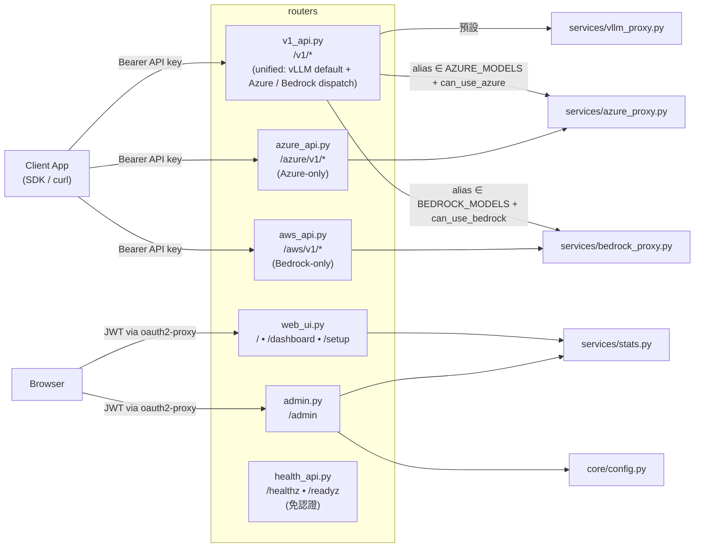

# Routers — API 端點與頁面路由

[English](README.md)

定義 FastAPI 路由：統一 `/v1/*` 公開 API、Azure-only `/azure/v1/*` API、Bedrock-only `/aws/v1/*` API、Web UI 頁面、Admin 管理，以及免認證的健康檢查探針。

## 模組總覽



---

## `v1_api.py` — 統一 `/v1/*` API（OpenAI 與 Anthropic 相容）

**認證**：`deps.get_current_user`（API key + daily limit 檢查）。`chat/completions`、`responses`、`messages` 改用 `deps.limited_current_user`（相同檢查，另外佔一個並行名額）；`/v1/me` 用 `deps.get_current_user_unmetered`（不做每日額度 429）。

`v1_api.py` 是主要的公開入口。預設走 vLLM 後端；當請求的 `model` alias 設定在雲端後端、且 caller 有權使用時（admin 兩個旗標都免檢查），會 dispatch 到該雲端後端：

- **Azure**：alias 在 `[azure_models.*]` + `can_use_azure` → chat / responses / messages / count_tokens。
- **Bedrock**：alias 在 `[bedrock_models.*]` + `can_use_bedrock` → chat / messages / count_tokens。

同一個 base URL 就能讓 Claude Code 之類的 model picker 看到所有後端。所有路由都額外註冊不含 `/v1` 前綴的別名，避開 Roo Code / Cline / Cursor / Anthropic SDK 因 base URL 沒寫 `/v1` 而 404 的情況。

### 端點

| 方法 | 路徑 | 說明 | Proxy 方式 | 允許類型 |
|---|---|---|---|---|
| `GET` | `/v1/models`、`/models` | 列出模型(僅 LLM/VLM,`hidden` 的不列)。有 `can_use_azure` 的使用者會多看到 Azure 別名,有 `can_use_bedrock` 的會多看到 Bedrock 別名(admin 自動 bypass) | 直接回傳 | `llm`, `vlm` |
| `GET` | `/v1/me`、`/me` | 呼叫者的權限(地端 / Azure / AWS)與各後端今日額度。驗證時不做每日額度 429，額度用完也能查 | 直接回傳 | — |
| `POST` | `/v1/chat/completions`、`/chat/completions` | Chat 對話生成 | `vllm_forward_chat_completions`(vLLM) / `azure_forward_chat_completions`(Azure) / `bedrock_forward_chat_completions`(Bedrock) | `llm`, `vlm` |
| `POST` | `/v1/responses`、`/responses` | Responses API(沒有 Bedrock dispatch:Bedrock alias 會 fallback 到 vLLM) | `vllm_forward_responses`(vLLM) / `azure_forward_responses`(Azure) | `llm`, `vlm` |
| `POST` | `/v1/embeddings`、`/embeddings` | 文字向量嵌入 | `vllm_forward_simple_request` | `embedding`, `vision_embedding` |
| `POST` | `/v1/rerank`、`/rerank` | 文件重排序 | `vllm_forward_simple_request` | `reranker`, `vision_reranker` |
| `POST` | `/v1/score`、`/score` | 相關性評分 | `vllm_forward_simple_request` | `reranker`, `vision_reranker` |
| `POST` | `/v1/systemone`、`/systemone` | System One 型別化決策(TypeSafe 的 wire format,也是 TypeSafe Python SDK 呼叫的路徑)。`model` 可省略,省略時用 systemone 預設模型。僅地端 | `vllm_forward_systemone` | `systemone` |
| `POST` | `/v1/messages`、`/messages` | Anthropic Messages(轉譯為 OpenAI;`reasoning_content` 串流成 `thinking` block;下游靜默時每 10 秒送 SSE `ping`) | `vllm_forward_messages`(vLLM) / `azure_forward_messages`(Azure) / `bedrock_forward_messages`(Bedrock) | `llm`, `vlm` |
| `POST` | `/v1/messages/count_tokens`、`/messages/count_tokens` | Anthropic token 計數(vLLM 走 `/tokenize`,失敗時 fallback chars/4;Azure 與 Bedrock 路徑用 chars/4 估算)。不計費 | `vllm_forward_count_tokens`(vLLM) / `azure_forward_count_tokens`(Azure) / `bedrock_forward_count_tokens`(Bedrock) | `llm`, `vlm` |
| `POST` | `/v1/tokenize`、`/tokenize` | vLLM 原生 pass-through tokenize(沒有雲端路徑 — Azure 與 Bedrock 都沒有 tokenize 端點) | `vllm_forward_tokenize` | `llm`, `vlm` |
| `POST` | `/v1/chat/completions/render`、`/chat/completions/render` | vLLM 原生 pass-through render — 只套 chat template 不生成(debug 用;僅地端 vLLM,無 Azure/Bedrock 路徑)。唯一在 `/docs` 有 request body 文件的路由,以 `openapi_extra` 宣告,不會驗掉任何欄位。預設就會把 detokenize 後的 prompt 放進 `decoded_prompt`,`?decode=false` 可退回純 pass-through。不計費也不進 Langfuse | `vllm_forward_render` | `llm`, `vlm` |

### 分派邏輯

helper `_peek_model_alias` + `_route_to_azure` + `_route_to_bedrock` 決定路由：

```
alias 在 AZURE_MODELS   且 (can_use_azure 或 is_admin)   → Azure 路徑   (chat、responses、messages、count_tokens)
alias 在 BEDROCK_MODELS 且 (can_use_bedrock 或 is_admin) → Bedrock 路徑 (chat、messages、count_tokens)
alias 在 AZURE_MODELS / BEDROCK_MODELS 但無權限          → vLLM 路徑(透過 _resolve_model 靜默 fallback)
其他                                                     → vLLM 路徑
```

`/v1/responses` 沒有 Bedrock dispatch（Converse 沒有 Responses 類型的 API），Bedrock alias 打到這裡會 fallback 到 vLLM。

要送往雲端的請求（含 count_tokens）接著會經過 `_cloud_budget_gate`（每日雲端上限，Azure + Bedrock 合計）。用完時預設回 429；若開啟 `[app].cloud_budget_fallback = true`（admin panel → Cloud Budget Fallback），請求改走 vLLM 路徑，回應帶 `X-Budget-Fallback` header。整體每日額度仍在認證階段檢查，所以各處額度都用完的使用者無論如何都會收到一般的 429；`/azure/v1/*` 與 `/aws/v1/*` 一律不 fallback。

**並行上限**：`chat_completions`、`responses`、`messages`（以及 `/azure/v1/*`、`/aws/v1/*` 對應的路由）改用 `deps.limited_current_user` / `limited_azure_access` / `limited_bedrock_access` 做認證。這些 dependency 會在 `concurrency_leases` 佔一筆租約，直到回應（含 stream）送完才歸還；模式為 `enforce` 時，已經有 `[app].concurrency_limit` 個 request 在跑的帳號會收到 429（admin panel → Concurrency Limit 設定；admin 與被 waive 的帳號不受限）。`count_tokens`、`tokenize`、`render`、`models`、embeddings、rerank、systemone 不計入。詳見 `app/services/concurrency.py`。

「沒旗標的 user 打雲端 alias → fallback 到 vLLM」這個分支沿用 gateway 一向「對未知 alias 寬容」的設計。雲端後端的存在感是透過 per-user `/v1/models` 過濾隱藏，而不是用 404 在請求時擋。`MODEL_ROUTING`、`AZURE_MODELS`、`BEDROCK_MODELS` 不能有同名 alias — `_build_config` 啟動時會 `ValueError`，`PUT /admin/api/config` 也會在寫入前拒絕重複。

### Proxy 方式

| 方式 | 串流 | 用途 | 特色 |
|---|---|---|---|
| `vllm_forward_chat_completions` | stream + non-stream | Chat Completions | SSE 解析、自動注入 `stream_options.include_usage` |
| `vllm_forward_simple_request` | non-stream only | Embeddings, Rerank, Score | 120s timeout，處理 reranker 的 total_tokens 回報 |
| `vllm_forward_responses` | stream + non-stream | Responses API | Raw pass-through，僅替換 model 欄位 |
| `vllm_forward_messages` | stream + non-stream | Anthropic Messages | Anthropic→OpenAI 請求、OpenAI→Anthropic 回應(使用 `services/anthropic_adapter.py`) |
| `vllm_forward_count_tokens` | non-stream | `count_tokens` | 轉送至 vLLM `/tokenize`,失敗時 fallback 為 chars/4;不計費 |
| `vllm_forward_tokenize` | non-stream | `/tokenize` | vLLM 原生 pass-through;不計費 |
| `vllm_forward_systemone` | non-stream | `/systemone` | body 原樣轉送到 `{server root}/v1/systemone`,`base_url` 有沒有 `/v1` 都可以(只改 `model`,回應的 `model` 換成 alias);依 `input_tokens + cached_tokens` 計費(decider 把快取的 schema 前綴另外回報,不含在 `input_tokens` 內);Phase 2 擷取 `{state, questions}` → `answers` |
| `vllm_forward_render` | non-stream | `/chat/completions/render` | vLLM 原生 pass-through;套用與 chat completions 相同的 reasoning 方言對齊,回應的 `model` 換回 alias;預設會經由同一台的 `/detokenize` 補上 `decoded_prompt`(best-effort,失敗記在 `decode_error`;`?decode=false` 可關閉);不計費、不觀測 |

### 共通行為

所有 vLLM proxy 方式共享 `_resolve_model()` 做健康感知路由：

```
1. 精確匹配 + 伺服器存活 → 直接使用
2. 伺服器 DOWN → 使用同類型的 configured fallback
3. 找不到匹配 → 使用同類型的任意存活伺服器
4. 無存活伺服器 → best-effort 嘗試任意同類型伺服器
```

Fallback 發生時，回應會帶 `X-Model-Fallback` header 說明原因。

---

## `azure_api.py` — Azure OpenAI 相容

**認證**：`deps.require_azure_access`（包裝 `get_current_user`，額外檢查 `user.can_use_azure` — admin 免檢查 — 與每日雲端上限）— 與 `/v1/*` 共用同一把 gateway API key 與 daily limit，另外多了使用者層級的 Azure 存取旗標。`chat/completions`、`responses`、`messages` 改走 `deps.limited_azure_access`（相同檢查，另外佔一個並行名額）。

使用同一把客戶端 API key、同一份 usage log、同一套觀測。差異只在於下游 URL/Header 慣例，由 `services/azure_proxy.py` 處理。Azure 部署在 `config.toml` 的 `[azure_models.<alias>]` 設定。沒有 `can_use_azure`（且非 admin）的使用者會收到 403 `"Azure access not granted. Contact your administrator."`；雲端上限用完回 429（這個前綴不會 fallback 到地端）。

### 端點

| 方法 | 路徑 | 說明 | Proxy 方式 |
|---|---|---|---|
| `GET` | `/azure/v1/models`、`/azure/models` | 列出已設定的 Azure 部署,`hidden` 的不列(一律只有 Azure,不受 `/v1/models` 過濾影響) | 直接回傳 |
| `POST` | `/azure/v1/chat/completions`、`/azure/chat/completions` | 透過 Azure 部署做 chat completion | `azure_forward_chat_completions` |
| `POST` | `/azure/v1/responses`、`/azure/responses` | 直接 pass-through 到 Azure Responses API(僅替換 `body.model`) | `azure_forward_responses` |
| `POST` | `/azure/v1/messages`、`/azure/messages` | Anthropic Messages → Azure(共用 `anthropic_adapter`;與 vLLM 路徑同樣支援 `thinking` block 轉譯與每 10 秒的 SSE `ping` 心跳) | `azure_forward_messages` |
| `POST` | `/azure/v1/messages/count_tokens`、`/azure/messages/count_tokens` | Token 計數(chars/4 估算;Azure 沒有 tokenize 端點)。不計費 | `azure_forward_count_tokens` |

刻意**沒有** `/azure/v1/embeddings` — Responses API 不涵蓋 embeddings，embedding 模型請設定在 vLLM 後端。

### Azure 特定行為

- 所有 LLM/VLM 呼叫都打 v1 Responses API：`{endpoint}/openai/v1/responses`（不帶 `api-version`）。Chat 與 Anthropic 請求先轉成 Responses（`services/responses_adapter.py`），回應再轉回來
- Header：`api-key: <key>`（不是 `Authorization: Bearer`）
- Body 的 `model` 欄位會換成 Azure deployment 名稱
- 用 `_resolve_azure` 取代 `_resolve_model`：精確 alias → 同類型的 `[azure_fallback]` → 第一個相容的項目（fallback 時帶 `X-Model-Fallback`）。沒有健康檢查
- Chat/messages 路徑會移除取樣參數，`/azure/v1/responses` pass-through 不會
- `_calc_cost` 已解耦 — `azure_proxy` 自己查 `AZURE_MODELS`，把 route dict 傳給 `_log_usage(route=...)`

---

## `aws_api.py` — AWS Bedrock 相容

**認證**：`deps.require_bedrock_access`（包裝 `get_current_user`，額外檢查 `user.can_use_bedrock` — admin 免檢查 — 與每日雲端上限）。`chat/completions`、`messages` 改走 `deps.limited_bedrock_access`（相同檢查，另外佔一個並行名額）。

命名分歧：URL 前綴是 **`/aws`**，但設定、旗標與 backend 標籤都叫 **`bedrock`**（`[bedrock_models.<alias>]`、`can_use_bedrock`、`usage_logs.backend = "bedrock"`）。沒有 `can_use_bedrock`（且非 admin）的使用者會收到 403 `"Bedrock access not granted. Contact your administrator."`；雲端上限用完回 429（這個前綴不會 fallback 到地端）。下游處理在 `services/bedrock_proxy.py`。

### 端點

| 方法 | 路徑 | 說明 | Proxy 方式 |
|---|---|---|---|
| `GET` | `/aws/v1/models`、`/aws/models` | 列出已設定的 Bedrock 模型,`hidden` 的不列(一律只有 Bedrock) | 直接回傳 |
| `POST` | `/aws/v1/chat/completions`、`/aws/chat/completions` | OpenAI chat completion,轉譯成 Converse | `bedrock_forward_chat_completions` |
| `POST` | `/aws/v1/messages`、`/aws/messages` | Anthropic Messages → Converse(共用 `anthropic_adapter` + `converse_adapter`) | `bedrock_forward_messages` |
| `POST` | `/aws/v1/messages/count_tokens`、`/aws/messages/count_tokens` | Token 計數(chars/4 估算;Bedrock 沒有 tokenize 端點)。不計費 | `bedrock_forward_count_tokens` |

刻意**沒有** `/aws/v1/embeddings` 與 `/aws/v1/responses` — Converse 兩者都不支援。

### Bedrock 特定行為

- 所有呼叫都打 Converse API：`https://bedrock-runtime.{region}.amazonaws.com/model/{model_id}/converse`（或 `/converse-stream`）；個別項目的 `endpoint` 可覆寫 host
- 認證：IAM 金鑰每次請求以 SigV4 簽章（`services/aws_sigv4.py`），或長期 Bedrock API key 以 `Authorization: Bearer` 送出。Region 與 IAM 金鑰對可由 `.env`（`BEDROCK_REGION`、`BEDROCK_AWS_*`）讓所有項目共用；項目自己有設定時優先
- 串流是二進位的 AWS event-stream frame（`services/aws_eventstream.py`），不是 SSE；proxy 會轉成 client 端的 SSE 格式，並同樣每 10 秒送 `ping` 心跳
- `_resolve_bedrock`：精確 alias → 同類型的 `[bedrock_fallback]` → 第一個相容的項目（fallback 時帶 `X-Model-Fallback`）。沒有健康檢查

---

## `web_ui.py` — 使用者 Dashboard

**認證**：`auth.get_web_user`（JWT scope 需含 `read` 或 `admin`）

### 端點

| 方法 | 路徑 | 說明 |
|---|---|---|
| `GET` | `/` | Welcome 首頁：API 使用指南、可用模型、快速上手 |
| `GET` | `/dashboard` | Dashboard 頁面：今日額度、用量統計、趨勢圖、各模型費用、伺服器狀態、App 帳號 |
| `GET` | `/dashboard/api/model-breakdown` | Cost by Model 卡片的 JSON 資料（`?period=month` 為預設，或 `day`；其他值回 400）。供 Month/Today 切換與重新整理按鈕使用 |
| `POST` | `/dashboard/refresh-key` | 重新產生自己的 API key，回傳 JSON `{ok, api_key}` |
| `POST` | `/dashboard/app/{app_id}/refresh-key` | 重新產生所屬 App 帳號的 API key（需為 owner，否則 403） |
| `GET` | `/dashboard/install-claude-code.bat` | 下載 Windows Claude Code 安裝檔：`setup/install-claude-code.bat` 中的 `__USER_API_KEY__` 換成呼叫者的 key，換行統一為 CRLF（範本不存在時回 404） |
| `GET` | `/setup` | Claude Code 安裝說明頁 |

### Dashboard 資料來源

| 區塊 | 資料函式 | 說明 |
|---|---|---|
| Budget / Today | `get_user_daily_summary()` + `effective_cloud_limit()` | 今日 requests、各後端費用、每日額度與雲端上限使用率 |
| Stats Cards | `get_user_monthly_summary()` | 當月 requests、cost、tokens |
| Usage Trend | `get_daily_trends()` | 近 30 天的每日 requests / cost |
| Cost by Model | `get_model_breakdown()`（經 `_build_model_breakdown()`） | 依後端分組的各模型費用；使用者無權使用的雲端後端不顯示（`_hidden_cloud_backends`） |
| My App Accounts | `get_owned_apps_summary()` | 所屬 App 帳號的月用量 |
| System Status | `MODEL_ROUTING` + `is_alive()` | 依類型分組的伺服器健康狀態；Azure / Bedrock 模型清單只顯示給有權限的使用者 |

---

## `admin.py` — 管理面板 + Admin API

**認證**：Router 層統一 `Security(get_web_user, scopes=["admin"])`，所有 `/admin/*` 端點（含 REST API）皆走 JWT 認證

額度由 `_limit_usd` 驗證：必須是 ≥ 0 的有限數字，`0` 代表 $0 額度（絕不是「無上限」）。表單端點會 303 導回 `/admin`；標示 JSON 的端點在帶 `Accept: application/json` 時改回 JSON（頁面上的原地切換）。

### Web UI 端點

| 方法 | 路徑 | 說明 |
|---|---|---|
| `GET` | `/admin` | Admin 首頁：用量彙總、DAU 趨勢、部門用量、排行榜、使用者管理。支援分頁（`?limit=15&offset=0&app_limit=15&app_offset=0`）與伺服器端搜尋（`?q=keyword`，對 username/display_name/org_code 做 ILIKE） |
| `POST` | `/admin/users/create` | 建立 App 帳號（表單 `username`、`daily_limit_usd`、`owner_username`；username 自動加 `app_` 前綴；建立時即豁免並行上限） |
| `POST` | `/admin/users/{id}/owner` | 替換 App 帳號的 owner（表單 `owner_usernames`，逗號分隔；有不存在的名稱回 400）。回傳 JSON |
| `POST` | `/admin/users/{id}/limit` | 修改使用者每日限額（表單 `new_limit`） |
| `POST` | `/admin/users/{id}/cloud-limit` | 設定使用者自己的雲端上限（表單 `new_cloud_limit`；空白則清除、改依預設值，`0` 為 $0 上限） |
| `POST` | `/admin/users/{id}/delete` | 先清掉所有參照該使用者的資料（app owner、舊版 `owner_id`、anomaly event、並行租約）再刪除使用者。usage log 與每日彙總保留（計費／稽核紀錄），並在 log 記下 id 對應的帳號。不可刪除自己 |
| `GET` | `/admin/users/{id}/api-key` | 取得單一帳號的完整 API key，回傳 JSON（列表只顯示遮罩後的 key）。會記錄是誰查了誰的 key |
| `POST` | `/admin/users/{id}/refresh-key` | 重新產生任意使用者的 API key，回傳 JSON |
| `POST` | `/admin/users/{id}/toggle-disable` | 翻轉使用者的 `is_disabled` 旗標。禁止停用自己（回 400）；可以重新啟用自己 |
| `POST` | `/admin/users/{id}/toggle-azure` | 翻轉使用者的 `can_use_azure` 旗標（控制 `/azure/v1/*` 存取與 `/v1/*` 的 Azure dispatch）。JSON |
| `POST` | `/admin/users/{id}/toggle-bedrock` | 翻轉使用者的 `can_use_bedrock` 旗標（控制 `/aws/v1/*` 存取與 `/v1/*` 的 Bedrock dispatch）。JSON |
| `POST` | `/admin/users/{id}/toggle-concurrency-waive` | 切換該使用者是否豁免並行上限。JSON |
| `POST` | `/admin/default-limit` | 設定預設每日額度（USD）。寫入 `[app].default_daily_limit_usd` 並批次將 `0 < daily_limit_usd < new_floor` 的使用者拉高到新 floor（`daily_limit_usd = 0` 的使用者是刻意設成 $0，不會被改動） |
| `POST` | `/admin/cloud-limit` | 設定預設雲端上限 `[app].cloud_daily_limit_usd`（每日 Azure + Bedrock 合計），套用於有雲端權限且沒有個人上限的使用者（表單 `new_cloud_limit`；空白則移除預設，`0` 為 $0 上限） |
| `POST` | `/admin/cloud-budget-fallback` | 表單 `enabled`（`on` / `off`）→ `[app].cloud_budget_fallback`：`/v1/*` 雲端請求超過雲端上限時改由地端服務，而非回 429。JSON |
| `POST` | `/admin/concurrency-limit` | 表單欄位 `mode`（`off` / `monitor` / `enforce`）+ `limit`（≥ 1 的整數）。JSON |
| `POST` | `/admin/site-links` | 表單 `support_bot_url`、`install_guide_url` → `[app]`；只接受 `http(s)://` 或站內相對路徑（否則 400）；空白則隱藏該元素 |
| `GET` | `/admin/models` | 模型設定頁面（SPA，透過 API 載入資料） |

### Admin REST API（JWT 認證，需 admin scope）

| 方法 | 路徑 | 說明 |
|---|---|---|
| `GET` | `/admin/users` | 列出所有使用者（遮罩後的 `api_key`、`daily_limit_usd`、`cloud_daily_limit_usd`、`is_admin`、`concurrency_waived`、`owner_ids`、`display_name`、`org_code`） |
| `POST` | `/admin/users` | 建立使用者（JSON body：`username`、`daily_limit_usd`、`cloud_daily_limit_usd` — `null` 表示依預設值、`is_admin`、`concurrency_waived` — 必須是 JSON boolean，`app_*` 帳號預設為 true、`owner_ids`）。username 重複回 409；回應含完整 `api_key` |
| `PATCH` | `/admin/users/{id}` | 更新使用者（`daily_limit_usd`、`cloud_daily_limit_usd`、`is_admin`、`owner_ids` — 整份替換 owner 清單、`concurrency_waived` — 必須是 JSON boolean） |
| `GET` | `/admin/api/anomalies` | `scripts/scan_anomalies.py` 寫入的異常紀錄（`?status=new` 為預設，或 `acknowledged`、`resolved`、`all`；`?limit=50`，上限 200） |
| `POST` | `/admin/api/anomalies/{id}/ack` | 將異常標為 `acknowledged` |
| `POST` | `/admin/api/anomalies/{id}/resolve` | 將異常標為 `resolved` |

`POST` / `PATCH /admin/users` 收到已退役的各後端欄位 `azure_daily_limit_usd` / `bedrock_daily_limit_usd` 會回 400：Azure 與 AWS 共用同一個雲端上限 `cloud_daily_limit_usd`。

### 用量匯出（JWT 認證，需 admin scope）

| 方法 | 路徑 | 說明 |
|---|---|---|
| `GET` | `/admin/api/export/usage.xlsx` | 月用量報表活頁簿（4 個工作表），範圍 `?from=YYYY-MM&to=YYYY-MM`（含頭尾，最多 24 個月） |
| `GET` | `/admin/api/export/user-backend-costs.csv` | 每個月 × 帳號一列（含使用者與 `app_*`），費用拆成 vLLM / Azure / Bedrock 欄位；同樣用 `from` / `to` |
| `GET` | `/admin/api/export/users.csv` | 所有真人使用者（不含 `app_*`），附旗標、每日額度、本月費用/requests 與最後活動時間 |

CSV 開頭帶 UTF-8 BOM，Excel 開啟中文才不會亂碼。

### Model Config API（JWT 認證，需 admin scope）

| 方法 | 路徑 | 說明 |
|---|---|---|
| `GET` | `/admin/api/config` | 取得 `config.toml` 內容（`models`、`pricing`、`fallback`、`azure_models`、`azure_fallback`、`bedrock_models`、`bedrock_fallback`），另附 `bedrock_shared`（`region`、`iam_credentials: bool` — 不含密鑰） |
| `PUT` | `/admin/api/config` | 驗證（跨後端 alias 不可重複、欄位型別、reasoning-effort 設定、`rate_limit_fallback` 目標）後儲存到 `config.toml` 並即時 reload |

---

## `health_api.py` — Liveness 與 Readiness 探針

**認證**：刻意沒有。探針來自 nginx、外部負載平衡器或容器 runtime，它們都不會帶
API key 或 SSO session。這兩個端點也不會洩漏任何「服務有回應」以外的資訊。

| 方法 | 路徑 | 說明 | 狀態碼 |
|---|---|---|---|
| `GET` | `/healthz` | Liveness。零 I/O — 只要 process 活著、event loop 還在轉就會回應。 | 永遠 `200` |
| `GET` | `/readyz` | Readiness。對資料庫跑一次 `SELECT 1`；另附上 vLLM 健康快取統計供閱讀。 | `200` / `503` |

`/readyz` **只以資料庫為判準**。vLLM 健康快取會回報但不會讓探針失敗：它由背景迴圈
填入，開機後約 30 秒內還是空的（剛啟動的 worker 會把自己判成 not ready）；而下游
全域故障時，這樣會一次把所有 Gateway 實例踢出負載平衡 —— 把「降級」變成「全斷」。

兩條路由都設 `include_in_schema=False`，不會出現在 OpenAPI 文件裡。

---

## 路由與認證對照

```mermaid
graph TD
    subgraph "API Key 認證 (deps.py)"
        V1["/v1/* (+ 無 /v1 別名)<br/>models • me • chat/completions • embeddings<br/>rerank • score • systemone • responses<br/>messages • messages/count_tokens • tokenize<br/>chat/completions/render<br/>(vLLM 預設 + Azure / Bedrock dispatch)"]
        Azure["/azure/v1/* (+ /azure/* 別名)<br/>models • chat/completions • responses<br/>messages • messages/count_tokens<br/>(Azure-only, require_azure_access)"]
        AWS["/aws/v1/* (+ /aws/* 別名)<br/>models • chat/completions<br/>messages • messages/count_tokens<br/>(Bedrock-only, require_bedrock_access)"]
    end

    subgraph "免認證 (health_api.py)"
        Probes["/healthz • /readyz<br/>(liveness • readiness)"]
    end

    subgraph "JWT 認證 (auth.py via oauth2-proxy)"
        Dashboard["/ • /dashboard/* • /setup<br/>Security: read scope"]
        Admin["/admin/*<br/>Security: admin scope<br/>(Web UI + REST API + Model Config + Export)"]
    end

    V1 -->|get_current_user| DB["DB: users.api_key"]
    Azure -->|require_azure_access<br/>(get_current_user + can_use_azure)| DB
    AWS -->|require_bedrock_access<br/>(get_current_user + can_use_bedrock)| DB
    Dashboard -->|get_web_user| JWT["JWT: sub → users.username"]
    Admin -->|get_web_user| JWT
```
