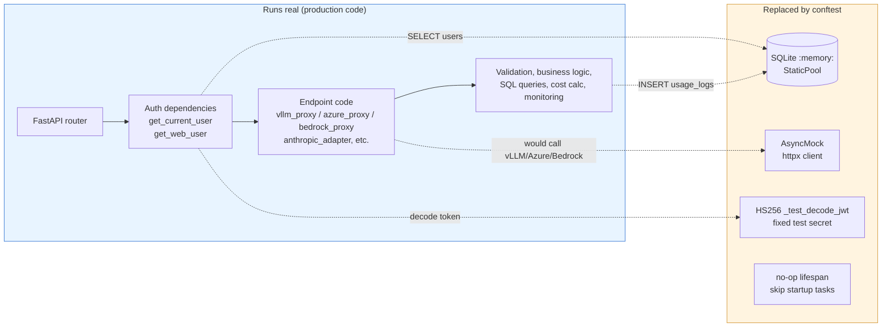
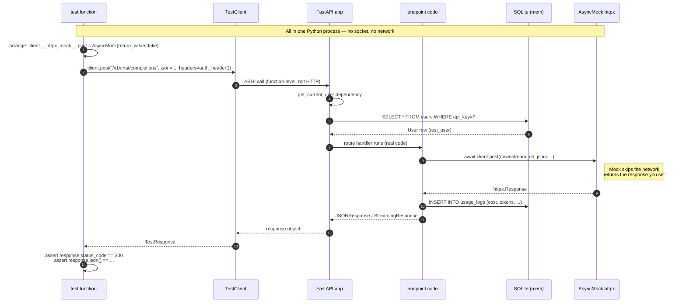

# Tests

Pytest suite covering the full HTTP surface of the gateway: **988 tests** in
54 files, run against an in-memory SQLite database with all downstream HTTP
traffic mocked. CI runs the same command on Python 3.11.

```bash
uv run pytest tests/ -q                 # everything (what CI runs)
uv run pytest tests/test_admin.py -v    # one file
uv run pytest tests/test_messages.py::TestX::test_y -v   # one test
uv run pytest tests/ -k "stream"        # filter by name
```

## How tests are wired (`conftest.py`)

The whole test rig is built so that **no real downstream servers, no real
PostgreSQL, and no real OAuth flow** are ever contacted. Three pieces make
that work:

| Mechanism | What it does |
|---|---|
| In-memory SQLite + `StaticPool` | `DATABASE_URL=sqlite://` is set before any app import; all connections share one DB, and tables are dropped and recreated per test by the `db_session` fixture |
| `_patch_all` autouse fixture | Applies `_ALL_PATCHES` (an `ExitStack`, since the list is past CPython 3.11's 20-nested-`with` cap) for every test: the routing / pricing / fallback maps (`MODEL_ROUTING`, `PRICING_MAP`, `FALLBACK_MAP`, `AZURE_MODELS`, `AZURE_FALLBACK_MAP`, `BEDROCK_MODELS`, `BEDROCK_FALLBACK_MAP`, plus the `get_*_snapshot` getters); every user-traffic httpx client getter (shared, Azure, Bedrock, in the proxies and in `server_state`) → one shared `AsyncMock`; every module-level `engine` (`vllm_proxy`, `deps`, `concurrency`, `alerts`) → the test engine; `is_alive` → `True`; `_decode_jwt` → an HS256 test decoder; and `_submit_background` → an inline write so `usage_logs` assertions don't race the executor thread |
| `_build_test_app` | Imports the routers under the config patches and builds a `FastAPI` app with a no-op lifespan (no DB init, no health loop, no lease heartbeat, no real httpx clients). Mounts every router: `health_api`, `web_ui`, `v1_api`, `azure_api`, `aws_api`, `admin`, and registers the production `AccountDisabledError` handler |

### What runs real vs. what's swapped



### Lifecycle of a single test



Useful helpers exposed from `conftest`:

- `client` — `TestClient` with mocked deps (`get_session` overridden to `db_session`); `client.__httpx_mock__` is the shared `AsyncMock` you set return values on
- `test_user` (api_key `sk-testkey123`, daily limit `$100`, `can_use_azure=True`, `can_use_bedrock=True`, `is_disabled=False`) and `admin_user` (`sk-adminkey456`, `is_admin=True`, limit `$999`). Web-UI admin rights come from the JWT scope, not `is_admin`: use `web_auth_header(sub="admin", scopes=["admin"])`
- `auth_header(api_key=...)` for `/v1` / `/azure/v1` / `/aws/v1` Bearer auth, `web_auth_header(sub=..., scopes=..., display_name=..., org_code=...)` for JWT-protected web routes
- `make_httpx_response(status, json_body, text)` for non-stream mocks; `FakeStreamResponse(lines, status_code, body_bytes)` for SSE mocks (`body_bytes` is what a non-200 pre-flight `aread()` returns); `FakeBedrockStreamResponse(events, ...)` for Bedrock ConverseStream — `(event_type, payload)` pairs encoded as binary AWS event-stream frames, `"exception:<type>"` for exception frames
- `TEST_MODEL_ROUTING` / `TEST_AZURE_MODELS` / `TEST_BEDROCK_MODELS` — the per-test alias maps. Seven vLLM-path aliases (`test-llm`, `test-vlm`, `test-embedding`, `test-reranker`, `test-vision-embedding`, `test-vision-reranker`, and `test-systemone` — a System One decision server, no `api_key`), two Azure aliases (`azure-gpt-4`, `azure-embed`) and two Bedrock aliases (`bedrock-claude`, `bedrock-nova`)

For non-stream HTTP mocks, set `client.__httpx_mock__.post = AsyncMock(return_value=make_httpx_response(...))`. For streams, set `client.__httpx_mock__.send = AsyncMock(return_value=FakeStreamResponse([...]))` (or `FakeBedrockStreamResponse`).

### Pitfalls

- **Never let a test trigger a real `save_config()`.** It writes `config.toml`, and `reload_config()` mutates the patched `TEST_*` dicts in place, emptying them for every later test. Wrap a happy-path `PUT /admin/api/config` in `with patch("app.routers.admin.save_config"):` (pattern: `test_models_endpoint.py::TestAdminConfigMetadataValidation`). `TestAzureFallback` in `test_azure_api.py` deliberately mutates `TEST_AZURE_MODELS`; keep the autouse patch pointing at the same dict.
- The shared httpx mock's `reset_mock()` does **not** clear `side_effect`, and some tests replace its methods. Use `patch.object(client.__httpx_mock__, "post", side_effect=...)` and assert on the mock you patched, never on the shared one.
- Import `app.routers.*` inside test functions, never at a test module's top level. `_build_test_app` imports the routers under its config patches; a collection-time import binds them to the real config and pages silently render the wrong models.
- The concurrency limit defaults to `off`. Tests that exercise it patch `app.core.deps.get_concurrency_settings`.
- SQLite ignores `FOR UPDATE`, and only enforces foreign keys with `PRAGMA foreign_keys` on (`TestDeleteUser` turns it on). `test_pg_concurrent_acquire_respects_limit` runs against PostgreSQL only when `CONCURRENCY_TEST_PG_URL` is set; it is skipped in CI.
- The shared mock client has no httpx event hooks, so phase-timing tests (`test_request_timing.py`) build real `httpx.AsyncClient`s over a `MockTransport` instead.

---

## vLLM endpoints (`/v1/*`)

### `test_chat_completions.py` — `/v1/chat/completions`

The OpenAI-compatible chat endpoint, vLLM backend.

| Test class | What it covers |
|---|---|
| `TestChatCompletionsNonStream` | Happy-path completion; missing-auth 401; an unknown alias falls back to a model of the same type; downstream connection error → 502; downstream non-200 propagation |
| `TestChatCompletionsToolCall` | Single-turn tool call response; multi-turn with `tool_calls` + `role: "tool"` round-trip |
| `TestChatCompletionsStructuredOutput` | `response_format={"type": "json_object"}` and `{"type": "json_schema", ...}` both forwarded as-is |
| `TestChatCompletionsStream` | SSE happy path: deltas and the `[DONE]` terminator relayed as `text/event-stream` |
| `TestReasoningFieldAlignment` | The `reasoning` / `reasoning_content` dialect split (vLLM ≥ 0.20 reads only `reasoning`): whichever name a client sends, both reach the downstream; whichever the downstream emits, both reach the client; neither is added when absent |

### `test_responses.py` — `/v1/responses` (raw pass-through)

The "OpenAI Responses API" endpoint. Body forwarded verbatim except the
`model` field which is alias→real swapped.

Covers: basic response, model-name swap, VLM via responses, missing auth,
malformed JSON → 400, downstream errors, SSE pass-through and its usage row.

### `test_embeddings.py` — `/v1/embeddings`

Single-input, batch input, alias→real model swap, 401, downstream connection
error → 502, non-200 propagation.

### `test_rerank_score.py` — `/v1/rerank` and `/v1/score`

Cross-encoder reranking. Covers basic flow, `top_n`, model swap, the
`total_tokens`-only response shape (some rerankers don't report `prompt_tokens`),
auth, downstream errors.

### `test_vlm.py` — Vision LLM

Routing for VLM-typed models, base64 images, remote image URLs, multiple
images in one message, the optional `image_url.detail` parameter.

### `test_vision_embedding.py` — `/v1/embeddings` with `vision_embedding` type

Text-only, image URL, base64, batched multi-modal, model swap, downstream
URL construction (asserts the request landed on the right backend),
errors and auth.

### `test_vision_rerank_score.py` — Vision reranker / score

Text documents, image URL, base64, mixed text+image, multi-modal `content`
blocks, downstream URL routing, auth, errors. Two test classes — one per
endpoint.

### `test_systemone.py` — `/v1/systemone` (System One typed decisions)

The decider-style decision endpoint. Covers verbatim forwarding to `{server root}/v1/systemone` for a `base_url` with or without `/v1`, the failover attempt included (only `model` rewritten, the response's `model` set to the alias), the bare `/systemone` alias, an absent `model` resolving to the systemone default without a fallback header (and to `[fallback].systemone` when set), unknown/wrong-type aliases staying on systemone servers and systemone aliases never reaching chat servers, billing (`input_tokens + cached_tokens`, the cached-price discount, malformed usage never failing an answered request), downstream 413/422 pass-through unbilled, 503 failover, 502/400/401 paths, Langfuse capture (`{state, questions}` → `answers`), the dashboard's TypeSafe SDK card and the welcome-page row, and `TestTypeSafeSdkContract` — what `typesafe-sdk` 0.7.1 requires: its request shape (default model `jev-latest`, Bearer auth), a string `model` + `usage` object on the response, and `/v1/models` staying llm/vlm-only with no TypeSafe `models` list (no discovery, by design). `TestSystemOneHealthProbe` pins the non-vLLM health check: decider's `/health` at the server root (`ok: false` and non-200 are DOWN, a 404 falls back to `/v1/models`), no `/metrics` scrape, and vLLM routes still on `{base_url}/models` + `/metrics`.

### `test_tokenize.py` — `/v1/tokenize` (vLLM-native pass-through)

vLLM exposes `/tokenize` directly; the gateway forwards both the
`{model, messages, ...}` and `{model, prompt}` payload shapes verbatim,
only rewriting the `model` alias. Covers both shapes, alias without `/v1`
prefix, `x-api-key` auth, missing auth, malformed JSON, downstream errors,
unknown alias falls back to "any alive LLM".

### `test_render.py` — `/v1/chat/completions/render` (vLLM-native pass-through)

The debug endpoint that renders a chat request through the model's chat
template without generating from it. Covers the happy path (body forwarded
verbatim, alias → `real_model` down and back to the alias on the echoed
`model`, no `usage_logs` row), the alias without the `/v1` prefix, the
reasoning / `reasoning_content` alignment that mirrors `/v1/chat/completions`,
`x-api-key` auth, missing auth, malformed JSON, downstream 502, a 404 from a
vLLM too old to serve the endpoint, unknown-alias fallback, and that an
Azure-configured alias stays on the vLLM path (on-prem-only endpoint) even for
a user with `can_use_azure`. Two further tests pin the documentation contract:
`/openapi.json` carries a request-body schema for both paths (the handler takes
a raw `Request`, so it comes from `openapi_extra`), and fields the schema never
names (`vllm_xargs`, `structured_outputs`, …) still reach the downstream
verbatim — the guard against a future Pydantic body model validating them away.
`TestRenderDecode` covers the decode step (on by default): the detokenize call goes to the same
server that rendered (root `/detokenize`, real_model, the returned ids) and its
text lands in `decoded_prompt`; `?decode=false` makes no second call at all;
a detokenize failure, a non-200, and a render with no `token_ids` each keep the
render and report `decode_error`; a downstream that already returned
`decoded_prompt` keeps its own; and the flag is documented as a query param.
`TestRenderIsNotObserved` pins that the endpoint stays outside billing and
observability on both the success and the error path — no `usage_logs` row and
no Langfuse generation, since a render is a debug query rather than inference.

### `test_models_endpoint.py` — `/v1/models`

| Test class | What it covers |
|---|---|
| `TestListModels` | Only LLM/VLM types are returned (Embedding/Reranker hidden); base fields (`id`, `object`, `owned_by`, `type`, `capability`); optional metadata (`context_window`, `display_name`, `supports_*`) surfaced when set, omitted otherwise; auth required |
| `TestAdminConfigMetadataValidation` | Type checking for `PUT /admin/api/config` — boolean rejected for `context_window`, negatives rejected, string rejected for `supports_tools`, etc. (Python `True` is an `int`, so the validator checks `bool` *before* `int`); `hidden` must be a bool |
| `TestAdminAzureFallbackValidation` | `azure_fallback` entries must be strings naming an existing Azure alias of the matching type |
| `TestHiddenModels` | The `hidden` flag: hidden models (vLLM and cloud) are left out of every listing, `/v1/models` included, but are still served when a request names the alias; the `hidden` key itself is never surfaced |

### `test_unified_dispatch.py` — one `/v1` base URL for vLLM + cloud

`/v1/models`, `/v1/chat/completions`, `/v1/responses`, `/v1/messages` and
`/v1/messages/count_tokens` route an alias configured under `[azure_models.*]`
to Azure when the user has `can_use_azure` (or is admin); otherwise the alias
silently falls back to the vLLM default — no 404. `/v1/models` lists Azure
llm/vlm entries only for permitted users (embeddings excluded, `owned_by`
labelled); Azure `count_tokens` uses the chars/4 estimate. `TestNoV1PrefixAliases`
pins the routes without `/v1` (models, chat, embeddings, rerank, score), and
`TestDuplicateAliasGuard` that `_build_config` raises on an alias shared by
`[models.*]` and `[azure_models.*]` / `[bedrock_models.*]`.

### `test_failover.py` — request-time failover + `Retry-After`

One retry against another alive server of the same type: on connect failure
(the dead server is `mark_down()`'d) for chat, stream before the first byte, and
the translated messages path; no backup → 502. On 503 the request fails over
without marking down; a 500 is surfaced as-is, and the failover target's own
error is returned (no retry loops). The daily-limit 429 carries `Retry-After`
bounded by local midnight.

### `test_config_fallback.py` — `config.toml.example` fallback

`config.toml` is gitignored, so reads fall back to the example: the real file
wins when present, the example parses and builds, and `save_config` still
targets `config.toml`. Also: Bedrock IAM keys survive build + save (blank ones
left out), and credential setups that can only end in a 403 (no credential,
half an IAM pair) warn at load time without logging the secret.

## Anthropic Messages (`/v1/messages`)

### `test_messages.py` — `/v1/messages` (Anthropic Messages API)

The largest file in the suite — covers the Anthropic ↔ OpenAI translator
(`anthropic_adapter.py`) plus the routed endpoint.

| Test class | What it covers |
|---|---|
| `TestRequestTranslation` | Pure function tests on `anthropic_to_openai_request`: text content, `system` as string vs list, leading system/developer entries hoisted into the single leading system message and mid-conversation ones merged into the adjacent user turn as `<system-reminder>` text (never re-wrapped, buffered across tool-result turns); base64 image blocks → `image_url` parts; `tools` schema translation; `tool_use` ↔ `tool_calls` round-trip; `tool_reference` blocks in a tool result become text; `stop_sequences` → `stop`; `thinking` blocks in assistant history replayed as **both** `reasoning_content` and `reasoning`; `reasoning_effort` mapping (`effort`, `output_config.effort`, `thinking` budget buckets, unknown spellings verbatim) emitted only when `is_reasoning=True` |
| `TestResponseTranslation` | `openai_to_anthropic_response`: text response, tool call response, `stop_reason` mapping (`length` → `max_tokens`); `reasoning_content` (or `reasoning`) is surfaced as a leading `thinking` content block before the text block |
| `TestStreamTranslator` | Stateful `AnthropicStreamTranslator` — emits canonical Anthropic SSE event sequence (`message_start` → `content_block_start` → deltas → `message_stop`) for both text and tool calls; reasoning deltas open a `thinking` block and close it with `content_block_stop` only (no `signature_delta`) before the text block starts; `test_fail_emits_error_and_closes_block` — a downstream drop with no `finish_reason` closes the open block and emits an `overloaded_error` event instead of `message_stop` |
| `TestMessagesEndpointNonStream` | End-to-end: basic message, `x-api-key` header (Anthropic-style auth), 401, valid `x-api-key` overrides bad bearer, system prompt forwarded, tool call, downstream 502, `?beta=...` query param pass-through, alias works without `/v1` prefix |
| `TestCountTokensEndpoint` | `/v1/messages/count_tokens` forwards to vLLM `/tokenize`; falls back to chars/4 estimate on connection error and on 404; `x-api-key` auth; works without `/v1` prefix |
| `TestMessagesEndpointStream` | Full SSE stream end-to-end against a mocked upstream; a clean finish with ≤ 1 output token and no visible content logs the empty-turn warning |
| `TestEmptyTurnDiagnostics` | The translator's visible-text / thinking char counters, when the empty-turn warning fires (0 or 1 token) and stays silent, and the request-shape summary it logs |
| `TestObservabilityIOShape` | Langfuse I/O for Anthropic endpoints is recorded in Anthropic shape (original content blocks), not the internal OpenAI pivot |

### `test_native_messages.py` — `native_messages` pass-through flag

Routes flagged `native_messages = true` forward Anthropic requests as-is to
the downstream vLLM's native `/v1/messages` (>= 0.11.1) instead of
translating via the OpenAI pivot.

| Test class | What it covers |
|---|---|
| `TestNativeNonStream` | Pass-through hits `{base_url}/messages` with alias→real_model swap (response model rewritten back to alias); 404 falls back to the translation path (`/chat/completions`); non-404 downstream errors propagate |
| `TestNativeStream` | Native Anthropic SSE forwarded verbatim with `message_start.model` rewritten to the alias; stream dying without `message_stop` emits an `overloaded_error` event; stream 404 pre-flight falls back to the translated stream |
| `TestNativeCountTokens` | Native `/messages/count_tokens` used when flagged; any failure falls back to the `/tokenize` translation flow |
| `TestNormalizeAnthropicMessages` | `normalize_anthropic_messages` pure-function behavior: schema-clean requests returned as the same object (pure pass-through); `tool_reference` blocks in tool results rewritten to text; leading system-role entries hoisted into the top-level `system` field (existing `cache_control` blocks preserved verbatim); mid-conversation system entries merged into the adjacent user message as `<system-reminder>` text (append to previous user / prepend to next / trailing orphan becomes its own user message); plus end-to-end checks that the native path applies it before forwarding |
| `TestFlagOff` | Without the flag the translation path is used unchanged |
| `TestSanitizeNativeBody` | `sanitize_native_messages_body`: a clean body is returned as the same object; beta top-level fields and beta tool fields dropped; `adaptive` thinking dropped while `enabled` is kept; applied on the native path |

## Cloud backends (Azure, Bedrock)

### `test_azure_api.py` — Azure OpenAI backend (`/azure/v1/*`)

Every Azure LLM/VLM call goes to the v1 Responses API
(`{endpoint}/openai/v1/responses`), so the mocked downstreams use the
Responses shape.

| Test class | What it covers |
|---|---|
| `TestAzureModelsListing` | `GET /azure/v1/models` lists configured aliases with `owned_by` `azure-openai`; auth required; `test_azure_blocked_without_can_use_azure` → 403; same data with and without `/v1` |
| `TestAzureRouteAliases` | Every POST route also answers without `/v1` (`/azure/chat/completions`, `/azure/responses`, `/azure/messages`) |
| `TestAzureChatCompletions` | Translation to the Responses URL with the `api-key:` header; `max_tokens` → `max_output_tokens`; system hoisted to `instructions`; unknown alias falls back to a compatible deployment; a system-only probe gets a user placeholder instead of a 400 |
| `TestAzureResponsesPassthrough` | `/azure/v1/responses` forwards verbatim, only swapping `model` alias → deployment; unknown alias falls back |
| `TestAzureEmbeddingsRouteRemoved` | `/azure/v1/embeddings` is intentionally gone (404) |
| `TestAzureMessagesAnthropic` | Anthropic `/azure/v1/messages` translated and back; Claude Code's `max_tokens: 1` probe raised to Azure's floor of 16; `count_tokens` returns a chars/4 estimate |
| `TestAzureChatCompletionsStream` / `TestAzureMessagesStream` / `TestAzureResponsesStream` | Responses SSE translated to chat chunks / Anthropic events, or passed through as-is; a 4xx at pre-flight is surfaced as a JSON error |
| `TestAzureFallback` | `_resolve_azure`'s tiers: exact match (no header) → `[azure_fallback]` → first compatible entry; only-embedding config → 400; same rules on the Anthropic path |

### `test_responses_adapter.py` — chat completions ↔ Azure Responses translation

Pure functions in `responses_adapter.py`. Request side: system → `instructions`,
`max_tokens` / `max_completion_tokens` → `max_output_tokens` (raised to 16;
non-int passes through), tools flattened, tool-call history → `function_call`
items, `image_url` → `input_image`, sampling knobs and `stop` always stripped
while `reasoning_effort` passes. `TestOrphanFunctionCallDropping` drops
`function_call`s without a paired output (Roo Code's mixed style). Response
and stream translation: text, function calls (arguments concatenated across
deltas), reasoning summary → `reasoning_content`, `incomplete` → `length`,
cached tokens carried through.

### `test_aws_api.py` — AWS Bedrock backend (`/aws/v1/*` + unified dispatch)

Every Bedrock call goes to Converse; streams are binary event-stream frames
built by `FakeBedrockStreamResponse`.

| Test class | What it covers |
|---|---|
| `TestEventStreamDecoder` | `aws_eventstream` round-trip, partial feeds, several messages per chunk, bad CRC raises, exception headers exposed |
| `TestConverseRequestTranslation` | System hoisted; tool results → user `toolResult` blocks; same-role messages merged; probe placeholder; `toolConfig`; sampling in `inferenceConfig`; Claude effort → thinking budget (xhigh spellings and `max` share the top budget, `none` disables) on older models, adaptive thinking + `output_config.effort` on 4.6+, no `temperature`/`top_p` on 4.7+; effort pass-through for the OpenAI family; reasoning history not replayed |
| `TestConverseResponseTranslation` / `TestConverseStreamTranslator` | Text, usage, tool use, reasoning, cached tokens, `max_tokens` stop; throttling / validation exceptions mapped |
| `TestBedrockModelsListing` | Configured aliases, `bedrock` owner, auth, 403 without `can_use_bedrock`, with/without `/v1` |
| `TestBedrockChatCompletions` | Converse URL + Bearer auth; IAM credentials SigV4-signed over the exact bytes sent (stream too) with no secret or Bearer on the wire; shared `.env` region/credentials apply to a bare entry and an entry's own values win; region defaults to `us-east-1`; unknown alias fallback header; error pass-through; stream; pre-flight 4xx → JSON error |
| `TestBedrockMessages` | Non-stream and stream Anthropic messages, Claude Code's adaptive request reaching Converse as adaptive, alias without `/v1`, `count_tokens` estimate |
| `TestUnifiedDispatchToBedrock` | `/v1/models`, `/v1/chat/completions` and `/v1/messages` dispatch to Bedrock with permission, vLLM fallback without, cloud-cap 429 on the unified route |

### `test_aws_sigv4.py` — SigV4 signing

`aws_sigv4.py` against AWS's published `get-vanilla` / `post-vanilla` vectors
and a botocore-pinned Bedrock model ID (the `:` double-encoded in the
canonical request); the signature covers body, region and path, omits the
default `:443`, and the secret never appears in the headers.

### `test_rate_limit_fallback.py` — per-model 429 fallback (`rate_limit_fallback`)

| Test class | What it covers |
|---|---|
| `TestAzureRateLimitFallback` | A 429 hops to the named sibling (chat, messages, responses pass-through, stream pre-flight, unified `/v1`), with `X-Model-Fallback`; a chain is followed (two hops served) and the last 429 surfaces; other errors don't hop; cycles try each model once; unusable-type targets skipped; the retry body uses the fallback's effort policy |
| `TestBedrockRateLimitFallback` | Same on Bedrock, exhausted chain → 429, never crosses backends |
| `TestConfig` / `TestAdminValidation` | Key parsed for cloud entries (bad target only warns), not surfaced in `/v1/models`; admin rejects unknown, self, and embedding targets |
| `TestRateLimitLogging` | One "Rate limit fallback" line per retried 429; an unretried 429 says why (no fallback / end of chain) |
| `TestAzureInStreamRateLimit` / `TestPeekWindow` | Azure's in-stream rate-limit event (200 + quota error as first event) still moves the request; peeked lines are replayed; without a fallback it becomes a retryable overload; a read in flight when the 5 s window closes is not lost |
| `TestRateLimitClassification` | `too_many_requests` and nested `response.failed` rate limits classify as overload |

### `test_reasoning_effort.py` — per-model reasoning-effort compatibility

A model entry declaring `reasoning_efforts` gets outgoing requests reconciled
with what that model actually accepts (the case it exists for: an upgrade that
dropped `high`) — remapped where `reasoning_effort_map` says so, stripped
otherwise; a route declaring nothing keeps the faithful pass-through.

| Test class | What it covers |
|---|---|
| `TestNormalizeAndDeclare` | `normalize_effort` spelling variants (`extra-high`/`x-high` → `xhigh`, unknown spellings verbatim) and `MAX` → `max`, a level of its own rather than a spelling of xhigh; `declared_efforts` normalizes + dedupes, treats `[]` as meaningful ("no effort knob") and a malformed declaration as undeclared |
| `TestCanonicalSpelling` | `canonical_effort` (used only where a level must be *interpreted*, e.g. Converse's budget buckets) folds the xhigh spellings (`extra-high` / `x-high` / `extra_high`, any casing), keeps `max` as `max`, and returns an unknown level or a non-string verbatim |
| `TestAdaptEffort` | Accepted level untouched; `max` is declared and mapped on its own (accepting `xhigh` says nothing about it); unaccepted + unmapped is dropped; `reasoning_effort_map` sends the operator's target (including one outside the declared list, and for an unknown spelling), blank target = drop, malformed map = drop; a map entry never touches an accepted level; undeclared route passes through |
| `TestApplyHelpers` | In-place rewrite/strip of OpenAI `reasoning_effort` and Azure Responses `reasoning.effort` (emptied `reasoning` object removed); bodies without the field untouched, and an undeclared route byte-faithful down to spelling and casing; a declared route accepts a variant spelling of a level it lists |
| `TestVllmChatCompletions` | `/v1/chat/completions` strips an unaccepted effort, sends the mapped one, forwards an accepted one unchanged, forwards an undeclared route's request verbatim (spelling included) and `max` as `max`, and reads a variant spelling as the declared level it aliases |
| `TestVllmMessages` | `/v1/messages` reconciles the translated level, including one bucketed from `thinking.budget_tokens`; the `native_messages` path carries no `effort` to adapt (the sanitizer strips it) and forwards `thinking` untouched |
| `TestAzureAdaptation` | `/azure/v1/chat/completions` adapts before the Responses translation; the `/azure/v1/responses` pass-through adapts `reasoning.effort` only for a deployment that declares its levels |
| `TestBedrockAdaptation` | The mapped level is resolved before Converse expands it into a Claude thinking budget (`xhigh` → mapped `medium` → 8192); an unmapped level leaves `additionalModelRequestFields` off entirely; a variant spelling (`extra-high`) buys the full xhigh budget instead of falling through to the medium default, since Converse must interpret the level even when the entry declares nothing |
| `TestConfigPlumbing` | `_build_config` carries both keys onto vLLM / Azure / Bedrock entries (including an empty list) and leaves them absent when undeclared |
| `TestAdminConfigValidation` | `PUT /admin/api/config` 400s on a non-list `reasoning_efforts` / non-table `reasoning_effort_map`, and passes a valid policy through to `save_config` — the Model Config page writes these keys straight onto its `config` object and sends them as-is, so the server must keep what it is sent |

### `test_admin_model_config.py` — `PUT /admin/api/config` for Bedrock + alias uniqueness

`bedrock_models` / `bedrock_fallback` are passed through to `save_config`
(omitting them leaves them untouched). An entry needs a `model_id` and some
credential (API key, a full IAM pair, or the shared `.env` pair, which also
covers the region); half an IAM pair is rejected; the config `GET` reports the
shared settings without the secret. `rate_limit_fallback` targets, fallback
types and metadata are validated, and an alias shared across vLLM / Azure /
Bedrock is rejected before anything is written.

## Budgets, limits and billing

### `test_pricing.py` — Cost calculation (`_calc_cost`)

Pure-function tests on `_calc_cost`, independent of any router.

| Test class | What it covers |
|---|---|
| `TestCalcCostBasics` | Per-model `input_price_per_1m` / `output_price_per_1m` override; fallback to per-type `[pricing.<type>]` when the route carries no override |
| `TestCachedTokenPricing` | `cached_tokens` billed at the discounted `cached_input_price_per_1m` with the uncached remainder at full input price; no cached price → full input rate even when `cached_tokens` is passed; `cached_tokens=0` is a no-op; cached count clamped to total input (never negative); the vLLM path is unaffected since it never passes `cached_tokens` |
| `TestCostBreakdown` | `_calc_cost_breakdown` (Langfuse `costDetails`) components sum to `_calc_cost`'s total, with and without a cached rate |

### `test_daily_limit.py` — Daily spend cap

| Test class | What it covers |
|---|---|
| `TestDailyLimitEnforcement` | Under-limit request passes; at-or-over limit returns 429 |
| `TestZeroLimit` | `daily_limit_usd = 0` is a $0 budget: every request 429s (soft mode still lets it through) |
| `TestAdminLimitValidation` | Admin limit writes (web form, JSON API, default limit) reject negative / `inf` / `nan`; `0` is accepted |
| `TestGatewaySoftMode` | `ENFORCE_DAILY_LIMIT` env var: `false` lets overage through (with warning log), default-strict, explicit `true` still enforces, value is case-insensitive |

### `test_cloud_limit.py` — one cloud cap for Azure + Bedrock

| Test class | What it covers |
|---|---|
| `TestConfig` | `[app].cloud_daily_limit_usd` parsing; absent = no cap; a user's own value (0 included) wins and NULL follows the default; set / clear |
| `TestEnforcement` | Spend split freely across backends until the cap, then both 429 (dedicated surfaces too) while on-prem keeps working; `0` refuses cloud; no cap leaves cloud to the daily limit; the retired per-backend columns cap nothing; `cloud_budget_fallback` serves on-prem |
| `TestAccountInfo` / `TestDashboard` | `/v1/me` and the dashboard show the cap (own value or default) and bound cloud `remaining_usd` by it — never to a user without cloud access |
| `TestAdmin` | Set / clear and validation; retired per-backend fields 400 and their endpoints are gone; per-user form; JSON API and listing; the admin page shows the cloud field only for cloud users |

### `test_azure_daily_limit.py` — backend tagging + cloud access gating

`usage_logs.backend` is `vllm` for on-prem and `azure` for Azure-served
requests, whichever surface they entered (including unified `/v1` dispatch).
A user without `can_use_azure` gets 403 on `/azure/v1/*` and the vLLM
fallback on `/v1/*` even with the cloud cap spent — never a cap 429.

### `test_cloud_budget_fallback.py` — `[app].cloud_budget_fallback`

Off (default): an exhausted cloud cap is a 429 on `/v1/*`. On: the same
Azure/Bedrock chat, messages, responses and `count_tokens` requests are served
by the vLLM default with `X-Budget-Fallback`, billed as `vllm`; under the cap or
with no cap nothing changes. The overall daily limit still refuses, the
dedicated `/azure/v1/*` / `/aws/v1/*` surfaces never fall back, and soft mode
stays on cloud. Also config parsing, `POST /admin/cloud-budget-fallback`
(explicit `enabled=on|off`, JSON reply for the in-place toggle), and the
Azure / AWS grant toggles answering JSON under `Accept: application/json`.

### `test_account_info.py` — `GET /v1/me`

The caller's own access and today's budget: limits, spend split by backend
(today only), cloud `remaining_usd` bounded by the overall limit, `0` limits
reported as zero, no cloud block without access, admins bypassing the cloud
flags. `TestOverBudget` pins that it still answers once the budget is spent
(and reports soft mode); `TestAuth` covers missing / invalid / disabled keys
and `x-api-key`; `TestConcurrency` the reported concurrency mode. Every
response is checked for `null`s (`_no_nulls`).

### `test_concurrency_limit.py` — per-user concurrency limit

| Test class | What it covers |
|---|---|
| `TestModes` | `off` takes no lease; `enforce` 429s over the limit without calling downstream and releases after serving (and after a downstream error); `monitor` serves and logs; expired leases and other users' leases don't count |
| `TestExemptions` | Waived users and admins are not limited; a store failure fails open |
| `TestCoverage` | Which routes take a lease (chat / responses / messages on all surfaces) and which don't (`count_tokens`, model listings, …) |
| `TestLeaseSpansTheResponse` | The lease is held until a stream's last byte (OpenAI and Anthropic), so a second request is refused while the first streams |
| `TestClientDisconnect` | A cancelled request still releases (shielded release) |
| `TestStore` | Acquire, heartbeat renewal, sweep of expired leases, dead local workers and recycled pids; `pid_alive` (never signals on Windows); errors swallowed; in-flight summary |
| `TestSettings` / `TestAdmin` | Mode/limit validation and persistence; admin limit form / JSON, waive toggle and `PATCH` (a string is not a bool), `delete_user` removes leases, admin card renders even if the store fails |
| `TestAppAccountsStartWaived` | App accounts are created waived (form and API), people are not, an explicit value wins, an un-waived app is limited |

`test_pg_concurrent_acquire_respects_limit` (PostgreSQL only, `CONCURRENCY_TEST_PG_URL`) checks that `FOR UPDATE` admits exactly `limit` concurrent acquirers.

### `test_background_dispatch.py` — `_submit_background`

The rest of the suite inlines this seam (usage-log write and Langfuse
generation), so the real dispatch is tested here: inline without a running
loop; under a loop the call goes to a worker thread, in a copy of the caller's
context, and dispatch returns before it finishes.

## Streams, connections and health

### `test_stream_idle_guard.py` — SSE pump max-idle + health pool starvation

Covers the "all models DOWN while containers are alive" failure mode.

| Test class | What it covers |
|---|---|
| `TestPumpMaxIdle` | `_pump_sse_lines` aborts a downstream that produces no data within `max_idle` (yields `('err', TimeoutError)`) and always closes the response so the pool connection is recycled; happy-path lines flow through unchanged |
| `TestHealthPoolStarvation` | `check_all_servers` keeps the previous alive state on `httpx.PoolTimeout` (probe never left the gateway); a real `ConnectError` marks an UP server DOWN only on the second consecutive failure, and a never-up server DOWN immediately |

### `test_stream_disconnect_cleanup.py` — client disconnect releases the downstream

Reproduces Starlette's task-group cancellation (anyio re-delivers the cancel at
every await) against an httpcore-like fake whose close sequence a second
cancellation would interrupt; parametrized over the SSE pump and the Bedrock
event-stream pump. The downstream must end up closed, uninterrupted.

### `test_stream_preflight_timeout.py` — bounded streaming pre-flight

`_STREAM_TIMEOUT` bounds every phase, with time-to-headers equal to the
non-stream timeout and under nginx's 300 s. Each streaming pre-flight uses it:
Azure (chat, messages, responses), Bedrock (chat, messages), vLLM (chat).

### `test_auth_session_scope.py` — auth dependencies don't pin a DB connection

Against a real `QueuePool` engine: `get_current_user` (accepting or rejecting)
and the cloud-access dependencies return with the pool empty, and a chat stream
is served with the pool empty — the regression that exhausted the PostgreSQL
pool with one connection per open stream.

### `test_health_metrics.py` — vLLM `/metrics` load scrape

Pure-function tests on the health loop's metrics helpers (`health.py`):
`_metrics_url` (derives the `/metrics` URL from an OpenAI-style base_url,
stripping a trailing `/v1`) and `_parse_vllm_metrics` (sums
`vllm:num_requests_running` / `vllm:num_requests_waiting` across label sets,
data-parallel engines included; exact name match so vLLM ≥ 0.20's
`*_waiting_by_reason` isn't double-counted; returns `None` on a parse miss or
non-vLLM output).

### `test_health_probes.py` — `/healthz` and `/readyz`

Both answer without auth (bogus credentials don't turn them into 401s).
`/readyz` is 503 only when the database is unreachable; downstream health
counts are informational.

## Logging and observability

### `test_observability.py` — Langfuse integration

Pure helpers, with the Langfuse SDK never imported: client classification
(Claude Code, Roo Code, Anthropic SDK, OpenAI-compatible), scores, error
generations, `record_generation` (no-op when unconfigured, never raises),
streamed-output reassembly (tool-call-only turns captured), request latency,
I/O capture only when enabled, `RequestMetaMiddleware` header capture (must be
pure ASGI), and `LANGFUSE_SAMPLE_RATE` parsing and sampling.

### `test_request_timing.py` — per-request phase timing

Phases (gateway overhead, upstream TTFB, TTFT, tok/s) from the marks, retries,
upstream event hooks and request-id headers, output detection for SSE and
event types, Langfuse emission, and end-to-end through the vLLM, Bedrock and
Azure stream paths (non-stream has no TTFT). `TestClientWiring` pins that every
user-traffic client carries `UPSTREAM_EVENT_HOOKS` and the health client doesn't.

### `test_redact.py` — `summarize_body`

Bodies keep their schema and lose their prose: message text, system / thinking
blocks, Converse and Responses shapes reduced to lengths; long lists truncated
with a count, output capped, odd inputs never raise. `LOG_REQUEST_BODIES`
restores raw output (off by default), and the Azure / Bedrock error log lines
actually use it.

### `test_downstream_error_logging.py` — downstream error lines

Azure and Bedrock error lines (non-stream timeouts, stream connect failures)
carry `user=`, `model=`, `endpoint=` and the exception type, since httpx
timeouts stringify to an empty message.

### `test_slow_request_warning.py` — `Slow request` WARNING

`SLOW_REQUEST_WARN_S` (default 120 s, garbage → default, `0` disables). One
line at or over the threshold, silent below it or without a start marker, and
a failing hook never breaks billing; end-to-end through `_log_usage`.

### `test_slow_headers_warning.py` — `Slow response headers` WARNING

Logged when a streaming pre-flight's headers take at least
`SLOW_REQUEST_WARN_S`, with phase and fields; silent when fast, disabled by
`0`. Covers Azure, Bedrock messages and vLLM chat streams.

### `test_metrics.py` — Prometheus metrics

Off by default (`/metrics` 404, hooks no-op); on, a completed chat request is
counted with tokens, timing phases and cost land in their series, an unknown
model is labelled `other`, a daily-limit 429 counts as a rejection, the health
loop sets `server_up`, the in-flight gauge covers the request and returns to 0,
each server run gets its own directory (stale ones removed), and a broken
metrics directory never fails a request.

### `test_teams_alerts.py` — Teams alerts

Nothing posted or stored without `TEAMS_WEBHOOK_URL`; `TEAMS_ALERTS` picks
kinds. Budget: 80% posts once (also across a second worker's memory), 100%
posts with the 429, below 80% and $0 budgets stay quiet. Health: first sight UP
is silent, DOWN and back UP post once each, the health loop reports a dead
server with its models. Anomalies: only created findings are posted. Delivery:
card shape, non-2xx and connection errors return False; pruning drops only old
budget keys.

## Admin and web UI

### `test_admin.py` — Admin REST API

| Test class | What it covers |
|---|---|
| `TestCreateUserAPI` | `POST /admin/users` to create app accounts and regular users; duplicate username → 409; empty username → 400; non-admin → 403; users CSV export requires admin |
| `TestDeleteUser` | `delete_user` clears every row referencing the user, with `PRAGMA foreign_keys` on so SQLite catches a missed reference like PostgreSQL would |

### `test_app_ownership.py` — App account ownership

App accounts (`app_*` usernames) can have human owners. Tests cover:

- Creating an app with or without `owner_ids`
- Setting / clearing owners via `PATCH /admin/users/{id}` with `owner_ids`
- `GET /admin/users` includes the `owner_ids` field
- `POST /dashboard/app/{id}/refresh-key` — owner can rotate their app's key, non-owners get 403, missing app → 404, no auth → 401

### `test_disable_user.py` — User disable + Azure access flags

| Test class | What it covers |
|---|---|
| `TestApiKeyDisabledRejection` | A user with `is_disabled=True` gets 403 on `/v1/*` calls; flipping the flag back makes the same key work again |
| `TestDisabledHTMLRendering` | The `AccountDisabledError` global handler discriminates by `Accept`: `text/html` → renders `disabled.html` (asserts the page has "Account Disabled" + "Sign Out"); `application/json` → `{"detail": "Account disabled. Contact your administrator."}` |
| `TestAdminToggle` | `POST /admin/users/{id}/toggle-disable` flips and re-flips the flag; admin cannot disable themselves (400); non-admin scope → 403 |
| `TestAzureToggle` | `POST /admin/users/{id}/toggle-azure` flips `can_use_azure` (the fixture defaults it to `True`, so first toggle flips to `False`) |

Also note `test_azure_blocked_without_can_use_azure` lives in `test_azure_api.py` — it revokes the fixture default and asserts a 403 from `/azure/v1/*`. The JSON replies of the Azure / AWS toggles are in `test_cloud_budget_fallback.py::TestGrantTogglesAnswerJson`.

### `test_api_key_exposure.py` — masked keys on admin surfaces

`mask_api_key` keeps the prefix and last four (reveals nothing for short keys);
the admin page HTML and `GET /admin/users` carry no raw keys; the full key
comes one account at a time from `GET /admin/users/{id}/api-key` (404 for an
unknown account, admin scope required).

### `test_anomaly_scan.py` — usage-anomaly scan

Detectors from `scripts/scan_anomalies.py` run directly on the SQLite session:
cost spike (with a floor), burst rate (humans only), model-level empty-turn
rate; persistence is idempotent and prunes resolved events. The admin API
lists / acks / resolves (admin only) and the admin page shows open anomalies.

### `test_usage_export.py` — Monthly usage report (xlsx / csv)

| Test class | What it covers |
|---|---|
| `TestParsing` | `parse_ym("2026-04")` round-trip; invalid month raises; `iter_months(start, end)` is inclusive; cross-year iteration; reversed range raises |
| `TestMonthlyReport` | Summary counts DAU/MAU only for human users (excludes `app_*`); department breakdown excludes apps; per-app sheet only lists `app_*` users; user ranking excludes apps |
| `TestByUserBackend` | Per-user cost split across vLLM / Azure / Bedrock: pivoted per user, app accounts flagged, sorted by total, columns sum to the total, empty month |
| `TestTopUsersDelta` | Rank movement between months (e.g., user moved from #5 → #2); new entrant after a month of absence |
| `TestExportEndpoint` | `GET /admin/api/export/usage.xlsx`: admin can download (including the cost-by-backend sheet), non-admin denied, invalid `month` → 400, reversed range → 400, range > 12 months → 400 |
| `TestUserBackendCostsCsv` | `GET /admin/api/export/user-backend-costs.csv`: one row per month × account with per-backend columns; admin only; invalid month / too-wide range → 400 |

### `test_dashboard_models.py` — dashboard model list

On-prem / Azure / Bedrock sections shown only to users with the matching
access (admins see all), with status, a subsection per model type and price
columns. The Today's Cost backend split hides a cloud backend the user can't
use, including stale limits and spend from before access was revoked.

### `test_model_breakdown.py` — Cost by Model card

`stats.get_model_breakdown` groups the month's (or today's) spend by alias and
backend, ordered by cost, scoped to the user. The dashboard card and its
refresh API (`/dashboard/api/model-breakdown`, auth required, period
validated) render the groups and hide backends the user may not use (admins
see every backend).

### `test_page_highlights.py` — what the dashboard and admin pages lead with

Budget meter bands and duration formatting, the on-prem status rollup, today's
totals (people, not apps) and budget pressure; the dashboard leading with the
budget (including a $0 limit) and status chips, the admin "Needs attention"
panel (or all-clear); the `gwTabs` tab bars on both pages; daily trends with
quiet days as zero rows; and the Models tab linking to `/admin/models`, which
renders the same bar.

### `test_monthly_overview.py` — the admin page's month view

`get_monthly_overview` derives totals, both leaderboards (capped at 10), the
per-user map and the department table (apps excluded) from one aggregate;
`app_account_clause` treats `_` literally (`apple` is a person); and the
usage-heavy web/admin handlers are plain `def`, so their DB work runs in the
threadpool instead of on the event loop.

### `test_site_links.py` — admin-editable site links

`POST /admin/site-links` (admin only) sets or clears the support-bot and
install-guide URLs, accepts relative URLs and rejects `javascript:`;
`base.html` renders the support-bot button and the Install Guide link only when
set, and the admin panel shows the current values.

### `test_setup_page.py` — `/setup`

Renders the Claude Code section with no CA-certificate tab, requires login, and
the old `/setup/files/...` route is gone (404).

---

## Adding new tests

1. Use the existing `client` fixture and `auth_header()` / `web_auth_header()` helpers — don't build a new `TestClient` from scratch.
2. For non-stream endpoints, set `client.__httpx_mock__.post = AsyncMock(return_value=make_httpx_response(...))`. For SSE, set `client.__httpx_mock__.send` (`FakeStreamResponse`, or `FakeBedrockStreamResponse` for Bedrock). Prefer `patch.object(client.__httpx_mock__, ...)` when you need `side_effect` (see *Pitfalls*).
3. If you need a new mock model, add it to `TEST_MODEL_ROUTING` (vLLM), `TEST_AZURE_MODELS` (Azure) or `TEST_BEDROCK_MODELS` (Bedrock) in `conftest.py`. The patches in `_patch_all` will pick it up automatically.
4. Use `db_session` directly only if the test needs to seed extra rows (e.g., usage logs, app owners) — most tests just rely on the implicit `test_user` row.
5. Import `app.routers.*` inside the test function, and patch `app.routers.admin.save_config` around any `PUT /admin/api/config` that would succeed.
